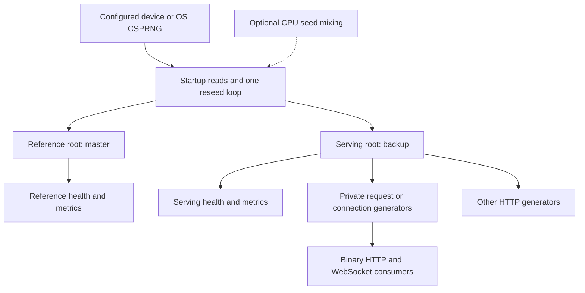

# entropy-service

[](https://golangci-lint.run/)
[](https://github.com/fantuz/entropy-service/actions/workflows/build.yml)

[](LICENSE)


**From photons to bytes. Random data from your own hardware, delivered through simple APIs.**

entropy-service is a Go server and command-line client for generating, delivering and inspecting random data. Connect a supported hardware random-number source, such as a quantum random-number generator (QRNG), or use the operating system's cryptographic random source. Fetch binary samples, keep a WebSocket stream open, or explore words, images, colours and short harmonic sounds in a browser.

The original demonstration uses an ID Quantique Quantis PCI card. Hardware supplies seed material; a software deterministic random bit generator (DRBG), using ChaCha20 or optional AES-256-CTR, produces the bulk output. This expands a seeded cryptographic stream; it does not create additional physical entropy or make every delivered byte a fresh QRNG measurement.

- **Build applications and experiments:** retrieve bounded binary samples over HTTP or continuous samples over WebSockets.
- **Study random data:** inspect distributions, bit balance, heatmaps and uploaded files. These diagnostics help find obvious problems; they do not certify a source's unpredictability.
- **Explore generative output:** sample words from a dictionary, generate images and QR codes, or synthesise harmonic audio.
- **Operate your own service:** monitor seed freshness, failures, traffic and resource budgets through JSON health checks, Prometheus text metrics and stderr logs.

`entropy-server` serves the APIs and embedded browser pages. `entropy-client` consumes the binary HTTP/WebSocket APIs and offers terminal diagnostics.

[Quick start](#quick-start) · [Configuration](#configuration) · [Architecture](#architecture) · [API reference](#api-reference) · [Performance](#performance) · [Statistical tests](#statistical-tests) · [Development](#development) · [Roadmap](#roadmap)

## Quick start

Use **Go 1.24.4 or newer**, Git and Make. Linux is the primary deployment target; hardware devices also need their own working kernel driver and read permissions.

```sh
git clone https://github.com/fantuz/entropy-service.git
cd entropy-service
make build

# Local demonstration using the OS CSPRNG; no QRNG or TLS certificates needed.
./bin/entropy-server -device=/dev/urandom -enable-https=false -http=127.0.0.1:8080
```

In another terminal, from the repository directory:

```sh
curl --fail http://127.0.0.1:8080/ready
curl --fail 'http://127.0.0.1:8080/v1/data/random?bytes=4096' -o sample.bin
wc -c sample.bin

# Repeated HTTP requests, 64 KiB per response.
./bin/entropy-client -mode=pull -url=http://127.0.0.1:8080/v1/data/random -slice=65536 -refresh=100ms

# Alternatively, one WebSocket connection delivering 64 KiB per message.
./bin/entropy-client -mode=stream -wsurl=ws://127.0.0.1:8080/stream -slice=65536 -refresh=100ms
```

Stop a running client or server with Ctrl+C. Open [byte preview](http://127.0.0.1:8080/bytes.html?bytes=4096&refresh=1000), [colours](http://127.0.0.1:8080/colors.html), [words](http://127.0.0.1:8080/words.html?words=8&refresh=1000), [sound](http://127.0.0.1:8080/sound.html) or [file analysis](http://127.0.0.1:8080/upload.html) in your browser.

Build the **whole command packages**, not individual `.go` files: each binary now spans several source files. Without Make, use `go build -o ./bin/entropy-server ./cmd/entropy-server` and the corresponding `./cmd/entropy-client` command.

### Hardware and TLS

Require your hardware source explicitly when silent fallback would be inappropriate:

```sh
./bin/entropy-server -device=/dev/qrandom0 -require-device=true -enable-https=false -http=127.0.0.1:8080
```

Without `-require-device=true`, an unavailable device can fall back to the OS CSPRNG. `/dev/urandom` is a cryptographic source, not a deliberately weak test generator. Accepting a device path does not establish the quality of its output; the hardware, driver and source assessment remain part of your deployment.

The standalone binary enables HTTPS by default and expects `cert.pem` and `key.pem`. To serve HTTP on port 8080 and TLS 1.3 on port 8443 using your own certificates:

```sh
./bin/entropy-server -device=/dev/urandom -cert-file=/absolute/path/cert.pem -key-file=/absolute/path/key.pem
```

Use `https://` and `wss://` for remote consumers. Configure access control at the deployment boundary: the application currently has no built-in authentication or WebSocket origin restriction. HTTP/2 is not enabled in the current listener setup.

### Install Linux packages

The [Releases](https://github.com/fantuz/entropy-service/releases) page provides archives and `.deb`/`.rpm` packages for Linux amd64, armv7 and arm64. Download the package matching your system, then install that file:

```sh
# Debian / Ubuntu; keep only the intended package in the current directory.
sudo apt install ./entropy-service_*.deb

# RPM-based systems.
sudo rpm -Uvh ./entropy-service_*.rpm

sudo systemctl status entropy-server
sudo journalctl -u entropy-server -f
```

Packages install both binaries in `/usr/bin` and enable/start `entropy-server`. The supplied unit runs as root, listens on HTTP `:8080`, disables HTTPS and uses `/var/lib/entropy-service` as its working directory. Review those defaults for your deployment.

Change flags with `sudo systemctl edit entropy-server`. For example, to require a hardware source and bind only to loopback:

```ini
[Service]
ExecStart=
ExecStart=/usr/bin/entropy-server -device=/dev/qrandom0 -require-device=true -enable-https=false -http=127.0.0.1:8080
```

Then run `sudo systemctl daemon-reload` and `sudo systemctl restart entropy-server`. Browser assets are embedded in the binary: no `./web` copy, symlink or special working directory is needed. Rebuild the server when changing those assets.

## Configuration

Run either binary with `-help` for its complete flag list. Boolean values use `-flag=true` or `-flag=false`.

### Server

All server timing flags accept **plain integer milliseconds**, without a unit suffix: `-reseed-ms=250`, not `250ms`. Sizes below are bytes unless explicitly labelled MiB.

#### Source and reseeding

| Flag | Default | Purpose |
| --- | --- | --- |
| `-device` | `/dev/qrandom0` | Source device; OS fallback is allowed unless required. |
| `-require-device` | `false` | Fail startup if the requested device is unavailable. |
| `-drbg` | `chacha20` | Backend: `chacha20` or `aes-256-ctr`. |
| `-cpu-mix` | `false` | Supplement seed reads with RDSEED/RDRAND on supported amd64 CPUs. |
| `-rdrand-mix` | `false` | RDRAND-only mode; requires CPU support. |
| `-reseed-ms` | `250` | Root reseed interval: 1–10000 ms. |
| `-buffer-reseed` | `256` | Bytes per root reseed: 32–65536. |
| `-max-reseed-age` | `0` | Readiness age limit in ms; zero selects `max(1000, 4 × reseed-ms)`. |

#### Listeners and TLS

| Flag | Default | Purpose |
| --- | --- | --- |
| `-http` | `:8080` | HTTP address; binds all interfaces by default. |
| `-https` | `:8443` | HTTPS address; binds all interfaces by default. |
| `-enable-https` | `true` | Enable HTTPS; the packaged service sets this to false. |
| `-cert-file` | `cert.pem` | TLS certificate path. |
| `-key-file` | `key.pem` | TLS private key path. |
| `-debug` | `false` | Debug output and loopback pprof on port 6060. |

#### Output and resource budgets

| Flag | Default | Purpose |
| --- | --- | --- |
| `-max-bytes` | `33554432` | Maximum binary sample: 1 byte to 32 MiB. |
| `-words` | `20` | Default word count and per-request word limit. |
| `-refresh-ms` | `5000` | Default `/bytes` WS interval in ms. |
| `-refresh-colors-ms` | `1500` | Default `/stream`, `/colors` and `/words` WS interval in ms. |
| `-refresh` | `5000` | HTTP word-page interval in ms; HTML rounds up to seconds. |
| `-fingerprint` | `2097152` | Upload prefix analysed statistically; full-upload SHA-256 is unaffected. |
| `-cookie` | `false` | Enable HTTP byte/word preference cookies. |
| `-ws-max-connections` | `128` | Shared WS connection limit. |
| `-ws-memory-mib` | `1024` | Shared WS estimated memory budget in MiB. |
| `-http-max-requests` | `128` | Separate HTTP work limit. |
| `-http-memory-mib` | `512` | Separate HTTP estimated memory budget in MiB. |

`-buffer-qrng` is deprecated and ignored. `-buffer-entropy` is an unused legacy option; neither controls an active pool or ring buffer.

`-cpu-mix` prefers RDSEED, falls back to RDRAND, and takes precedence over `-rdrand-mix`. Mixing applies to **startup and reseed input**, not every output byte. Hardware attempts are bounded; if CPU randomness is unavailable, `-cpu-mix` retains the configured source bytes and logs the first failure. It does not turn the CPU instructions into a replacement for the configured source.

### Client

| Flag | Default | Purpose |
| --- | --- | --- |
| `-mode` | `pull` | HTTP `pull` or WebSocket `stream`. |
| `-slice` | `2097152` | Bytes per response/message: 1 byte to 32 MiB. |
| `-refresh` | `1s` | A **Go duration**, e.g. `100ms`; minimum 1 ms. |
| `-debug` | `false` | Fetch/receive timing and runtime, to three decimal places in ms. |
| `-preview` | `false` | Hex preview. |
| `-matrix` | `false` | Transition matrix. |
| `-graph` | `false` | Entropy history graph. |
| `-dashboard` | `false` | Summary dashboard. |
| `-histogram` | `false` | Extended histogram. |
| `-writeout` | `false` | Experimental Linux write to `/dev/urandom`; does not credit the [kernel's entropy count](https://man7.org/linux/man-pages/man4/random.4.html). |

Transport flags and their full default URLs are listed separately to keep the table readable:

- `-url`: `http://127.0.0.1:8080/v1/data/random`
- `-wsurl`: `ws://127.0.0.1:8080/stream`

Pass **bare endpoints** to `-url` and `-wsurl`: the client appends its own `bytes` and `refresh` query parameters. Use `-slice` and `-refresh` to control them. The CLI consumes `/stream` raw messages, not `/bytes` compact envelopes.

The client performs startup diagnostics before entering its normal loop. The last WS receive duration includes waiting for the server's next frame. The HTTP fetch duration includes reading the body. Neither is a pure network round-trip measurement; terminal rendering and client pacing can also limit observed throughput.

## Architecture



The old background producer, software ring buffer and experimental generator-pool path are no longer active. The current code still creates **two root DRBGs** from separate source reads: `master` is exposed through the first health/metrics pair, while `backup` is the serving parent for all generation endpoints. The names do not imply automatic failover.

`/v1/data/random` creates a private generator per request. Each entropy WebSocket creates its own generator lazily on the first output read, then refreshes it after a parent reseed or before exceeding the 256 GiB per-key output limit. Child seeds come from the serving DRBG; they are not additional hardware reads. `/v1/data/test` and the other generated HTTP representations read the serving root directly.

This lets independent bulk consumers use multiple CPU cores without holding one shared lock for all their output. Parent seed derivation and reseeding still synchronise, and each individual generator serialises its own reads. AES acceleration, message size, encoding, TLS, network capacity and client work determine actual scaling.

Fresh entropy is read before taking the root generator's reseed lock. At the default settings, periodic reads nominally request `2 roots × 256 bytes / 250 ms = 2048 bytes/s`, in addition to startup/validation reads. This is seed-source demand, not the service's output throughput or a claim about measured physical entropy.

### Security and source boundaries

ChaCha20 and AES-256-CTR are selectable stream backends inside the project's own SHA-512-based seed/reseed construction. This is **not an implementation of NIST CTR_DRBG**, and the project makes no FIPS-validation or independent security-audit claim.

The suite can support laboratory work, application prototyping and integration experiments. It is not an HSM, key-management system, OpenSSL provider or certified entropy source. Remote randomness also introduces trust in the server and transport; keep private keys and sensitive seed material out of public diagnostic pages and logs.

Source failures are visible through readiness and reseed metrics. A failed reseed does **not** automatically stop existing DRBG output. Use `/ready` in routing/monitoring if your application requires a recent successful seed, and assess whether a stricter failure policy is needed.

## API reference

HTTP and HTTPS use the same routes. WebSockets use the corresponding `ws://` or `wss://` address and require a normal HTTP Upgrade handshake. Browser `.html` pages are clients of the APIs, not WebSocket endpoints themselves.

### Binary data, words, images and sound

The normal request method below is GET, except where another method is specified.

| Route | Response | Parameters / defaults |
| --- | --- | --- |
| `/v1/data/random` | Raw binary; private request generator. | `bytes=N`<br>Default: 2 MiB; capped by `-max-bytes`. |
| `/v1/data/test` | Raw binary; shared serving root. | `bytes=N`<br>Default: 1024 bytes; no statistical tests are run. |
| `/v1/meta/random` | HTML words and SHA-256. | `words=N`<br>Default/limit: `-words`; page interval: `-refresh`. |
| `/paroleparoleparole` | Alias of the HTTP word page. | Same as `/v1/meta/random`. |
| `/v1/image/random` | Random RGB PNG. | Fixed 1024 × 1024 pixels. |
| `/v1/image/heatmap` | Byte-popcount PNG. | Fixed 1024 × 1024 pixels; visual diagnostic. |
| `/v1/qr/random` | PNG QR code containing hexadecimal data. | Fixed 256 × 256 pixels; encodes 64 generated bytes. |
| `/sound` | WAV audio; GET or HEAD. | `duration_ms=250..5000`<br>`style=bloom` or `chime`. |
| `/files` | JSON file analysis; POST a raw binary body. | Maximum: 32 MiB; see [file analysis](#file-analysis). |

Sound defaults to 2500 ms and `bloom`, with 48 kHz, 16-bit mono output. It uses 64 random bytes to select synthesis parameters; the PCM samples are harmonic synthesis, not raw random bytes. Heatmaps illustrate byte patterns rather than certifying entropy quality. QR dimensions and encoded sample length are not configurable.

Explicit byte counts must be positive and at most `-max-bytes`; duplicate or invalid values return 400. Word counts must be within the configured word limit. Dictionary sampling is unbiased, with replacement: repeated words are valid. The dictionary currently comes from `github.com/8ff/diceware` and is loaded once.

With `-cookie=true`, `/v1/data/random` and the HTTP word pages use validated preference cookies; explicit query values take precedence. Fresh cookie-mode defaults are 512 KiB and 3 words, bounded by server limits. A stored/query `refresh` preference does not override the HTTP word page's server-configured refresh interval.

### WebSockets

| Route | Payload | Default query values |
| --- | --- | --- |
| `/stream` | Raw binary sample; no digest prefix. | `bytes=2048`<br>`refresh=1500` |
| `/bytes` | Sample and SHA-256, in the selected format. | `bytes=2048`<br>`refresh=5000`<br>`format=json` |
| `/colors` | Same protocol as `/bytes`. | `bytes=2048`<br>`refresh=1500`<br>`format=json` |
| `/words` | JSON fields: `words`, `hash`. | `words=20`<br>`refresh=1500` |

For `/words`, the word default and limit follow `-words`. The response contains a space-separated word string and its SHA-256 hex digest.

The table shows factory defaults; server flags can change the intervals. Request `refresh` values are integer milliseconds from 1 to 60000. `/words` rejects invalid or duplicate values; `/stream`, `/bytes` and `/colors` currently fall back to the configured interval for an invalid `refresh` value. The first message is sent on the first timer tick, not immediately on connection.

`/bytes` and `/colors` accept three formats:

| `format` | Message type | Application payload |
| --- | --- | --- |
| `json` | Text | JSON fields: `hex`, `base64`, `hash`.<br>Compatibility default; two encodings of the same sample. |
| `compact` | Binary | **32 digest bytes + N raw sample bytes**, in one message.<br>No hex prefix or length header. |
| `hash` | Text | JSON fields: `hash`, `bytes`.<br>Metadata only; the sample is not transmitted. |

For compact messages, read the first 32 bytes as the digest and the remainder as the sample; a 32 MiB sample therefore needs a receive limit of **33554464 bytes**. The hash format still generates and hashes the requested sample on the server. A digest sent with the data is a checksum, not proof of origin or entropy quality.

Examples: `ws://127.0.0.1:8080/bytes?bytes=65536&refresh=100&format=compact` and `ws://127.0.0.1:8080/colors?bytes=2048&refresh=1000&format=hash`.

### File analysis

```sh
curl --fail http://127.0.0.1:8080/files \
  -H 'Content-Type: application/octet-stream' \
  --data-binary @sample.bin
```

Uploads are streamed through a 32 KiB read buffer and are not saved to disk. SHA-256 covers the complete upload; statistical analysis covers only the first `-fingerprint` bytes (2 MiB by default). JSON fields are `total_bytes`, `analyzed_bytes`, `histogram` (256 counts), `entropy` (empirical Shannon bits per byte), `ones`, `zeros`, `sha256` and `preview` (Base64, up to 2048 analysed bytes).

Histogram, bit balance and entropy refer to the analysed prefix, not necessarily the whole file. The browser's mosaic, waveform and FFT are small-preview illustrations. Empty/incomplete uploads return 400, oversized uploads 413, unsupported content types 415 and unsupported methods 405. Uploads share the HTTP work budget.

### Health and metrics

| Route | Purpose |
| --- | --- |
| `/live` | Liveness JSON; independent of seed freshness. |
| `/ready` | Serving-root readiness JSON; 200 when fresh with no unresolved reseed error, otherwise 503. |
| `/health-1` | Reference-root health JSON. |
| `/health-2` | Serving-root health JSON, using the same readiness policy as `/ready`. |
| `/metrics-1` | Prometheus text metrics with reference-root metadata. |
| `/metrics-2` | Prometheus text metrics with serving-root metadata; the normal operational target. |

Both metrics endpoints also include the same service-wide counters and budgets; avoid counting those twice by scraping both as independent traffic totals. Seed age, reseed interval/size, failure totals and last-error information are exposed in health JSON.

Useful metric families include `rng_ready`, `rng_reseed_age_seconds`, `rng_reseed_failures_total`, `rng_bytes_generated_total`, `http_requests_total`, `wss_payloads_total`, `drbg_instance_count`, `ws_connections_*`, `ws_memory_*`, `ws_rejected_*` and `http_generation_*`.

`drbg_instance_count` normally starts at **2** for the two roots, then includes active children. Merely viewing metrics does not create a child generator. Generated-byte totals include internal child-seed derivation; they are not exact network-payload counters. Legacy software-buffer metrics remain zero because those buffers are disabled. The embedded `rng_version` value is still hard-coded and should not be used to identify the installed release.

### Browser pages

All pages are embedded and available on both listeners. `/` serves the asset directory listing. The `api-` pages are additional browser entry points, not a separate versioned API.

| Page | Additional entry point | Role |
| --- | --- | --- |
| `/bytes.html` | `/api-bytes.html` | Compact byte messages; worker prepares a bounded hex/Base64 preview and displays the full-sample digest. |
| `/colors.html` | `/api-colors.html` | Hash-only colour display, avoiding transmission of the full sample. |
| `/words.html` | `/api-words.html` | Live words and their digest. |
| `/sound.html` | `/api-sound.html` | Generate and play short harmonic WAV clips. |
| `/upload.html` | `/api-upload.html` | Upload a file for server analysis and preview-based visualisations. |
| `/stream.html` | `/api-stream.html` | Legacy experimental stream-analysis view; see note below. |

The stream-analysis view still needs binary/worker repairs. Prefer the CLI for raw streaming and `/bytes.html` for browser byte previews.

The byte/colour views move presentation work into a browser worker and bound pending display work. This limits UI work; it does not increase the amount of entropy in a sample.

<details>
<summary>Legacy navigation helpers and old documentation names</summary>

These embedded helpers use browser-side redirects; they are not HTTP redirect APIs:

| Helper | Target |
| --- | --- |
| `/aa_health-1` | `/health-1` |
| `/aa_health-2` | `/health-2` |
| `/aa_metrics-1` | `/metrics-1` |
| `/aa_metrics-2` | `/metrics-2` |
| `/zz_v1-data-random.html` | `/v1/data/random` |
| `/zz_v1-data-test.html` | `/v1/data/test` |
| `/zz_v1-image-heatmap.html` | `/v1/image/heatmap` |
| `/zz_v1-image-random.html` | `/v1/image/random` |
| `/zz_v1-meta-random.html` | `/v1/meta/random` |
| `/zz_v1-qr-random.html` | `/v1/qr/random` |

Older README examples mentioned paths that are **not registered aliases**:

| Old name | Current route |
| --- | --- |
| `/health` | `/ready` or `/health-2` |
| `/metrics` | `/metrics-2` |
| `/v1/random` | `/v1/data/random` |
| `/data` | `/stream` (WebSocket) |
| `/streams.html` | `/stream.html` (legacy view); prefer `/bytes.html` for byte previews. |

</details>

### Optional profiling endpoints

With `-debug=true`, a separate listener on **127.0.0.1:6060** exposes `/debug/pprof/`, `/debug/pprof/profile`, `/debug/pprof/heap`, `/debug/pprof/cmdline`, `/debug/pprof/symbol` and `/debug/pprof/trace`. The index also serves named runtime profiles, including `/debug/pprof/allocs`, `/debug/pprof/block`, `/debug/pprof/goroutine`, `/debug/pprof/mutex` and `/debug/pprof/threadcreate`. Block/mutex samples require their corresponding runtime sampling to be enabled. These routes are not on the public API listeners.

## Stability and resource limits

The generated-sample ceiling is **32 MiB**, shared by binary HTTP/WebSocket handlers and the client. Uploads have a separate fixed 32 MiB ceiling. Encoding can make the transmitted message larger than the underlying sample.

| Resource | Default policy |
| --- | --- |
| Incoming WebSocket message | 1 KiB maximum; the server does not need large client messages. |
| Entropy WebSockets | At most 128 admitted connections and 1024 MiB estimated working memory, shared across HTTP/HTTPS. Reservations last until disconnect. |
| HTTP generation and file analysis | At most 128 admitted requests and 512 MiB estimated working memory, shared across HTTP/HTTPS. Probes and static files are excluded. |
| Sound synthesis | An additional two simultaneous synthesis/download slots. |
| CLI receive queue | One queued WS message; other in-flight reader/consumer buffers can also exist. |
| Network lifecycle | Context-driven cancellation, WS write deadlines and a shared five-second server shutdown deadline. |

Budgets are **admission estimates, not process RSS limits**. For N-byte WS samples the reservation is `N + 64 KiB` for raw/compact/hash formats, or `16N + 64 KiB` for JSON. With the default 1 GiB budget and full 32 MiB samples, that admits at most 31 raw/compact/hash connections, or one JSON connection, before other reservations. TLS, kernel buffers, garbage collection and retained allocations require additional headroom.

Invalid sample parameters return 400. A request whose reservation exceeds the entire memory budget returns 413; temporary connection/request or aggregate-memory exhaustion returns 503 with `Retry-After: 1`. Successful WebSocket admission is still followed by the usual Upgrade validation.

HTTP responses with status **400 or higher** are logged to stderr with method, path, status, duration and remote address. Query strings and request bodies are omitted. After a successful WS upgrade, later stream errors are connection events rather than new HTTP response statuses. Under systemd, console logs are available through `journalctl`.

### Recent improvements: October–November 2026

| Area | Implemented change and practical effect |
| --- | --- |
| Seeding | Full startup/reseed reads, explicit errors and a single context-controlled reseed loop; readiness now reports stale or failed seeding. |
| CPU and concurrency | Removed the disconnected producer and busy-spinning WS branches; optional AES backend and private bulk generators reduce shared-lock contention. |
| Validation and budgets | Validated byte counts/cookies, a common 32 MiB sample ceiling, inbound WS limits and aggregate HTTP/WS admission budgets. |
| Lifecycle and diagnostics | Joined WS cleanup, client cancellation, synchronised client rate metrics and separate HTTP/WS cycle timing. |
| Transmission and UI | Opt-in compact/hash WS formats, bounded browser previews and worker-based presentation instead of sending/rendering both full text encodings. |
| Features and operations | Harmonic WAV output, streaming file analysis, embedded web assets and failed-request logging; word sampling loads the dictionary once instead of shuffling it per request. |

These are implementation improvements, not a claim of a measured percentage gain for every workload. The results below separate protocol size, encoding CPU cost and historical network throughput.

## Performance

### Application payload size

For a **32 MiB generated sample**, current encoder payloads are:

| Route/format | Application bytes sent | What the client receives |
| --- | ---: | --- |
| `/stream` | 33,554,432 | Raw sample. |
| `/bytes?format=json` | 111,848,205 | Hex + Base64 + digest, approximately 106.7 MiB. |
| `/bytes?format=compact` | 33,554,464 | Digest + raw sample: 32 bytes overhead. |
| `/colors?format=hash` | 93 | Digest and sample length; no raw sample. |

Sizes include JSON's trailing newline and exclude HTTP Upgrade, WebSocket framing and TLS overhead. Compact cuts application payload by about **70% versus the JSON byte format**. Ordinary binary HTTP and `/stream` were already raw and do not incur that 3.33× text-encoding expansion.

### Encoding benchmark

The tracked `BenchmarkByteFrameFormats` benchmark measures SHA-256 plus format encoding of an already allocated sample into `io.Discard`. It excludes DRBG generation, sockets, TLS and browser processing; its input-processing rate is not a network-transfer result.

Measured from commit [01ed418](https://github.com/fantuz/entropy-service/commit/01ed41846d3ecd340db176ded8cb2e820b87bcc1) on an AMD EPYC 9V74 VM, Linux amd64, Go 1.24.4, with 9 visible logical CPUs. The benchmark loop is serial. Three 300 ms runs per case, medians rounded:

| Sample | JSON time/op | Compact time/op |
| --- | ---: | ---: |
| 512 KiB | 4.73 ms | 0.319 ms |
| 8 MiB | 77.57 ms | 5.42 ms |

The compact encoder allocated 32 B/op beyond the existing sample buffer in these runs. That is an encoder allocation measurement, not the complete connection's memory footprint. Reproduce on your hardware:

```sh
go test ./cmd/entropy-server -run '^$' -bench '^BenchmarkByteFrameFormats$' -benchmem -benchtime=300ms -count=3
```

### Author-reported HTTP benchmark: Ryzen 5 3500U

Measured on an **AMD Ryzen 5 3500U with Radeon Vega Mobile Gfx**, using local HTTP requests to `/v1/data/random`. The sample size is **512 KiB (524288 bytes)**, with **32 wrk threads**, **64 connections** and a **10-second requested duration**:

```sh
wrk -t32 -c64 -d10s --latency --timeout 3 'http://localhost:8080/v1/data/random?bytes=524288'
```

| Metric | Reported result |
| --- | ---: |
| Completed requests | 35,837 in 10.04 s |
| Requests/s | 3,570.87 |
| Transfer/s, original wrk label | `1.75GB` |
| Total read, original wrk label | `17.52GB` |
| Mean latency | 19.05 ms |
| Median latency (p50) | 20.11 ms |
| p75 latency | 26.60 ms |
| p90 latency | 38.44 ms |
| p99 latency | 58.19 ms |
| Maximum latency | 173.02 ms |

This is a short **loopback HTTP delivery** measurement, including work by both the server and local load generator; it does not measure physical network throughput or raw QRNG speed. No socket errors are listed in the supplied output. The tested revision, DRBG backend, seed source, Go version and `GOMAXPROCS` were not supplied with this result. Different hardware, payloads and load settings make it unsuitable for a direct before/after comparison with the older runs below.

<details>
<summary>Full supplied wrk output</summary>

```text
Running 10s test @ http://localhost:8080/v1/data/random?bytes=524288
  32 threads and 64 connections
  Thread Stats   Avg      Stdev     Max   +/- Stdev
    Latency    19.05ms   14.24ms 173.02ms   58.50%
    Req/Sec   112.04     28.93   232.00     67.03%
  Latency Distribution
     50%   20.11ms
     75%   26.60ms
     90%   38.44ms
     99%   58.19ms
  35837 requests in 10.04s, 17.52GB read
Requests/sec:   3570.87
Transfer/sec:      1.75GB
```

</details>

### Historical HTTP results

The earlier README included short loopback `wrk` runs on an Intel Core i5-3470 at 3.20 GHz, using 16 load threads and 64 connections for about five seconds:

| Response size | Requests/s | Transfer/s, original wrk labels | Reported socket errors |
| --- | ---: | ---: | --- |
| 64 B | 68,019.56 | 11.68 MB/s | None. |
| 2 MiB | 572.97 | 1.12 GB/s | 2 timeouts. |

These are **historical author measurements**, not a rerun of the current release. They used the old `/v1/random` route; the exact revision, backend and source configuration were not recorded. Transfer totals include HTTP overhead.

### Benchmark your installation

Throughput benchmarks measure delivery performance, separately from the [statistical tests](#statistical-tests). Start a server with recorded flags, then run:

```sh
wrk -t4 -c16 -d30s --latency --timeout 5s 'http://127.0.0.1:8080/v1/data/random?bytes=65536'
```

Compare `-drbg=chacha20` and `-drbg=aes-256-ctr`, vary `GOMAXPROCS` and concurrency, and record errors, tail latency, CPU and peak RSS as well as throughput. AES can benefit from CPU acceleration; private generators allow parallel bulk work, but tiny requests, encoding or the load generator may become the bottleneck. Longer runs and remote/TLS clients answer different questions from a loopback test. Do not apply blanket `sysctl` or socket-buffer tuning before identifying the constraint.

## Statistical tests

Use `rngtest` for a quick regression screen and Dieharder for a broader statistical battery. These tests assess statistical behaviour, not maximum throughput or cryptographic certification. The HTTP examples test the **served DRBG output**, not the QRNG device before your software generator.

On Debian/Ubuntu, install the tools if needed:

```sh
sudo apt install curl rng-tools5 dieharder
```

Run the examples in **Bash**, with the server already running. Replace the address if it runs elsewhere:

```bash
set -o pipefail
ENTROPY_URL='http://127.0.0.1:8080/v1/data/random'
```

### Quick screen with rngtest

```bash
curl -fsS --max-time 60 "${ENTROPY_URL}?bytes=25000004" | rngtest -c 10000 -b 1000
```

This requests about 23.84 MiB: 10,000 blocks of 20,000 bits, plus four initialisation bytes, within the default 32 MiB response limit. It reports every 1,000 blocks. If you lowered `-max-bytes`, reduce the block count and request size together: `bytes = 2500 × blocks + 4`.

The five legacy checks are monobit, poker, runs, long runs and continuous run; they are not five separate cryptographic standards. Confirm that successes plus failures totals 10,000. An occasional rejected block can occur with good random data; exit status 1 means at least one block was rejected. See the [rngtest manual](https://github.com/nhorman/rng-tools/blob/master/rngtest.1.in).

### Broader battery with Dieharder

Dieharder needs a continuing supply of fresh input. Do not loop a small capture: file-input mode can rewind and reuse data, making results suspect. Define this feeder once; it downloads a fresh 1 MiB response before forwarding it, so calculation pauses do not hold an HTTP download open:

```bash
entropy_stream() (
    entropy_chunk=$(mktemp) || exit
    trap 'rm -f "$entropy_chunk"' EXIT
    while :; do
        curl -fsS --max-time 30 \
            "${ENTROPY_URL}?bytes=1048576" \
            -o "$entropy_chunk" || exit
        cat "$entropy_chunk" || break
    done
)
```

The temporary file is overwritten with fresh data each cycle and removed on exit. Run the full default battery with this one-liner:

```bash
entropy_stream | dieharder -g 200 -a
```

`-g 200` selects raw binary stdin; `-a` runs the default battery. Allow substantial runtime and data consumption. For a shorter first run, replace `-a` with `-d sts_monobit`. To inspect available tests, use `dieharder -l`.

An isolated `WEAK` result is not proof of a defect. Repeat suspicious tests with fresh input and the same parameters, and compare with an OS-source baseline rather than rerunning until everything passes. Check for premature `EOF` and missing results; exit status alone does not establish completion. See the [Dieharder manual](https://manpages.debian.org/testing/dieharder/dieharder.1.en.html).

For a baseline or direct device check, run the same test with input redirected from `/dev/urandom` or, on the machine with the QRNG and read permission, `/dev/qrandom0`:

```bash
dieharder -g 200 -d sts_monobit < /dev/urandom
dieharder -g 200 -d sts_monobit < /dev/qrandom0
```

Feed each utility the original bytes; do not place `rngtest -p` before Dieharder, because that filters out rejected blocks. Passing statistical tests cannot certify unpredictability or replace cryptographic review; see [NIST SP 800-22](https://csrc.nist.gov/pubs/sp/800/22/r1/upd1/final).

## Development

| Command | Action |
| --- | --- |
| `make build` | Build both command packages into `./bin`. |
| `make build-server` | Build the server. |
| `make build-client` | Build the client. |
| `make test` | Run `go test ./...`. |
| `make lint` | Run golangci-lint. |
| `make fmt` | Run the configured golangci-lint formatters. |
| `make release-snapshot` | Build local GoReleaser snapshot artifacts in `./dist`. |
| `make clean` | Remove `./bin` and `./dist`. |

Formatting/linting require [golangci-lint](https://golangci-lint.run/); packaging requires [GoReleaser](https://goreleaser.com/install/). CI currently uses golangci-lint 2.12.2. For local release preparation, also run:

```sh
go test -race -count=1 ./...
```

Race tests require a supported platform and a C toolchain with cgo enabled. Packaged release binaries are built with `CGO_ENABLED=0`; that does not prevent testing the source with the race detector separately.

The tracked tests cover DRBG backends/reads, reseed failures, private streams, validation, budgets, shutdown/cancellation, sound, file analysis, logging and client timing/metrics. Passing statistical checks is not a substitute for cryptographic review.

Current build CI runs ordinary Go tests, lint and a GoReleaser snapshot for relevant main-branch pushes/PRs; Markdown-only changes are excluded. The tag-triggered release workflow packages/publishes without its own test step. **A mandatory race-test release gate and automated browser regression checks remain pending.**

## Roadmap

Available features are documented above. The following are follow-up work or ideas, not capabilities shipped by this repository:

- Enforce race checks before releases; add browser regression coverage and repair the legacy stream-analysis view.
- Correct cumulative pull-mode throughput accounting and use release-derived version metadata in health output.
- Decide whether to remove the reference root or give it a defined operational role; clarify source-failure policy and cancellation of blocking hardware reads.
- Continue word-endpoint profiling and assess buffer reuse only where allocation measurements justify it. An independent dictionary would remove the remaining Diceware dependency.
- Improve deployment hardening: service identity/device permissions, access control, origin policy and optional hardware-specific startup checks.
- Evaluate integrations separately: FUSE/CUSE byte devices and an OpenSSL provider need distinct designs. FUSE alone does not implement `openssl rand -engine entropyctl`. HSM/blockchain integrations, GPU generation and production/demo build profiles are not implemented.

## Project background and screenshots

The project began as a demonstration around an older Quantis PCI QRNG, with driver adaptation for newer Linux kernels. Hardware-driver maintenance is separate from this Go suite. The service can also run with the OS CSPRNG and no external card.

<details>
<summary>Historical interface gallery (February–March 2026)</summary>

These screenshots illustrate earlier interfaces; layouts and endpoint names have since evolved.

**Terminal client** — diagnostics in the terminal.


**Legacy stream-analysis view** — `/stream.html`, using `/stream` in the current server.


**Byte preview** — `/bytes.html` and `/bytes`.


**Words** — `/words.html` and `/words`.


**Colours** — `/colors.html` and `/colors`.


**File analysis** — `/upload.html` and `/files`.


**Metrics** — use `/metrics-2` for the current serving-root view.


</details>

## License

[MIT](LICENSE) · Copyright © 2026 Massimiliano Fantuzzi HB9GUS.
