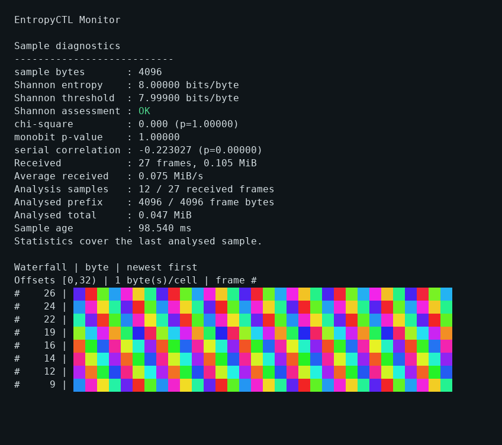
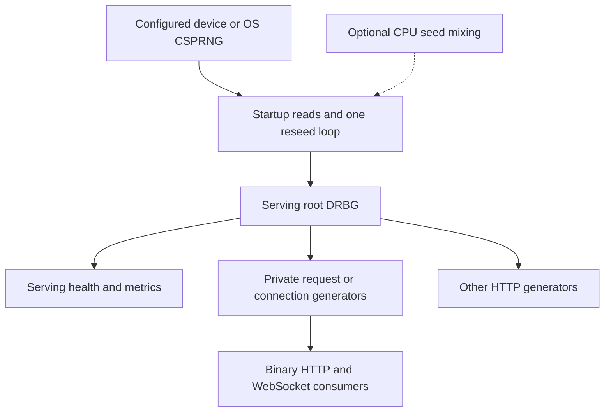
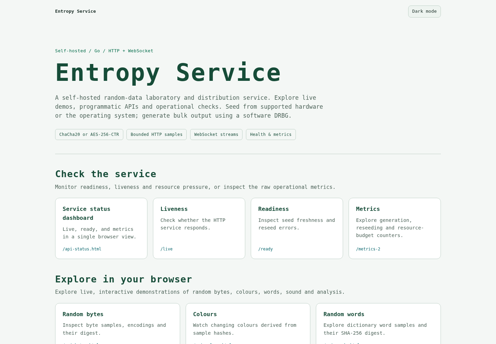
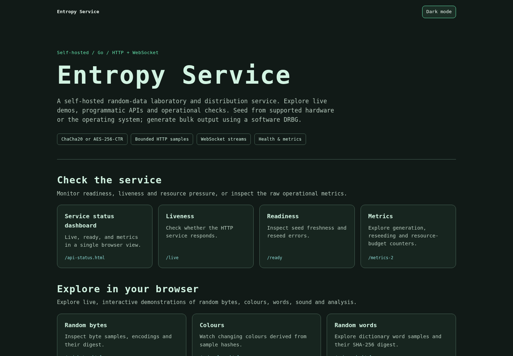
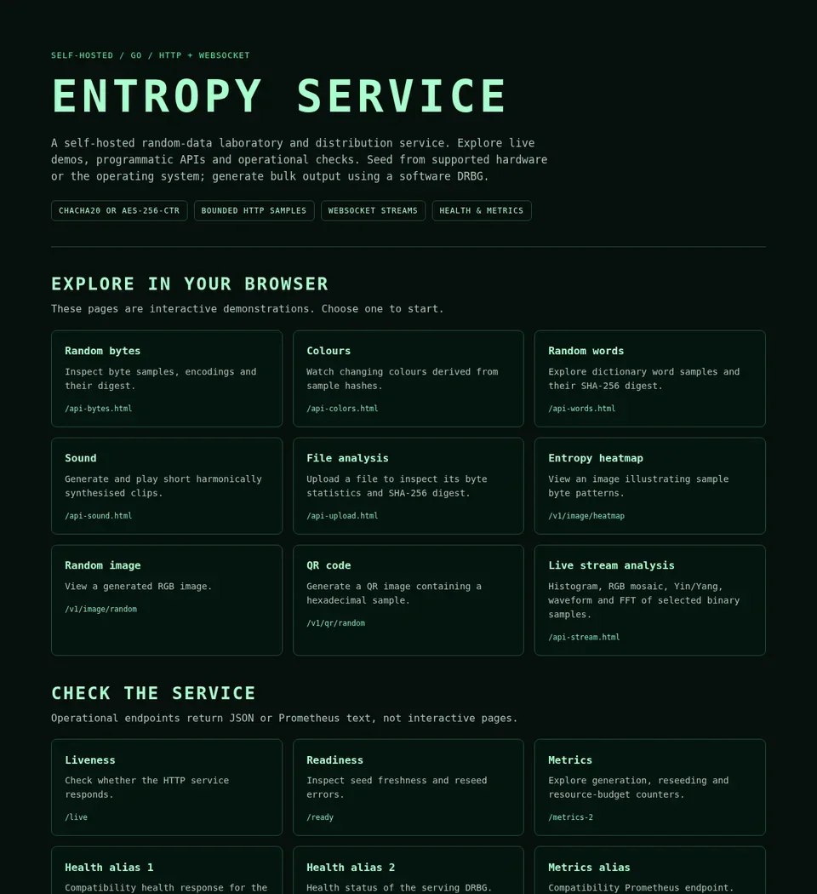
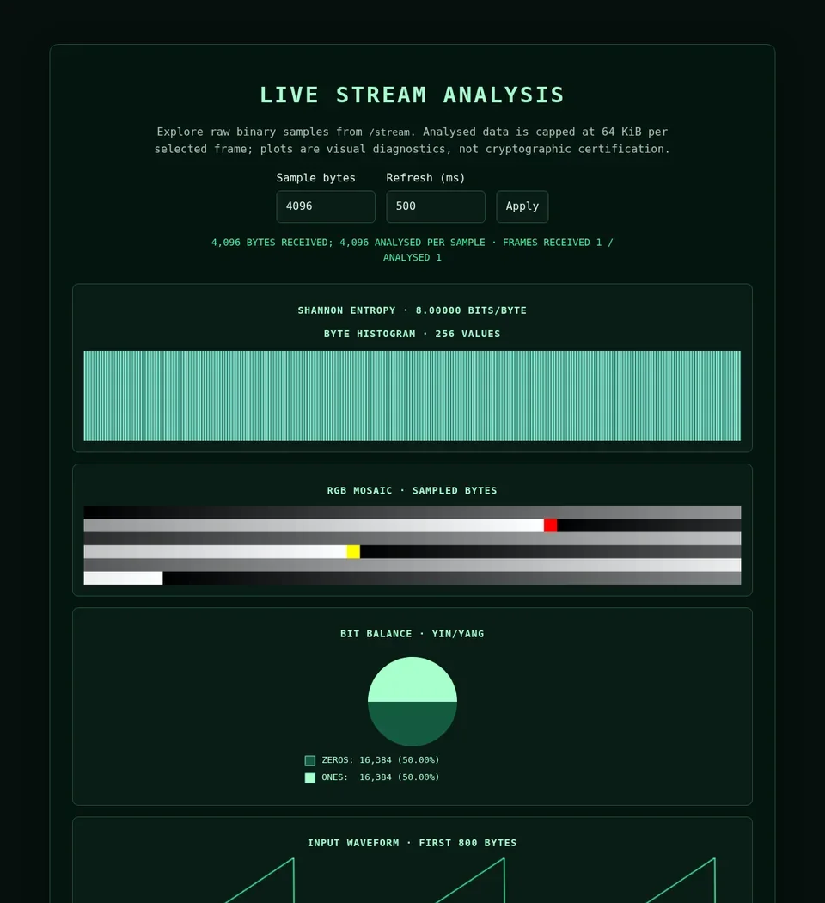

# entropy-service

[](https://golangci-lint.run/)
[](https://github.com/fantuz/entropy-service/actions/workflows/build.yml?query=branch%3Amain)
[](go.mod)
[](https://github.com/fantuz/entropy-service/actions/workflows/github-code-scanning/codeql?query=branch%3Amain)
[](https://github.com/fantuz/entropy-service/actions/workflows/release.yml)

[](https://github.com/fantuz/entropy-service/releases/latest)
[](LICENSE)
[](https://github.com/fantuz/entropy-service/releases)
[](https://github.com/fantuz/entropy-service/commits/main)

[](https://github.com/fantuz/entropy-service/stargazers)
[](https://github.com/fantuz/entropy-service/issues)

**Self-hosted random data — configurable entropy sources, high-throughput delivery, and interactive exploration.**

Entropy Service is a Go server and command-line client for generating, distributing, and inspecting pseudorandom data from a cryptographic deterministic random bit generator (DRBG). It supports hardware or operating-system seed sources; ChaCha20 and AES-256-CTR backends; bounded HTTP and WebSocket delivery; and a browser-based showcase for experiments and diagnostics.

**From photons to bytes** describes the project's hardware-origin story: an ID Quantique Quantis PCI card inspired the first demonstration. The same architecture can also be seeded from the operating system CSPRNG. DRBG output is generated from seed material, **not a claim that each output byte is an independent hardware-entropy measurement**.

- **Integrate:** request binary samples over HTTP or maintain a WebSocket stream for development and test applications.
- **Experiment:** inspect byte statistics, live stream previews, words, images, colours, QR codes, and synthesized sounds.
- **Operate:** monitor readiness, reseeding, traffic and resource admission through JSON and Prometheus metrics.

`entropy-server` serves the APIs and embedded browser pages. `entropy-client` consumes binary HTTP/WebSocket APIs and provides terminal monitoring with bounded analysis.

The client's opt-in [`-writeout`](docs/client-writeout.md) mixes received bytes
into Linux's random pool without entropy credit. It is normally unnecessary;
it does not establish stronger randomness or replace OS boot seeding.
For practical capture and remote consumers, [raw exports](docs/client-output.md)
support private files, stdout/SSH pipes, explicit Linux devices and exact byte limits.

[Quick start](#quick-start) · [Use cases](#use-cases) · [Architecture](#architecture) · [Configuration](#configuration) · [API reference](#api-reference) · [Performance](#performance) · [Statistical tests](#statistical-tests) · [Development](#development) · [Security](SECURITY.md) · [Full reference](docs/README.md)

## Quick start

Use **Go 1.26.11 or newer**, Git and Make. Linux is the primary deployment target.
Hardware sources need appropriate OS support, binding and permissions; PCI
kernel drivers and native USB transports have different requirements.

An optional [Windows x64 port](docs/windows.md) builds both executables from the
same source tree, using the native OS RNG, standard sockets, plain terminal text
and file exports. Its capability limits are explicit; Linux remains the primary
deployment target.

An experimental [Quantis PCI Windows adapter](docs/quantis.md) also supports
explicit hardware selection with an installed legacy driver. No driver is bundled;
physical-card validation remains outstanding.

Use [`entropy-server hardware list` and `hardware probe`](docs/hardware-probe.md)
to inspect known devices and test an explicit source without starting the server.
The [hardware qualification matrix](docs/hardware-qualification.md) separates
builds, simulated I/O and physical records, with a template for reproducible results.

Experimental [Quantis USB seeding](docs/quantis-usb.md) uses native WinUSB on
Windows x64 and usbfs on released Linux targets, without CGO or a vendor DLL.
Experimental [ChaosKey cooked seeding](docs/chaoskey.md) reuses those native I/O
mechanics with its own hardware-noise TRNG identity/protocol checks; raw/flash
endpoints are excluded.

```sh
git clone https://github.com/fantuz/entropy-service.git
cd entropy-service
make build

# Local demonstration using the OS CSPRNG; no QRNG or TLS certificates needed.
./bin/entropy-server -device=/dev/urandom -enable-https=false -http=127.0.0.1:8080
```

**Start in your browser:** open **http://127.0.0.1:8080/** (or your configured HTTP/HTTPS base URL). The embedded homepage presents interactive demonstrations, HTTP APIs, WebSocket routes, health/metrics endpoints and optional legacy shortcuts in a three-column layout. It hides internal JavaScript files from navigation without denying access to those required assets.

In another terminal, from the repository directory:

```sh
curl --fail http://127.0.0.1:8080/ready
curl --fail 'http://127.0.0.1:8080/v1/data/random?bytes=4096' -o sample.bin
wc -c sample.bin

# Repeated HTTP requests, 64 KiB per response.
./bin/entropy-client -mode=pull -url=http://127.0.0.1:8080/v1/data/random -slice=65536 -refresh=100ms

# Alternatively, one WebSocket connection delivering 64 KiB per message.
./bin/entropy-client -mode=stream -wsurl=ws://127.0.0.1:8080/stream -slice=65536 -refresh=100ms

# Optional terminal waterfall of recent analysed sample prefixes.
./bin/entropy-client -mode=stream -waterfall -waterfall-mode=byte -color=auto

# A repeatable 60-second measurement with a custom Shannon threshold and JSONL.
./bin/entropy-client -mode=stream -slice=1048576 -refresh=50ms \
  -headless -duration=60s -shannon-threshold=7.99 -report=run-60s.jsonl
```

The monitor retains the raw Shannon estimate in bits/byte and shows one
**Shannon assessment**, using your threshold for `OK`/`WARN`. It is not a
weighted score or a cryptographic certification. See [timed client experiments
and JSONL reports](docs/client-experiments.md) for interpretation, comparisons
and longer runs. Report files must be new; choose a different name for each run.

The optional [client waterfall](docs/configuration.md#terminal-waterfall-and-colors)
maps bytes to hues, RGB triplets or grayscale, with bounded history and
terminal sizing. `-color=auto` detects Linux terminal capabilities and leaves
redirected stdout unstyled; explicit color modes are available.

Large interactive terminals use the [adaptive full layout](docs/client-terminal.md)
with adjacent panels and wider histories. `-layout=compact` keeps stacked
output; `-layout=full -waterfall` requests the larger dashboard explicitly.



### WebSocket examples with curl

With a curl build that supports the `ws://` protocol, you can pipe **8 MiB
WebSocket payloads** directly into `rngtest`, without first writing a file:

```sh
# Requires curl with WS support, bc and rngtest (from rng-tools).
curl --no-buffer -N "ws://127.0.0.1:8080/stream?bytes=$(echo 1024*1024*8 | bc)&refresh=500" --output - | rngtest --pipe >/dev/null
```

`rngtest` prints its statistical results to stderr; the redirected stdout
contains only its passed-through blocks and is discarded. Stop the ongoing
stream with Ctrl+C. This is a **statistical screening test**, not proof of
unpredictability, validated entropy quality or cryptographic certification.
Check `curl --version` for WS in the supported protocols; WebSocket support
became non-experimental in curl 8.11.0 but can be disabled in a particular
build. For curl documentation, see
[WebSocket support](https://curl.se/docs/websocket.html).

To inspect a WebSocket handshake on builds without native WS support, curl
can instead request an HTTP/1.1 upgrade and capture the resulting **raw
WebSocket frames**:

```sh
curl --http1.1 --no-buffer --max-time 3 \
  -H 'Connection: Upgrade' \
  -H 'Upgrade: websocket' \
  -H 'Sec-WebSocket-Version: 13' \
  -H "Sec-WebSocket-Key: $(openssl rand -base64 16)" \
  'http://127.0.0.1:8080/stream?bytes=4096&refresh=500' \
  --output stream.ws --write-out 'HTTP status: %{http_code}\n'
```

A successful upgrade reports HTTP `101`. Since the stream is continuous,
the 3-second timeout deliberately terminates capture (curl exit code 28).
Unlike native `ws://` retrieval, `stream.ws` includes WebSocket **frame
headers** and is **not** directly suitable for piping to `rngtest`. Use
`entropy-client` or a WS-aware client for decoded message payloads. For remote
connections, prefer authenticated `wss://` behind an appropriate TLS boundary.

Stop a running client or server with Ctrl+C. The homepage links to the canonical [byte preview](http://127.0.0.1:8080/api-bytes.html?bytes=4096&refresh=1000), [colours](http://127.0.0.1:8080/api-colors.html), [words](http://127.0.0.1:8080/api-words.html?words=8&refresh=1000), [harmonic sound](http://127.0.0.1:8080/api-sound.html), [file analysis](http://127.0.0.1:8080/api-upload.html) and [live stream-analysis](http://127.0.0.1:8080/api-stream.html?bytes=4096&refresh=500) pages.

Build the **whole command packages**, not individual `.go` files: each binary now spans several source files. Without Make, use `go build -o ./bin/entropy-server ./cmd/entropy-server` and the corresponding `./cmd/entropy-client` command.

### Hardware and TLS

Require your hardware source explicitly when silent fallback would be inappropriate:

```sh
./bin/entropy-server -device=/dev/qrandom0 -require-device=true -enable-https=false -http=127.0.0.1:8080
```

An unavailable optional Linux device path can fall back to the OS CSPRNG;
`quantis-pci:N`, `quantis-usb:N` and `chaoskey-usb:N` selectors always require the requested
hardware. `/dev/qrandom0` reads through the Quantis driver, whereas
`/dev/urandom` is Linux's mixed CSPRNG. Installing a Quantis PCI driver alone
does not feed that OS pool. Direct hardware seeding also requires working
nonblocking reads and polling/deadlines; compiling a driver is only one check.
See [hardware driver compatibility and source layers](docs/hardware-drivers.md)
for official packages, a pinned modern-kernel source backup, validation steps
and the experimental cooked-only ChaosKey USB path.

For safekeeping, [download the pinned community legacy PCI driver sources](https://codeload.github.com/tcdent/quantis-pci/tar.gz/00fffc49306d748b34a95c14769b30908ef5985f).
This is a source archive to build for your kernel; the guide records its
compile-only Linux 6.12 check and the remaining direct-seeding requirements.

Accepting a device path does not establish the quality of its output; the
hardware, driver and source assessment remain part of your deployment.

The standalone binary enables HTTPS by default and expects deployment-specific `cert.pem` and `key.pem`. No TLS identity is bundled. The old public demonstration key has been removed and is rejected by the TLS loader; replace it if you used an earlier checkout. For local testing, generate a unique, short-lived identity first:

```sh
mkdir -m 700 ./tls
./bin/entropy-server generate-cert -cert-file=./tls/cert.pem -key-file=./tls/key.pem
./bin/entropy-server -device=/dev/urandom -http=127.0.0.1:8080 -https=127.0.0.1:8443 \
  -cert-file=./tls/cert.pem -key-file=./tls/key.pem
# In another terminal: trust this certificate explicitly for local testing.
curl --cacert ./tls/cert.pem https://localhost:8443/live
```

For public deployments, use your organization's CA/ACME certificate lifecycle. To serve HTTP on port 8080 and TLS 1.3 on port 8443 with an existing certificate chain and matching private key:

```sh
./bin/entropy-server -device=/dev/urandom -cert-file=/absolute/path/cert.pem -key-file=/absolute/path/key.pem
```

See [certificate generation, startup provisioning and migration](docs/tls-certificates.md) and [SECURITY.md](SECURITY.md). Missing or invalid TLS files fail startup; certificates are never silently generated or replaced.

Use `https://` and `wss://` for remote consumers. Configure authentication and access controls at the deployment boundary: the service has no built-in client authentication. The WebSocket upgrader uses Gorilla's default same-host browser origin policy; requests without an `Origin` header may still be admitted. Origin validation is not authentication. HTTP/2 is not enabled in the current listener setup.

To remember byte/word preferences and word language in a browser or a client's cookie jar, add
`-cookie=true` and use the HTTPS API URLs. Preference cookies are always
`Secure`, `HttpOnly` and `SameSite=Lax`; cookies remain disabled by default.
See [cookie policy and a curl example](docs/configuration.md#preference-cookies).

### Install Linux packages

The [Releases](https://github.com/fantuz/entropy-service/releases) page provides archives and `.deb`/`.rpm` packages for Linux amd64, armv7 and arm64. Download the package matching your system, then install that file:

```sh
# Debian / Ubuntu; keep only the intended package in the current directory.
sudo apt install ./entropy-service_*.deb

# RPM-based systems.
sudo rpm -Uvh ./entropy-service_*.rpm

sudo systemctl status entropy-server
sudo journalctl -u entropy-server -f
```

Packages install both binaries in `/usr/bin` and an **opt-in**, loopback-only
systemd unit. Package installation no longer enables or starts the daemon.
The service uses a restricted, unprivileged systemd identity, explicitly
requires `/dev/urandom`, and listens only on `127.0.0.1:8080` without HTTPS.
Inspect before activation:

```sh
sudo systemctl cat entropy-server
sudo systemctl enable --now entropy-server
curl --fail http://127.0.0.1:8080/live
```

**Upgrades of existing installations** preserve current enablement and running
state. Review device access, drop-ins and externally reachable listeners before
an explicit restart. Hardware QRNGs require opt-in device/group permissions
and a systemd `DeviceAllow` override; changing the executable flags alone
will not grant access. See [packaged service and migration instructions](docs/packaged-service.md).
The package does not change device ownership, create Unix users or modify
udev rules. Browser assets are embedded in the binary.


## Use cases

| Scenario | How Entropy Service helps | Boundary to keep in mind |
| --- | --- | --- |
| **Develop and test random-data consumers** | Retrieve bounded binary samples through HTTP or binary WebSocket streams. | Remotely delivered bytes depend on the server, its configuration and transport. |
| **Measure streaming and concurrency** | Adjust payload sizes and intervals; compare DRBG backends and client reception rates. | Requested throughput is not a measured guarantee; benchmark each environment. |
| **Explore entropy-source integration** | Seed a shared root DRBG from a supported device or the OS CSPRNG. | DRBG output is expanded from seeds, not continuous fresh physical entropy. |
| **Teach and explore statistical properties** | Visualize histograms, bit balance, entropy estimates, mosaics and FFT previews. | Statistical diagnostics do not prove unpredictability or certify cryptography. |
| **Prototype operational integrations** | Use liveness, readiness, metrics and resource budgets to monitor the service. | Access controls and secret-management policy belong to the deployment. |
| **Create interactive demonstrations** | Generate words, colours, images, QR codes and short harmonic sound clips. | These are demonstrations, not certified security or key-management products. |

For a quick tour, start the server and **open its base URL in a browser**. The curated homepage lists supported HTTP APIs, live WebSocket demonstrations and operational endpoints without exposing internal JavaScript files in its navigation.

## Configuration

The server supports configurable seed sources, DRBG backends, timing and resource budgets; the client separately controls reception, analysis and terminal redraw rates. Server timing flags take integer **milliseconds**, whereas client timing flags accept Go durations such as `50ms`.

Typical server options: `-device=/dev/urandom -enable-https=false -http=127.0.0.1:8080`; select `-drbg=chacha20` to override AES-256-CTR on non-ARM/non-RISC-V builds (ARM and RISC-V default to ChaCha20). Use `-require-device=true` when physical-source availability is mandatory.

**[Complete server and client flags, defaults, and examples](docs/configuration.md)**

For local research, an optional original Go implementation of the published
Barzakh-521 scalar construction is available with the
`experimental_barzakh` build tag and `-drbg=barzakh-521-experimental`.
It uses variable-time arithmetic and is unsuitable for secrets; see
[experimental build instructions, provenance and patent limitations](docs/experimental-barzakh.md).

## Architecture



The service creates **one root DRBG**, seeded from a full 64-byte startup read and refreshed by one reseed loop. This root serves all generation endpoints and seeds their private generators. The former reference root, background producer, software ring buffer and experimental generator-pool path are no longer active.

`/v1/data/random` creates a private generator per request. Each entropy WebSocket creates its own generator lazily on the first output read, then refreshes it after a parent reseed or before exceeding the 256 GiB per-key output limit. Child seeds come from the serving DRBG; they are not additional hardware reads. `/v1/data/test` and the other generated HTTP representations read the serving root directly.

This lets independent bulk consumers use multiple CPU cores without holding one shared lock for all their output. Parent seed derivation and reseeding still synchronise, and each individual generator serialises its own reads. AES acceleration, message size, encoding, TLS, network capacity and client work determine actual scaling.

Fresh entropy is read before taking the root generator's reseed lock. At the default settings, periodic reads nominally request `256 bytes / 15 s ≈ 17.1 bytes/s`, in addition to startup/validation reads. This is seed-source demand, not the service's output throughput or a claim about measured physical entropy.

### Security and source boundaries

**Formal review:** [Full Architecture & Assurance Assessment](docs/architecture-review.md)
· [Security Boundaries & Threat Model](docs/security-boundaries.md). These
explain what source failure, reseed freshness, private generators, TLS,
resource budgets and deployment isolation actually guarantee—and what they
do not.


AES-256-CTR (default on non-ARM/non-RISC-V) and ChaCha20 (default on ARM/RISC-V) are selectable stream backends inside the project's own SHA-512-based seed/reseed construction. This is **not an implementation of NIST CTR_DRBG**, and the project makes no FIPS-validation or independent security-audit claim.

The suite can support laboratory work, application prototyping and integration experiments. It is not an HSM, key-management system, OpenSSL provider or certified entropy source. Remote randomness also introduces trust in the server and transport; keep private keys and sensitive seed material out of public diagnostic pages and logs.

Source failures are visible through readiness and reseed metrics. By default, `-on-reseed-failure=stop` pauses serving-root generation immediately on a recorded reseed failure or when the seed exceeds `-max-reseed-age`. New requests return 503 and existing streams stop; `/live` and diagnostics remain available. A successful reseed restores admission. Explicit `-on-reseed-failure=continue` retains the earlier behavior while readiness still degrades. See [policy, reasoning, client behavior and upgrade guidance](docs/reseed-failure-policy.md).

## API reference

The homepage at `/` is the interactive entry point. Common API routes include:

| Route | Purpose |
| --- | --- |
| `GET /v1/data/random?bytes=4096` | Bounded raw binary sample from a private request DRBG. |
| `WS /stream?bytes=4096&refresh=500` | Continuous raw binary frames. |
| `WS /bytes` / `WS /colors` / `WS /words` | Framed bytes, colour/hash, or word streams. |
| `POST /files` | JSON statistics about an uploaded binary file. |
| `GET /ready` / `GET /metrics` | Readiness and Prometheus metrics. |

The stream and upload labs share analysis windows up to 1 MiB, FFTs up to 65,536 points, labelled plots, paused byte inspection, optional bit-position rates and a historical colour waterfall, with desktop/mobile layouts. The [file workspace](docs/browser-ui.md#shared-file-analysis-workspace) adds bounded local seeking/playback while preserving server upload analysis and full-file SHA-256. See [controls and mathematics](docs/browser-ui.md#stream-analysis-shared-window-and-controls). Normal shutdown prints a [served-traffic executive summary](docs/operations.md#shutdown-executive-summary).

Random-word endpoints offer 18 dictionary choices across 17 languages through `lang=CODE`, including Russian, Afrikaans, Turkish, Tamil, Nepali, Arabic and both Chinese scripts; English remains the default. The browser offers a language selector, remembered when `-cookie=true`. See [dictionary sources, selection space and examples](docs/word-languages.md).

Interactive demonstrations live at `/api-bytes.html`, `/api-stream.html`, `/api-words.html`, `/api-colors.html`, `/api-sound.html`, `/api-upload.html`, `/api-sources.html` and `/api-socket.html`. They are **browser pages**, not API version prefixes.

**[Complete HTTP/WebSocket endpoint, parameter and format reference](docs/api.md)**

## Stability and resource limits

Binary HTTP/WebSocket samples are capped at **32 MiB** by default. HTTP and WebSocket requests have independent concurrency/memory-admission budgets; memory reservations are conservative estimates, **not guarantees about RSS**. Errors, source freshness, and reseeding status are observable through the service.

**[Detailed limits, rejection behavior, and operational notes](docs/operations.md)** · [Security model](SECURITY.md)

## Performance

The README records *author-reported* loopback HTTP results of **10,566 requests/s at 256 KiB** and **3,659 requests/s at 1 MiB** on an AMD Ryzen 5 3500U (short `wrk` runs). The corresponding original `wrk` transfer labels are `2.58GB` and `3.57GB` per second. These numbers describe local delivery of DRBG-generated output; they do **not** measure physical entropy production, a remote network link, or universal sustained throughput.

The repository also includes separate encoding benchmarks; their CPU and allocation figures are not whole-system throughput. The tested server revision, backend, seed source and Go runtime were not all recorded for the historical `wrk` results.

**[Full measurement tables, raw logs, commands and reproducibility checklist](docs/benchmarks.md)**

## Statistical tests

The project documents `rngtest` and Dieharder workflows for screening generated bytes. A favorable statistical-test result does **not** establish cryptographic unpredictability, prove entropy-source quality, or provide certification. Test the served DRBG output and the raw source independently when comparing them.

**[Commands, interpretation and limitations](docs/statistical-tests.md)**

## Development

See [CONTRIBUTING.md](CONTRIBUTING.md) for the full contribution workflow, race-test prerequisites, benchmark evidence and pull-request guidance.

| Command | Action |
| --- | --- |
| `make build` | Build both command packages into `./bin`. |
| `make build-server` | Build the server. |
| `make build-client` | Build the client. |
| `make test` | Run `go test ./...`. |
| `make test-race` | Race-test all Go packages, including server and client. |
| `make coverage` | Run all Go tests with cross-package instrumentation; write a profile, summary and HTML report under `./coverage`. |
| `make lint` | Run golangci-lint. |
| `make fmt` | Run the configured golangci-lint formatters. |
| `make release-snapshot` | Build local GoReleaser snapshot artifacts in `./dist`. |
| `make clean` | Remove generated `./bin`, `./dist` and `./coverage` output. |

Formatting/linting require [golangci-lint](https://golangci-lint.run/); packaging requires [GoReleaser](https://goreleaser.com/install/). CI currently uses golangci-lint 2.12.2. For local release preparation, also run:

```sh
go test -race -count=1 ./...
```

Race tests require a supported platform and a C toolchain with cgo enabled. Packaged release binaries are built with `CGO_ENABLED=0`; that does not prevent testing the source with the race detector separately.

The tracked tests cover DRBG backends/reads, reseed failures, private streams, validation, budgets, shutdown/cancellation, sound, file analysis, logging and client timing/metrics. Passing statistical checks is not a substitute for cryptographic review.

Build CI collects Go statement coverage, race-tests **all Go packages**, checks
the pure-Go DRBG/CPU-random fallback, runs vet/lint, verifies module tidiness
and checksums, checks reachable vulnerabilities, tests browser scripts and
builds a GoReleaser snapshot. Successful build runs expose coverage in their
job summary and a downloadable `go-coverage` artifact retained for 14 days.
Markdown-only changes are excluded. The release workflow runs the same Go
quality checks against the tagged commit before publishing.

See [Go conventions, module policy and coverage review](docs/go-quality.md)
for the measured baseline, remaining test gaps and badge meanings. Hardware
deployment and full interactive browser checks still require separate validation.

The [experimental source/socket labs](docs/source-labs.md) add browser generators/media, RTSP/ONVIF cameras, optional previews, metering/comparisons, binary downloads and registered peer/self/device connections. An assisted configurator prepares source registries; web-page sources support bounded body prefixes and random URL pools.

## Further reading

[Technical reference](docs/README.md) · [Security policy](SECURITY.md) · [Contributing](CONTRIBUTING.md) · [Benchmarks and reproduction](docs/benchmarks.md)

## Roadmap

Available features are documented above. The following are follow-up work or ideas, not capabilities shipped by this repository:

- Expand browser regression coverage (especially real network disconnections and mobile rendering).
- Verify release-derived metadata and package/service smoke checks on every release.
- Add source-specific cancellation of blocking hardware reads; the freshness gate already stops stale serving independently of a blocked read.
- Continue word-endpoint profiling and assess buffer reuse only where allocation measurements justify it. Word dictionaries are now embedded with pinned provenance; see [word languages](docs/word-languages.md).
- Improve deployment hardening: service identity/device permissions, authentication/access control, explicit optional origin allowlists for cross-host browser clients, and hardware-specific startup checks.
- Evaluate integrations separately: FUSE/CUSE byte devices and an OpenSSL provider need distinct designs. FUSE alone does not implement `openssl rand -engine entropyctl`. HSM/blockchain integrations, GPU generation and production/demo build profiles are not implemented.

## Project background and screenshots

### Current browser interface (November 2026)

The same compact interface is available in light and dark. Use **Dark mode**
in the toolbar; the choice is remembered across pages. Plot labels follow the
theme while sample colors and statistics keep their meaning.

| Standard / light | Dark |
| --- | --- |
|  |  |

<details>
<summary>Earlier November 2026 interface</summary>

These screenshots show the earlier Matrix-inspired appearance; routes and
analysis controls remain available in the shared light/dark interface.

[](docs/images/homepage.webp)

[](docs/images/stream-analysis.webp)

</details>


The project began around a legacy Quantis PCI QRNG. Historical Linux output
supplied by the maintainer records `179a:0001`, `quantis_pci` driver **2.9**,
core version **`0x040a1201`** and **`/dev/qrandom0`**. EasyQuantis 20.2.3 also
recognized the card and reported approximately 4 Mbit/s with one module.
These are historical observations, rather than current-kernel qualification.

Massimiliano Fantuzzi's [18.x kernel patch notes](https://gist.github.com/fantuz/8deb4eeb6963645bfb9ccd2bbe9116a7)
and [20.x kernel patch notes](https://gist.github.com/fantuz/d45080e87e438ded307979b3402f9950)
record the Linux 5.x adaptation work. They need review before reuse on current
kernels, particularly MMIO caching, procfs handlers and readiness/deadline
support; see the [driver guide](docs/hardware-drivers.md). Hardware-driver
maintenance is separate from this Go suite, which can also use the OS CSPRNG.

<details>
<summary>Historical interface gallery (February–March 2026)</summary>

These historical screenshots illustrate removed page URLs and earlier layouts; follow the linked current `api-*.html` browser pages instead.

**Terminal client** — diagnostics in the terminal.


**Historical stream-analysis view** — pictured URL `/stream.html` (removed); current browser page: [`/api-stream.html`](cmd/entropy-server/web/api-stream.html) using WebSocket `/stream`.


**Historical byte preview** — pictured URL `/bytes.html` (removed); current browser page: [`/api-bytes.html`](cmd/entropy-server/web/api-bytes.html), using WebSocket `/bytes`.


**Historical words page** — pictured URL `/words.html` (now a compatibility redirect); current browser page: [`/api-words.html`](cmd/entropy-server/web/api-words.html), using WebSocket `/words`.


**Historical colour page** — pictured URL `/colors.html` (removed); current browser page: [`/api-colors.html`](cmd/entropy-server/web/api-colors.html), using WebSocket `/colors`.


**Historical file-analysis page** — pictured URL `/upload.html` (removed); current browser page: [`/api-upload.html`](cmd/entropy-server/web/api-upload.html), using `POST /files`.


**Metrics** — use `/metrics` for the current serving-root view.


</details>

## License

[MIT](LICENSE) · Copyright © 2026 Massimiliano Fantuzzi HB9GUS.
