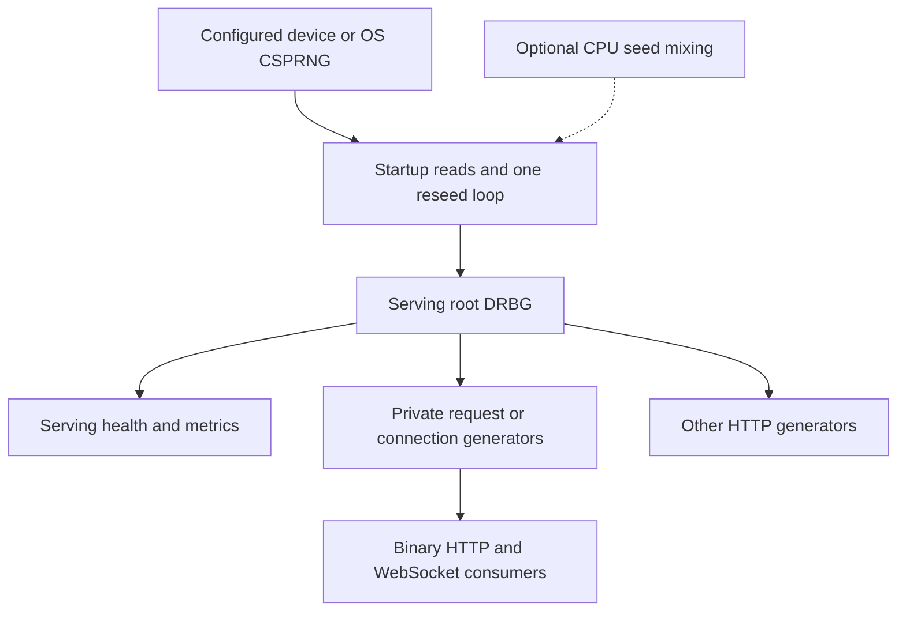

# entropy-service

[](https://golangci-lint.run/)
[](https://github.com/fantuz/entropy-service/actions/workflows/build.yml)

[](LICENSE)


**Self-hosted random data — configurable entropy sources, high-throughput delivery, and interactive exploration.**

Entropy Service is a Go server and command-line client for generating, distributing, and inspecting pseudorandom data from a cryptographic deterministic random bit generator (DRBG). It supports hardware or operating-system seed sources; ChaCha20 and AES-256-CTR backends; bounded HTTP and WebSocket delivery; and a browser-based showcase for experiments and diagnostics.

**From photons to bytes** describes the project's hardware-origin story: an ID Quantique Quantis PCI card inspired the first demonstration. The same architecture can also be seeded from the operating system CSPRNG. DRBG output is generated from seed material, **not a claim that each output byte is an independent hardware-entropy measurement**.

- **Integrate:** request binary samples over HTTP or maintain a WebSocket stream for development and test applications.
- **Experiment:** inspect byte statistics, live stream previews, words, images, colours, QR codes, and synthesized sounds.
- **Operate:** monitor readiness, reseeding, traffic and resource admission through JSON and Prometheus metrics.

`entropy-server` serves the APIs and embedded browser pages. `entropy-client` consumes binary HTTP/WebSocket APIs and provides terminal monitoring with bounded analysis.

[Quick start](#quick-start) · [Use cases](#use-cases) · [Architecture](#architecture) · [Configuration](#configuration) · [API reference](#api-reference) · [Performance](#performance) · [Statistical tests](#statistical-tests) · [Development](#development) · [Security](SECURITY.md) · [Full reference](docs/README.md)

## Quick start

Use **Go 1.24.4 or newer**, Git and Make. Linux is the primary deployment target; hardware devices also need their own working kernel driver and read permissions.

```sh
git clone https://github.com/fantuz/entropy-service.git
cd entropy-service
make build

# Local demonstration using the OS CSPRNG; no QRNG or TLS certificates needed.
./bin/entropy-server -device=/dev/urandom -enable-https=false -http=127.0.0.1:8080
```

**Start in your browser:** open **http://127.0.0.1:8080/** (or your configured HTTP/HTTPS base URL). The embedded homepage presents interactive demonstrations, HTTP APIs, WebSocket routes, health/metrics endpoints and optional legacy shortcuts in a three-column layout. It hides internal JavaScript files from navigation without denying access to those required assets.

In another terminal, from the repository directory:

```sh
curl --fail http://127.0.0.1:8080/ready
curl --fail 'http://127.0.0.1:8080/v1/data/random?bytes=4096' -o sample.bin
wc -c sample.bin

# Repeated HTTP requests, 64 KiB per response.
./bin/entropy-client -mode=pull -url=http://127.0.0.1:8080/v1/data/random -slice=65536 -refresh=100ms

# Alternatively, one WebSocket connection delivering 64 KiB per message.
./bin/entropy-client -mode=stream -wsurl=ws://127.0.0.1:8080/stream -slice=65536 -refresh=100ms
```

Stop a running client or server with Ctrl+C. The homepage links to the canonical [byte preview](http://127.0.0.1:8080/api-bytes.html?bytes=4096&refresh=1000), [colours](http://127.0.0.1:8080/api-colors.html), [words](http://127.0.0.1:8080/api-words.html?words=8&refresh=1000), [harmonic sound](http://127.0.0.1:8080/api-sound.html), [file analysis](http://127.0.0.1:8080/api-upload.html) and [live stream-analysis](http://127.0.0.1:8080/api-stream.html?bytes=4096&refresh=500) pages.

Build the **whole command packages**, not individual `.go` files: each binary now spans several source files. Without Make, use `go build -o ./bin/entropy-server ./cmd/entropy-server` and the corresponding `./cmd/entropy-client` command.

### Hardware and TLS

Require your hardware source explicitly when silent fallback would be inappropriate:

```sh
./bin/entropy-server -device=/dev/qrandom0 -require-device=true -enable-https=false -http=127.0.0.1:8080
```

Without `-require-device=true`, an unavailable device can fall back to the OS CSPRNG. `/dev/urandom` is a cryptographic source, not a deliberately weak test generator. Accepting a device path does not establish the quality of its output; the hardware, driver and source assessment remain part of your deployment.

The standalone binary enables HTTPS by default and expects deployment-specific `cert.pem` and `key.pem`. **Never deploy the publicly committed `cmd/entropy-server/key.pem`: it is a development fixture, not a secret.** Use your own certificate and private key; see [SECURITY.md](SECURITY.md). To serve HTTP on port 8080 and TLS 1.3 on port 8443 using your own certificates:

```sh
./bin/entropy-server -device=/dev/urandom -cert-file=/absolute/path/cert.pem -key-file=/absolute/path/key.pem
```

Use `https://` and `wss://` for remote consumers. Configure authentication and access controls at the deployment boundary: the service has no built-in client authentication. The WebSocket upgrader uses Gorilla's default same-host browser origin policy; requests without an `Origin` header may still be admitted. Origin validation is not authentication. HTTP/2 is not enabled in the current listener setup.

### Install Linux packages

The [Releases](https://github.com/fantuz/entropy-service/releases) page provides archives and `.deb`/`.rpm` packages for Linux amd64, armv7 and arm64. Download the package matching your system, then install that file:

```sh
# Debian / Ubuntu; keep only the intended package in the current directory.
sudo apt install ./entropy-service_*.deb

# RPM-based systems.
sudo rpm -Uvh ./entropy-service_*.rpm

sudo systemctl status entropy-server
sudo journalctl -u entropy-server -f
```

Packages install both binaries in `/usr/bin` and enable/start `entropy-server`. The supplied unit runs as root, listens on HTTP `:8080`, disables HTTPS and uses `/var/lib/entropy-service` as its working directory. Review those defaults for your deployment.

Change flags with `sudo systemctl edit entropy-server`. For example, to require a hardware source and bind only to loopback:

```ini
[Service]
ExecStart=
ExecStart=/usr/bin/entropy-server -device=/dev/qrandom0 -require-device=true -enable-https=false -http=127.0.0.1:8080
```

Then run `sudo systemctl daemon-reload` and `sudo systemctl restart entropy-server`. Browser assets are embedded in the binary: no `./web` copy, symlink or special working directory is needed. Rebuild the server when changing those assets.

## Use cases

| Scenario | How Entropy Service helps | Boundary to keep in mind |
| --- | --- | --- |
| **Develop and test random-data consumers** | Retrieve bounded binary samples through HTTP or binary WebSocket streams. | Remotely delivered bytes depend on the server, its configuration and transport. |
| **Measure streaming and concurrency** | Adjust payload sizes and intervals; compare DRBG backends and client reception rates. | Requested throughput is not a measured guarantee; benchmark each environment. |
| **Explore entropy-source integration** | Seed a shared root DRBG from a supported device or the OS CSPRNG. | DRBG output is expanded from seeds, not continuous fresh physical entropy. |
| **Teach and explore statistical properties** | Visualize histograms, bit balance, entropy estimates, mosaics and FFT previews. | Statistical diagnostics do not prove unpredictability or certify cryptography. |
| **Prototype operational integrations** | Use liveness, readiness, metrics and resource budgets to monitor the service. | Access controls and secret-management policy belong to the deployment. |
| **Create interactive demonstrations** | Generate words, colours, images, QR codes and short harmonic sound clips. | These are demonstrations, not certified security or key-management products. |

For a quick tour, start the server and **open its base URL in a browser**. The curated homepage lists supported HTTP APIs, live WebSocket demonstrations and operational endpoints without exposing internal JavaScript files in its navigation.

## Configuration

The server supports configurable seed sources, DRBG backends, timing and resource budgets; the client separately controls reception, analysis and terminal redraw rates. Server timing flags take integer **milliseconds**, whereas client timing flags accept Go durations such as `50ms`.

Typical server options: `-device=/dev/urandom -enable-https=false -http=127.0.0.1:8080`; select `-drbg=aes-256-ctr` to compare the alternate backend. Use `-require-device=true` when physical-source availability is mandatory.

**[Complete server and client flags, defaults, and examples](docs/configuration.md)**

## Architecture



The service creates **one root DRBG**, seeded from a full 64-byte startup read and refreshed by one reseed loop. This root serves all generation endpoints and seeds their private generators. The former reference root, background producer, software ring buffer and experimental generator-pool path are no longer active.

`/v1/data/random` creates a private generator per request. Each entropy WebSocket creates its own generator lazily on the first output read, then refreshes it after a parent reseed or before exceeding the 256 GiB per-key output limit. Child seeds come from the serving DRBG; they are not additional hardware reads. `/v1/data/test` and the other generated HTTP representations read the serving root directly.

This lets independent bulk consumers use multiple CPU cores without holding one shared lock for all their output. Parent seed derivation and reseeding still synchronise, and each individual generator serialises its own reads. AES acceleration, message size, encoding, TLS, network capacity and client work determine actual scaling.

Fresh entropy is read before taking the root generator's reseed lock. At the default settings, periodic reads nominally request `256 bytes / 250 ms = 1024 bytes/s`, in addition to startup/validation reads. This is seed-source demand, not the service's output throughput or a claim about measured physical entropy.

### Security and source boundaries

ChaCha20 and AES-256-CTR are selectable stream backends inside the project's own SHA-512-based seed/reseed construction. This is **not an implementation of NIST CTR_DRBG**, and the project makes no FIPS-validation or independent security-audit claim.

The suite can support laboratory work, application prototyping and integration experiments. It is not an HSM, key-management system, OpenSSL provider or certified entropy source. Remote randomness also introduces trust in the server and transport; keep private keys and sensitive seed material out of public diagnostic pages and logs.

Source failures are visible through readiness and reseed metrics. A failed reseed does **not** automatically stop existing DRBG output. Use `/ready` in routing/monitoring if your application requires a recent successful seed, and assess whether a stricter failure policy is needed.

## API reference

The homepage at `/` is the interactive entry point. Common API routes include:

| Route | Purpose |
| --- | --- |
| `GET /v1/data/random?bytes=4096` | Bounded raw binary sample from a private request DRBG. |
| `WS /stream?bytes=4096&refresh=500` | Continuous raw binary frames. |
| `WS /bytes` / `WS /colors` / `WS /words` | Framed bytes, colour/hash, or word streams. |
| `POST /files` | JSON statistics about an uploaded binary file. |
| `GET /ready` / `GET /metrics-2` | Readiness and Prometheus metrics. |

Interactive demonstrations live at `/api-bytes.html`, `/api-stream.html`, `/api-words.html`, `/api-colors.html`, `/api-sound.html`, and `/api-upload.html`. They are **browser pages**, not API version prefixes.

**[Complete HTTP/WebSocket endpoint, parameter and format reference](docs/api.md)**

## Stability and resource limits

Binary HTTP/WebSocket samples are capped at **32 MiB** by default. HTTP and WebSocket requests have independent concurrency/memory-admission budgets; memory reservations are conservative estimates, **not guarantees about RSS**. Errors, source freshness, and reseeding status are observable through the service.

**[Detailed limits, rejection behavior, and operational notes](docs/operations.md)** · [Security model](SECURITY.md)

## Performance

The README records *author-reported* loopback HTTP results of **10,566 requests/s at 256 KiB** and **3,659 requests/s at 1 MiB** on an AMD Ryzen 5 3500U (short `wrk` runs). The corresponding original `wrk` transfer labels are `2.58GB` and `3.57GB` per second. These numbers describe local delivery of DRBG-generated output; they do **not** measure physical entropy production, a remote network link, or universal sustained throughput.

The repository also includes separate encoding benchmarks; their CPU and allocation figures are not whole-system throughput. The tested server revision, backend, seed source and Go runtime were not all recorded for the historical `wrk` results.

**[Full measurement tables, raw logs, commands and reproducibility checklist](docs/benchmarks.md)**

## Statistical tests

The project documents `rngtest` and Dieharder workflows for screening generated bytes. A favorable statistical-test result does **not** establish cryptographic unpredictability, prove entropy-source quality, or provide certification. Test the served DRBG output and the raw source independently when comparing them.

**[Commands, interpretation and limitations](docs/statistical-tests.md)**

## Development

See [CONTRIBUTING.md](CONTRIBUTING.md) for the full contribution workflow, race-test prerequisites, benchmark evidence and pull-request guidance.

| Command | Action |
| --- | --- |
| `make build` | Build both command packages into `./bin`. |
| `make build-server` | Build the server. |
| `make build-client` | Build the client. |
| `make test` | Run `go test ./...`. |
| `make lint` | Run golangci-lint. |
| `make fmt` | Run the configured golangci-lint formatters. |
| `make release-snapshot` | Build local GoReleaser snapshot artifacts in `./dist`. |
| `make clean` | Remove `./bin` and `./dist`. |

Formatting/linting require [golangci-lint](https://golangci-lint.run/); packaging requires [GoReleaser](https://goreleaser.com/install/). CI currently uses golangci-lint 2.12.2. For local release preparation, also run:

```sh
go test -race -count=1 ./...
```

Race tests require a supported platform and a C toolchain with cgo enabled. Packaged release binaries are built with `CGO_ENABLED=0`; that does not prevent testing the source with the race detector separately.

The tracked tests cover DRBG backends/reads, reseed failures, private streams, validation, budgets, shutdown/cancellation, sound, file analysis, logging and client timing/metrics. Passing statistical checks is not a substitute for cryptographic review.

Current build CI runs ordinary Go tests, **server race-detector tests**, lint and a GoReleaser snapshot for relevant main-branch pushes/PRs; Markdown-only changes are excluded. The tag-triggered release workflow publishes without its own test step. A mandatory race-test release gate and automated browser-interaction tests in CI remain pending.

## Further reading

[Technical reference](docs/README.md) · [Security policy](SECURITY.md) · [Contributing](CONTRIBUTING.md) · [Benchmarks and reproduction](docs/benchmarks.md)

## Roadmap

Available features are documented above. The following are follow-up work or ideas, not capabilities shipped by this repository:

- Enforce race checks before releases; expand browser regression coverage (especially real network disconnections and mobile rendering).
- Use release-derived version metadata in health output.
- Clarify source-failure policy and cancellation of blocking hardware reads.
- Continue word-endpoint profiling and assess buffer reuse only where allocation measurements justify it. An independent dictionary would remove the remaining Diceware dependency.
- Improve deployment hardening: service identity/device permissions, authentication/access control, explicit optional origin allowlists for cross-host browser clients, and hardware-specific startup checks.
- Evaluate integrations separately: FUSE/CUSE byte devices and an OpenSSL provider need distinct designs. FUSE alone does not implement `openssl rand -engine entropyctl`. HSM/blockchain integrations, GPU generation and production/demo build profiles are not implemented.

## Project background and screenshots

### Current browser interface (November 2026)

The following screenshots capture the Matrix-inspired homepage and stream-analysis layout from the November 2026 UI revision. They are representative examples rather than a guarantee of pixel-identical appearance on later releases.

[](docs/images/homepage.webp)

[](docs/images/stream-analysis.webp)


The project began as a demonstration around an older Quantis PCI QRNG, with driver adaptation for newer Linux kernels. Hardware-driver maintenance is separate from this Go suite. The service can also run with the OS CSPRNG and no external card.

<details>
<summary>Historical interface gallery (February–March 2026)</summary>

These historical screenshots illustrate removed page URLs and earlier layouts; follow the linked current `api-*.html` browser pages instead.

**Terminal client** — diagnostics in the terminal.


**Historical stream-analysis view** — pictured URL `/stream.html` (removed); current browser page: [`/api-stream.html`](cmd/entropy-server/web/api-stream.html) using WebSocket `/stream`.


**Historical byte preview** — pictured URL `/bytes.html` (removed); current browser page: [`/api-bytes.html`](cmd/entropy-server/web/api-bytes.html), using WebSocket `/bytes`.


**Historical words page** — pictured URL `/words.html` (removed); current browser page: [`/api-words.html`](cmd/entropy-server/web/api-words.html), using WebSocket `/words`.


**Historical colour page** — pictured URL `/colors.html` (removed); current browser page: [`/api-colors.html`](cmd/entropy-server/web/api-colors.html), using WebSocket `/colors`.


**Historical file-analysis page** — pictured URL `/upload.html` (removed); current browser page: [`/api-upload.html`](cmd/entropy-server/web/api-upload.html), using `POST /files`.


**Metrics** — use `/metrics-2` for the current serving-root view.


</details>

## License

[MIT](LICENSE) · Copyright © 2026 Massimiliano Fantuzzi HB9GUS.
