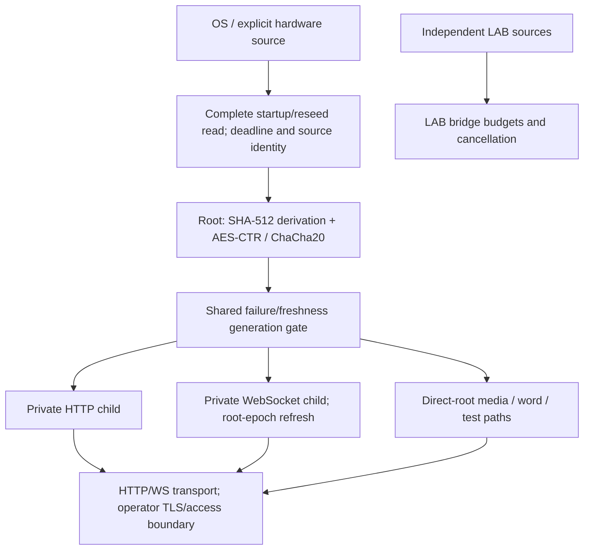

# Architecture and assurance status

Implementation claims refreshed on 2026-11-13 against `main`
[`dcc01a8`](https://github.com/fantuz/entropy-service/commit/dcc01a87aa2d517371f5262dfa95d2eb6e9f9f8d),
after PR #76. This is source-backed maintenance of the November 4 first-pass
review, not an independent cryptographic audit, hardware certification,
penetration test or endurance result. The [original review text](https://github.com/fantuz/entropy-service/blob/dcc01a87aa2d517371f5262dfa95d2eb6e9f9f8d/docs/architecture-review.md)
remains in Git history. The [change report](maintenance-review-2026-11-13.md)
identifies removed and rephrased claims.

## Current assessment

The architecture separates startup/reseed input, one serving root, private
HTTP/WebSocket children, transport admissions, observability and browser/CLI
consumers. Per-generator locks and per-key output ceilings protect state and
usage. All serving-root paths share the default fail-closed freshness policy;
LAB bridges consume independent operator-selected sources.

| Question | Current evidence | Remaining work |
| --- | --- | --- |
| Architectural boundaries | Root/child separation, admission budgets, joined source/WS cleanup, explicit source provenance | Repeated mixed-load fault tests and measured resource trends |
| Cryptographic assurance | AES-CTR/ChaCha20 primitive vectors, fixed seed/reseed fixtures and a documented custom SHA-512 construction | Independent composition review; source min-entropy and health assessment |
| Operational stability | Focused failure/recovery, cancellation, race and package/service tests | Long-duration workloads and actual OS/driver/device qualification |
| Performance | Controlled pre-Windows/v2.0.3 Linux assessment and large-waterfall measurements with raw samples | Physical-device, real terminal/network and longer-duration measurements |
| Deployment safety | Unique TLS provisioning, unprivileged loopback systemd defaults, release validation | Operator trust/access policy, permissions, certificate renewal and physical-host validation |

This remains a self-hosted random-data distribution and experimentation
platform, not a validated HSM, certified entropy service or key-management
product. Statistical displays are diagnostics, not cryptographic validation.

## Source-to-client path

The diagram shows responsibilities, not a new key derivation or an added
network proxy. A serving root expands seed material; it is not a reservoir
that forwards a physical random byte for every network byte. Children still
share the root/host trust domain. The [construction specification](drbg-construction.md)
defines the actual seed/reseed bytes, epoch transitions and output ceiling.

## Earlier findings: implemented controls

| Original concern | Current implementation and practical boundary |
| --- | --- |
| Packaged root/all-interface plaintext service | The shipped unit uses an unprivileged systemd identity, loopback HTTP, restricted devices and explicit activation. Standalone listeners still default to all interfaces. See [deployment](packaged-service.md). |
| Shared TLS private key | No identity is bundled; the retired public key is rejected. `generate-cert` explicitly creates a unique identity, and CI rejects tracked private keys. Existing old deployments still need rotation. See [certificates](tls-certificates.md). |
| Readiness degrades while output continues | `-on-reseed-failure=stop` is the default across root, descendants and production routes. Explicit `continue` retains old-state output. Buffered/in-flight data is not revoked. See [freshness policy](reseed-failure-policy.md). |
| Unbounded source reads and shutdown | Complete-read budgets, deadline-capable source adapters, joined cancellation and reseed-worker shutdown are implemented. Broken native drivers can still block OS calls; there is no unconditional userspace watchdog. See [source I/O](source-io.md). |
| Strict empty path / wrong fallback label | Strict Linux device mode rejects an empty path; metadata identifies the actual reader. Explicit USB and Windows hardware selectors never substitute the OS source. See [configuration](configuration.md). |
| Seed/state lifetime and dormant generator APIs | Owned seed/key/nonce/digest buffers are cleared where implemented; generators close and reject later use. The old `DRBG.Stream`, `Write` and `ReadInto` APIs no longer exist. This does not guarantee zeroization of Go/runtime/cipher copies. See [memory hardening](process-memory-hardening.md). |
| Release validation | Tag publication depends on tests, race/vet/lint, vulnerability checks and packaging validation. Native Windows and packaged ZIP checks complement Linux tests. A green run applies to its exact SHA. |
| No reproducible performance comparison | The [Linux assessment](linux-performance-v2.0.3.md) and [terminal guide](client-terminal.md) now publish controlled comparisons and samples. Older `wrk` logs retain their historical provenance limits. |

## Remaining priorities

1. **Repeatable endurance/fault tests:** sustained mixed HTTP/WS clients,
   slow consumers, connection churn, source errors/recovery and shutdown.
   Track admission reconciliation, errors, latency, heap/RSS and goroutines.
   Existing unit/race coverage is not proof of a stable 24-hour process.
2. **Physical source qualification:** populate the [device records](hardware-qualification.md)
   with firmware, installed driver, OS/kernel, throughput and cancellation.
   Simulation and cross-compilation do not establish actual device operation.
3. **Source health:** Quantis adapters check available module status;
   ChaosKey has no documented per-read health query. Complete predictable
   source bytes can still look fresh. Source-specific health tests and
   min-entropy assessment require their own design and evidence.
4. **Cryptographic assurance:** commission independent review of the custom
   composition. A standardized alternative would require an explicit design,
   compatibility and migration decision; do not change backends incidentally.
5. **Deployment access/resource policy:** authentication, identity quotas and
   rate limits remain external. Global admission estimates are not an RSS
   limit or a public-Internet DoS guarantee. Protect monitoring/debug access.
6. **Focused coverage and maintenance:** use the [current coverage review](coverage-review-2026-11-13.md)
   to choose active failure paths and distinguish native/platform fixtures
   from untested behavior. Remove legacy helpers only after checking callers.

The [threat model](security-boundaries.md) is the detailed security boundary;
[operations](operations.md), [monitoring](monitoring.md) and
[hardware examples](hardware-examples.md) describe practical deployment.
