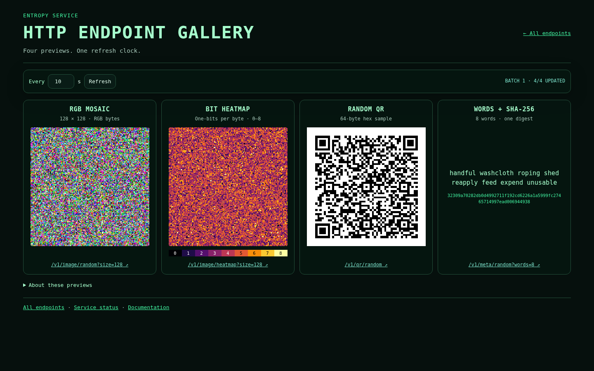
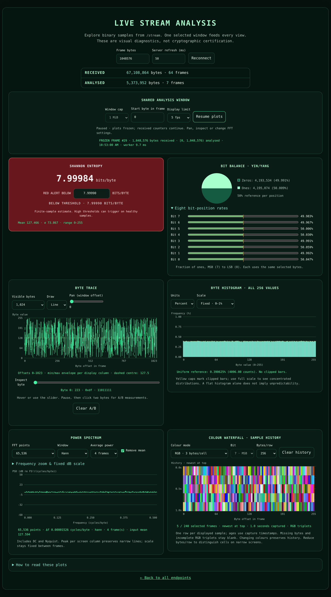

# Browser showcases and operations view

The embedded homepage is available at `/` on the configured HTTP or HTTPS address.
It displays interactive demonstrations and links to the original HTTP/WebSocket APIs.
There is no separate `/web` HTTP prefix; the assets are embedded in `entropy-server`.

## Endpoint gallery

Open `/api-gallery.html` for a framed view of these existing HTTP responses:

| Frame | Actual HTTP route | Content |
| --- | --- | --- |
| RGB mosaic | `/v1/image/random?size=128` | Raw RGB sample pixels (128 × 128) |
| Bit heatmap | `/v1/image/heatmap?size=128` | Byte one-bit counts, nine-colour PNG (128 × 128) |
| QR code | `/v1/qr/random` | PNG QR code containing generated hex |
| Words and digest | `/v1/meta/random?words=8` | Words and SHA-256 extracted from server-rendered HTML |

The compact layout uses **four columns from 1100 px**, two columns from
600–1099 px, and one column on narrower screens. The shorter subtitle shares
the title's left edge and stays on one line at normal mobile/desktop widths.
Refresh controls use one compact row where space permits; explanatory text
is available under **About these previews**. Direct-response links remain
available on every card, and the word sample retains its full SHA-256.

The gallery requests all four endpoints together on one browser-controlled clock
(default: approximately 2 seconds; adjustable from 0.5 to 120 seconds in
0.5-second steps). It waits for the batch to finish before swapping previews
and never overlaps cycles.
Slow or failed requests retain their last successful preview. The word response
is parsed rather than embedded as a self-refreshing iframe, so its HTTP meta
refresh does not desynchronise the gallery. PNGs are displayed as returned by
the server, with no added opaque iframe background or border; a QR code's own
quiet zone is preserved for scanning. Previews share a square region on wide
screens; the word panel is shorter on phones. Binary downloads such as
`/v1/data/random` are not shown; use a client or `/api-bytes.html` instead.

At the 0.5-second minimum, one visible gallery targets two batches and eight
HTTP requests per second; the two-second default targets two requests per
second. Slow batches delay the next update rather than queueing overlapping
work, and hidden tabs pause polling. This browser interval does not alter
the standalone image `Refresh` hint, the server's HTTP word-page interval
or other API/stream settings.

The two image previews request 128 × 128 samples and use nearest-neighbour
scaling so neighbouring pixels remain visible rather than blending into a
flat average. The RGB values are unchanged. The heatmap's labelled 0–8
palette indicates **one-bits per byte**, not entropy quality. A 128-pixel
sample has 64 times fewer pixels and consumes 64 times fewer generated
bytes than a 1024-pixel sample. Image allocation/admission estimates scale
with the requested area, and response sizes/encoding costs also decrease.
The API still defaults to 1024 × 1024; callers can request any integer
`size` from 64 to 1024. See [image parameters and mapping](api.md).

There are nine possible counts in an eight-bit byte: `00000000` has zero
ones, `11110000` has four, and `11111111` has eight. Bit positions are eight
separate locations; the heatmap counts how many are set. For uniform bytes,
four is the most common count (70 of the 256 possible byte values), so the
middle colours normally dominate. These count categories are unchanged by
the refresh adjustment.

**These are demonstration views**, not statistical evidence or an entropy
certificate. The implementation does not introduce aliases such as
`/v1/images` or `/v1/words`.

[](images/gallery-desktop.png)

[Mobile layout](images/gallery-mobile.png)

## Stream analysis: shared window and controls

`/api-stream.html` keeps the histogram, byte trace, power spectrum, historical
colour waterfall and symbolic Yin/Yang bit balance. Wide screens use two
columns; at 860 CSS pixels and below the cards form one column in reading
order. Plots retain a 240–260 CSS-pixel height (250 on mobile) and use the
screen pixel ratio, capped at three, rather than stretching an 800-pixel bitmap.

[](images/stream-lab-desktop.png)

[Mobile stream lab](images/stream-lab-mobile.png)

### Capture and analysis

The connection controls request **frame bytes** (default 65,536; maximum
32 MiB) and **server refresh** (default 500 ms). Reconnect applies those network
settings. Separate shared controls select a **start byte within each frame**
and a cap of **4, 16, 64, 256 KiB or 1 MiB**, default 64 KiB. A short remaining
window uses the available bytes; an offset outside the frame is reported
rather than silently clamped. All statistics use exactly that selected window.
The half-open `[start, end)` range appears above the charts.

Display analysis can run at 1, 2, 5 or 10 frames/second (default 5), subject to
the incoming frame rate and browser capacity. A worker computes statistics and
FFT; there is at most one running job, one replaceable queued job and one
pending display result. Large incoming messages are sliced to at most 1 MiB
before analysis; the full network message still reaches the browser. Hidden
tabs skip new analysis. This bounds computation and retained analysis state,
not incoming WebSocket traffic or total browser RSS.

**Pause plots** freezes the selected sample and waterfall while reception and
received counters continue. Trace and plot controls remain usable; FFT changes
recalculate the frozen sample. Changing the capture offset/cap requires
resuming. Resize, colour changes, frozen recalculation and power-average
changes never add duplicate frames to the waterfall or analysed counters.

The two cumulative counter rows have distinct meanings:

- **Received** counts every valid binary message and its full byte size,
  including frames skipped by the display sampler or while paused/hidden.
- **Analysed** counts unique sampled frames whose worker job completed and the
  selected bytes actually processed. An already-running job can complete
  after pause or a settings change, even if its obsolete result is discarded.
  Frozen-frame recalculations are excluded.

Neither row is a server-generation counter or a network throughput benchmark.
The latest-frame caption includes capture time and worker computation time;
that timing excludes transport, queueing and canvas rendering.

### Histogram, trace and bit balance

The histogram retains **all 256 byte values**. Choose counts or percent;
fixed detail (0–1%), fixed full range (0–100%), or labelled auto scale. The
dashed uniform reference is `100/256 = 0.390625%` (`N/256` counts). Yellow caps
identify clipped bars on detail scale. For example, a repeating 0…255 counter
has a flat histogram and Shannon estimate of eight, despite being predictable;
the trace and spectrum expose its structure.

The trace uses a fixed **0…255 byte-value** scale and **absolute byte offsets**,
with a 127.5 centre reference. Pan through the shared window; show 128, 512,
1,024, 8,192 or all selected bytes. Line, steps and dots are available for
individual samples. When several bytes occupy a display column, an exact
min/max envelope replaces the drawing style so isolated spikes survive
zoom-out. Hover/touch or use the keyboard-accessible inspect slider for decimal,
hex and binary readouts. While paused, click A and B to measure signed byte
offset and value differences. These are byte values, not voltage or time.

Yin/Yang retains its two-colour zero/one proportions with a compact legend.
Expand **Eight bit-position rates** for ones percentages at bits 7 (MSB) through
0 (LSB), each with a fixed 0–100% meter and 50% reference. These use the entire
shared window, independently of trace zoom and FFT size.

### Shared FFT mathematics

Stream and uploaded-file previews load the same `analysis-math.js` FFT and
`analysis-plots.js` spectrum renderer. Stream FFT choices are **512, 2,048,
8,192, 32,768 and 65,536 points**; Auto chooses the largest power of two fitting
the selected bytes, up to 8,192, with a minimum of 32. Explicit larger sizes
require enough selected bytes and never silently zero-pad. The upload API is
unchanged: its at-most-2,048-byte preview sets the file FFT's input limit.

Choose Hann (default) or rectangular weighting and optional mean removal
(default on). For N input bytes, mapped to full-scale amplitude:

```text
x[n] = (byte[n] − c) / 127.5
c = FFT-input mean when removing mean, otherwise 127.5
w[n] = 0.5 × (1 − cos(2πn/(N−1))) for Hann, or 1 for rectangular
X[k] = FFT(x[n] × w[n])
PSD[k] = |X[k]|² / Σ w[n]²
PSD[k] *= 2 for 0 < k < N/2 only
f[k] = k/N cycles/byte; Δf = 1/N
PSD_dB[k] = 10 log10(PSD[k])
```

The one-sided spectrum contains **N/2 + 1 bins**, including DC (0) and Nyquist
(0.5 cycles/byte). Summing `PSD × Δf` gives the window-weighted mean-square
normalized amplitude. Removing the unweighted input mean does not guarantee
zero DC after Hann weighting. Frequencies are **cycles/byte**, not Hz: a network
refresh interval is not the sample clock of the byte sequence. dB is relative
to `1 FS²/(cycles/byte)`; narrowband density peaks can exceed 0 dB. This is a
periodogram, not a calibrated instrument or a cryptographic health test.

Average **linear power** over 1, 4 or 16 distinct selected frames before taking
the logarithm. The count warms up and resets when selection or FFT settings
change; changing averaging depth restarts it too. Frozen-frame recalculation
shows a single-frame preview without repeatedly adding the same sample.

The default vertical range stays at **−60…+50 dB** between frames. Advanced
controls set fixed floor/ceiling and zoom within 0…0.5 cycles/byte; invalid
ranges retain the last valid scale with an explanation. Spectrum downsampling
uses the peak per display column to preserve narrow lines; the plotted line
is consequently a peak envelope at coarse zoom, not a bin average. Changing
viewport width can change that envelope, while numerical PSD stays unchanged.

### Historical colour waterfall

Each displayed sample contributes one timestamped row; the newest is at the
top. Retain **up to 240 rows**, each copying at most 1,024 raw bytes from the
start of the shared window (245,760 raw history bytes maximum). One, two or
three age labels refer to monotonic capture timestamps, so pauses and skipped
frames create real age gaps. Row spacing is uniform per selected frame, not a
uniform time axis. The caption shows row count and captured time span.

Choose **RGB** (three successive bytes per cell), **grayscale** (one byte,
0 black / 255 white), or **bit plane** (choose bit 7…0, 0 black / 1 white).
Switching colour mode or bytes/row (128, 256, 512 or 1,024) redraws retained raw
history. Missing bytes and incomplete RGB triplets are blank. On narrow plots,
cells can share display pixels; reduce bytes/row to inspect individual cells.
Clear history explicitly, or change the shared capture selection to start anew.

### Regression checks

The dependency-free Node suite runs in build/release CI:

```sh
node scripts/test-analysis-math.mjs
```

It compares the FFT with an independent direct DFT, checks Parseval, DC and
Nyquist normalization, known periodic inputs through 65,536 points, all eight
bit positions, min/max spike preservation, linear power averaging, history
bounds and the actual worker protocol.

For real Chromium checks, install Python Playwright and a Chromium executable,
build the server, then run:

```sh
make build-server
python3 -m pip install playwright
python3 scripts/test_stream_browser.py --chromium /usr/bin/chromium \
  --artifacts /tmp/entropy-stream-browser
```

The optional script starts and shuts down its own loopback server using
`/dev/urandom`, exercises live reception/pause, frozen reanalysis, trace A/B,
power averages, all waterfall modes, large/short FFTs, offset handling,
320/390/768/1440-pixel layouts, a deterministic counter fixture, file upload,
exact copyable Base64 and query validation. It saves screenshots, JSON results
and shutdown logs under the supplied artifacts directory. It does not modify
an existing server. Browser timings depend on host/browser and exclude a claim
that every device can sustain the maximum settings.

### Shannon entropy sample alert

The **Shannon entropy** instant value now has its own panel, independent of the
byte histogram. Choose a red-alert threshold between **1.00000** and **8.00000**
bits per byte, in increments of **0.00001** (default **7.99990**). The panel
alone turns red when the *full-precision* sample estimate is strictly below
that threshold. Equality is not an alert. The numeric readout is rounded to
five decimals and can therefore appear equal to the threshold at its boundary.
Changing the selector immediately reevaluates the most recently analysed
sample, without reconnecting the WebSocket or contacting the server.

The threshold is a **per-browser preference**, stored in `localStorage` if
available. It persists across page reloads in that browser, but never changes
the server, API responses or the preferences of other visitors. Restricted
browser storage falls back gracefully to the default.

**Interpretation:** Shannon's plug-in entropy estimator is sample-size-dependent
and commonly *below* 8 even for excellent random streams. In particular, a
threshold of 7.99990 can flag perfectly healthy 4 KiB or 64 KiB samples. This
alert is a user-selected **statistical watchpoint**, *not* a cryptographic
health check, entropy-source exhaustion detector, or independent randomness
certification. Only the Shannon panel changes colour; other charts remain
unaffected.


## Byte, colour and upload presentation

`/api-bytes.html` uses the common Matrix theme for its hexadecimal, Base64
and SHA-256 fields rather than an old inline stylesheet. Base64 remains
in a centered, width-limited box with justified wrapped lines and a centered
last line. CSS changes no characters, spaces or padding in the copyable sample.

`/api-colors.html` displays the 64-character SHA-256 digest on **two
32-character lines** (16 whole byte pairs per line), preventing uneven
30+30+2 wrapping at typical browser widths. This is presentation only; the
hash used to generate the background colour is unchanged.

`/api-upload.html` now follows the stream-analysis card layout. File
selection and upload controls appear first, then Shannon entropy, file
metadata, full-upload SHA-256, the histogram, RGB mosaic, Yin/Yang bit
balance, waveform and FFT preview. Existing upload and cancel handling,
underlying `/files` API and result semantics are unchanged.

The four `WS /...` route labels in the homepage's WebSocket cards are pinned
to the card bottoms so they align even when text wraps at different zoom
levels.

## Word display stability

`/api-words.html` reserves a stable display region so new strings do not resize
the surrounding layout. Long messages scroll inside the words panel, including
on narrow mobile devices, where words may be displayed one per line. The SHA-256
field and connection notice retain their positions.

## Health and metrics

`/api-status.html` presents a *single browser dashboard* using existing routes:

| Canonical route | Meaning |
| --- | --- |
| `/live` | HTTP liveness, independent of seed freshness |
| `/ready` | Fresh reseeding and readiness (may return 503 when degraded) |
| `/metrics-2` | Prometheus service counters and limits |

This page polls the existing endpoints on a configurable interval (default
five seconds, selectable from **0.25 to 60 seconds**). The next cycle starts only
after the current cycle completes, so slow responses never produce overlapping
scrapes. Choosing 0.25 seconds specifies a minimum idle delay, **not** a
guaranteed four updates per second; the network and parsing time are additional.

The dashboard renders an operational snapshot, four admission-capacity gauges
and twelve activity indicators. Three additional indicators show **seed
freshness headroom**, **successful root reseeds/min**, and **failed root
reseeds/min**. The freshness percentage is remaining time before the configured
readiness age limit; errors or readiness degradation mark it critical.

### Reading the capacity gauges and KPIs

- **HTTP/WS memory pressure** is estimated reserved working memory divided by
  the respective configured admission budget. This is *not* actual process RAM,
  Go heap, or physical entropy-buffer fill.
- **HTTP/WS slot utilization** is active admitted requests or connections divided
  by the configured limit. Short HTTP requests can finish between scrapes.
- **Dim peak shadows** show server-side high-water marks for those same four
  gauges. New metrics (`http_generation_requests_peak`,
  `http_generation_memory_peak_reserved_bytes`, `ws_connections_peak`
  and `ws_memory_peak_reserved_bytes`) update on each successful admission
  under the existing budget lock, so brief peaks remain visible even if
  no dashboard was open at the time. The darker bar spans up to the peak;
  the bright bar still displays current utilization.
  The peaks reset when the server process restarts, not when a browser
  refreshes, and do not represent measured process RAM.
- **DRBG generation MiB/s**, **WebSocket frames/s** and **HTTP requests/s** are
  deltas between successful scrapes, not measurements of QRNG source throughput.
  HTTP requests include static assets and the dashboard's own polling.
- **Six lifetime activity peaks** accompany generation MiB/s, WebSocket
  frames/s, HTTP requests/s, WebSocket rejection pace, HTTP rejection pace,
  and live DRBG instances. Five rate peaks come from a single server-side
  roughly one-second sampling loop, independent of the browser. The
  `drbg_instances_peak` gauge is an exact atomic high-water mark on
  generator creation. All reset on server restart.
  Dim tracks represent the stored peak; bright bars indicate the present
  browser-observed value as a fraction of the peak. The browser's rolling
  rate window differs from the server's one-second sampler, so an individual
  displayed rate can occasionally exceed the sampled server peak. The
  visual fill is clamped in that case without modifying either value.
  These bars are relative comparisons, **not capacity or safety limits**.
  Cumulative rejection and reseed totals intentionally have no peak bars.
- **HTTP/WS rejection pace** sums admission rejections due to connection/request
  limits, estimated-memory pressure and excessive requested sizes. The latest
  interval is scaled to *rejections per minute*, not a percentage of requests.
  Cumulative rejection totals are also shown.
- **DRBG instance count** and **successful root reseeds** are existing server
  counters. Rate calculations show *SAMPLING* until two good snapshots exist,
  and reset on failed scrapes or counter rollback. A bounded window of recent
  samples (up to approximately five seconds, plus one prior baseline for
  slower polling) reduces rate jitter at 250 ms intervals.
- **Seed freshness headroom** is computed from `/ready` values
  `reseed_age_ms` and `max_reseed_age_ms`, not an entropy-buffer measurement.
  A stale or error-marked root is flagged regardless of age headroom.
- **Successful and failed reseeds per minute** are derived from changes in
  `rng_reseeds_total` and `rng_reseed_failures_total`. They do not indicate
  entropy-source throughput or guarantee fresh randomness.
- The historical `qrng_buffer_*` Prometheus metrics are fixed at zero because
  the older software buffer is no longer active. Displaying its fill percent
  would be misleading, so this dashboard does not use it.

These estimates help indicate admission exhaustion and concurrency pressure;
they are not a complete memory profiler. Use runtime/pprof data for heap/RSS
investigation and hardware instrumentation for actual seed-source buffering. The original API endpoints are unchanged.
For monitoring, continue querying the JSON/Prometheus routes directly.

Compatibility aliases `/health-1`, `/health-2` and `/metrics-1` remain available,
and their links are grouped in a collapsible section. Do **not** scrape both
metrics aliases as independent data sources: they represent the same service.

The dashboard is informational and does not add authentication. Use normal
network/access controls for externally exposed deployments.

[Main README](../README.md) · [API reference](api.md) · [Operations](operations.md)
