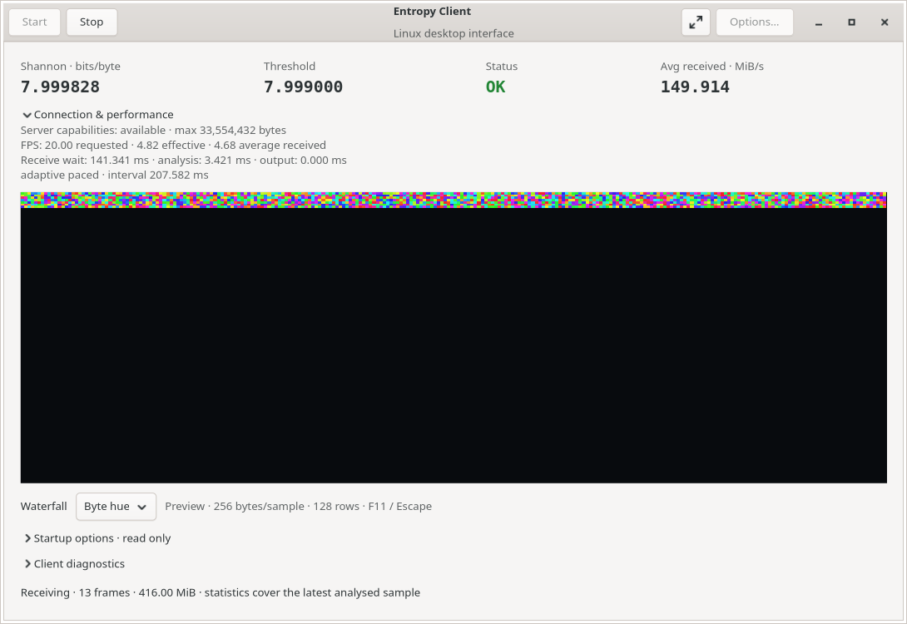

# Client capability discovery and performance

Available from v2.7.0. Use matching server/client binaries and GUI source or the
bundled Windows installer. Linux, Windows and macOS share the same flags and
desktop controls.

## Discover the selected server's limits

`GET /v1/capabilities` is a small, read-only JSON endpoint. For example:

```json
{"schema_version":1,"service":"entropy-service","version":"2.7.0","max_bytes":33554432,"transports":["http","websocket"],"websocket_min_refresh_ms":1,"websocket_max_refresh_ms":60000}
```

`max_bytes` is the operator's actual `-max-bytes`, rather than an assumed 32 MiB.
Transports describe the acquisition protocols, not additional listening addresses.
The interval range describes accepted raw `/stream` requests; it is not an FPS or
throughput guarantee. Capability discovery does not generate random data, test
hardware, assert readiness or expose device identities, registry entries, local
paths or certificate/key material. It remains usable when generation is paused;
check `/ready` for the live generation policy.

The client supports:

| Option | Behavior |
| --- | --- |
| `-capabilities=auto` (default) | Probe recognized entropy-service routes once; continue with CLI bounds if an older/custom server has no usable capability document. |
| `-capabilities=required` | Require a valid capability document before acquisition. |
| `-capabilities=off` | Make no discovery request; retain the existing request/error behavior. |

For `/v1/data/random`, `/v1/data/test` and `/stream`, discovery preserves a
reverse-proxy path prefix: `/entropy/stream` discovers
`/entropy/v1/capabilities` on the same authority. `ws` maps to `http`, and `wss`
to `https`, without guessing another port. Auto mode skips unrecognized data
paths. Required mode probes `/v1/capabilities` at the selected origin for those
custom paths. Query parameters and fragments are omitted; same-origin URL Basic
Auth is retained. Deployments requiring query-token authentication can use `off`
or provide access to the capability route through their authenticated proxy.

Discovery uses acquisition TLS/proxy settings, refuses redirects, limits the
response to 16 KiB and has a one-second deadline. Invalid/unsupported documents
are unavailable in auto mode and errors in required mode. A valid document that
rejects the chosen size, transport or WebSocket interval stops startup with an
explanation; auto mode does not ignore a known limit. Payloads are never silently
shrunk. Discovery precedes measurement, preflight generation and raw-output
opening. `-describe-json` remains entirely offline.

## Read the performance view

The normal terminal monitor and the desktop client's **Connection & performance**
section distinguish:

- **Requested FPS/rate:** the original `-refresh` and `-slice` target.
- **Effective target:** the current scheduling interval; equal to the requested
  value with fixed pacing. For WebSocket, this is the requested server cadence.
- **Average received FPS/throughput:** all monitored frames/bytes divided by the
  measured run's elapsed time, including connection setup and stalls. This is an
  average over the run, not instantaneous bandwidth or analysed-sample FPS.
- **Receive wait:** the complete request/message read, including server pacing,
  generation and transfer. It is not a measurement of network latency alone.
- **Analysis/output time:** client processing time, independent of statistical
  assessment. Analysis timing describes the selected sample/prefix; exported
  bytes and analysed bytes retain their separate counters.

`below target` is an observation, not a transport failure or a randomness
assessment. `warming up` avoids classifying the first few frames. Small terminal
canvases retain their waterfall space and show the received/effective FPS beside
average throughput; larger/redirected views show the timing details. Fullscreen
waterfall keeps its existing Shannon/threshold/status/throughput first line.
The desktop details can be collapsed and are hidden in fullscreen.

JSONL schema version 1 gains additive scalar fields in `sample` and `run_summary`:
`requested_fps`, `effective_target_fps`, `average_received_fps`,
`requested_mib_per_second`, `effective_interval_ms`, `output_ms`,
`total_analysis_ms` and `pacing_status`. Existing `receive_wait_ms` and
`analysis_ms` remain. `run_start.discovery` records availability and the validated
public document. Older reports remain usable in the GUI; new fields are optional.
Preview/history and JSONL record bounds are unchanged.

For progress independent from `-analysis-interval`, opt in with
`-report-performance` alongside `-report`. This adds a `performance` record on
a one-second timer, including aggregate frame/byte counts, received throughput
and timing fields. It does not create an analysed sample or disclose a raw
prefix. Existing report consumers receive no additional record types by default.
The GUI enables this option when its selected CLI advertises support, preserving
compatibility with older companions. Its rate display therefore continues to
update even when statistics are sampled only occasionally.

## Optional adaptive HTTP pull pacing

```sh
entropy-client -mode=pull \
  -url=http://127.0.0.1:8080/v1/data/random \
  -slice=33554432 -refresh=100ms \
  -adaptive -adaptive-max-interval=2s \
  -analysis-bytes=1048576 -duration=30s
```

In the GUI, select **Adaptive HTTP pull pacing** in Options. `-refresh` remains
the fastest allowed cadence. The default adaptive ceiling is five seconds;
`-adaptive-max-interval` must be between `-refresh` and one minute.

A smoothed estimate combines full receive time with consumer processing,
including analysis, output and report writes. A 25% scheduling margin reduces
continuous saturation. Rising cost slows the next requests promptly. Recovery
requires sustained spare capacity and proceeds gradually, with hysteresis to
avoid rapid oscillation. Measurements may include overlapping work, so this is
a conservative local pacing policy, not an estimate of server-only capacity.
The receive queue stays bounded; adaptive mode does not create parallel requests.

Only request frequency changes. Payload size, selected analysis prefix/interval,
Shannon threshold, exported bytes, TLS verification, request deadlines, retry
budgets and fail-closed behavior are preserved. Reaching the adaptive ceiling
is visible as `adaptive ceiling`; it does not suppress timeouts or generation
errors. Fixed pacing remains the default and retains its previous ticker policy.
For reproducible fixed-rate comparisons, leave adaptive mode disabled and record
actual achieved throughput.

WebSocket push uses the cadence negotiated at connection startup. Adaptive mode
is rejected with push/stream/websocket: delaying reads would merely move pressure
into socket buffers, while reconnecting repeatedly to change cadence would alter
stream semantics. Push still receives capability validation and performance
reporting. Live server-negotiated cadence changes are a possible later extension.

## Bounded local observation, 18 November 2026

Two four-second Linux x86-64 VM runs requested 32 MiB at 50 ms (20 FPS,
640 MiB/s), direct experimental RDRAND, a 1 MiB analysis prefix and loopback HTTP:

| Pacing | Average received FPS | Received MiB/s | Final effective target |
| --- | ---: | ---: | ---: |
| Fixed | 5.95 | 190.45 | 20 FPS / 50 ms |
| Adaptive | 4.98 | 159.51 | 5.00 FPS / 200.16 ms |

Both completed successfully. Adaptive pacing introduced headroom by requesting
less often, making the effective target reflect the observed workload. These
short, sequential VM observations are not a physical RDRAND qualification,
Windows benchmark, endurance result or universal capacity claim. The
[condensed observations](measurements/client-adaptive-2026-11-18.json) retain the
settings and final rates. Controlled slow-response tests separately check bounds,
recovery, byte/analysis accounting, cancellation and preserved generation errors.



Native macOS CI also exposed a close-during-fullscreen-animation crash. Shutdown
now lets GTK/AppKit finish entering and leaving fullscreen before destroying the
surface, while joining the owned client as before. Ctrl+C follows the same close
path. Linux and Windows retain their native fullscreen handling.
