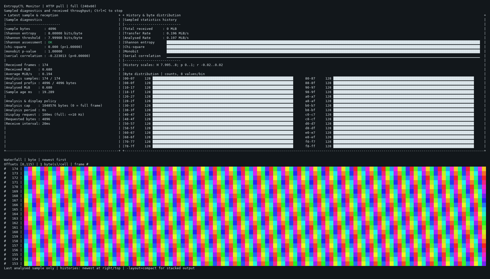

# Adaptive client terminal layout

**80 columns is a compatibility size, not a maximum.** The previous defaults
used 60 history points and 32 two-column waterfall cells; even the former
explicit 128-cell limit could exceed 80 columns. The adaptive dashboard uses
available horizontal space while preserving a compact alternative.

```sh
# Auto: adjacent panels on a sufficiently large interactive terminal.
./bin/entropy-client -mode=stream -dashboard -waterfall

# Explicit full view, automatic waterfall dimensions.
./bin/entropy-client -mode=stream -layout=full -waterfall \
  -waterfall-columns=0 -waterfall-rows=0

# Keep stacked output at every terminal size.
./bin/entropy-client -mode=stream -layout=compact -dashboard -waterfall

# Waterfall only: one status line, all remaining usable rows for samples.
./bin/entropy-client -mode=stream -layout=waterfall \
  -refresh=50ms -analysis-interval=50ms -display-interval=50ms
```

## Selection and presentation

| Layout | Behavior |
| --- | --- |
| `auto` (default) | Full panels on supported interactive terminals at least 120×30; compact otherwise. |
| `full` | Request panels down to 80×24; smaller/unknown/noninteractive terminals still use compact output. |
| `compact` | Stacked diagnostics and optional panels at every size. |
| `waterfall` | Waterfall cells with only throughput, Shannon entropy, threshold and assessment on the first line. Enables `-waterfall` automatically; supports wide, tall and odd-width interactive terminals. |

Linux and supported Windows VT-console dimensions are read on every redraw. Resizing changes the
visible area of retained history and switches automatic layouts on the next
redraw. Ctrl+C retains graceful shutdown. No raw keyboard mode, alternate
screen or UI library is used; the terminal profile owns the background and
default text colors. `-color` and `NO_COLOR` retain their existing meanings.

Waterfall-only mode uses the same byte-hue, RGB and grayscale mappings as the
other layouts. The first line starts with `SHANNON`, `THRESHOLD` and `STATUS`
on the left. Shannon entropy and its threshold use six decimal places in
bits/byte. `OK` is green and `WARN` red when colors are enabled; `-color=never`
and automatic monochrome output retain the text without ANSI color codes.
Average received throughput appears as a numeric MiB/s value at the right edge
of the same line, without a label. Before analysis the header shows `--` and
neutral `NO_SAMPLE`. Narrow terminals abbreviate the labels to `H` and `MIN`;
extremely narrow headers clip with `~`. There are no panel titles, frame
numbers, offsets or footer. The status compares the original entropy estimate,
so rounding to six decimals cannot suppress a warning.
Each remaining usable row is one selected sample, newest first. History fills
as samples arrive; missing history and missing sample bytes stay blank.

Graph, dashboard and preview histories are not allocated in this mode, even if
their display flags are supplied. Diagnostics, reports, exports and reception
still follow their existing settings. The layout itself does not increase
sampling or redraw rates: the example explicitly requests up to 20 selected
samples and redraws per second. The default analysis interval remains 250 ms.

Full view places sample/reception data and analysis/display settings on the
left, sampled histories and the existing byte histogram on the right, and
an optional waterfall across the remaining width below. Histories and the
histogram appear automatically in full mode. They reuse existing diagnostics;
no additional analysis pass, network request or statistical test is added.
Optional graph, preview, debug and matrix flags still select their data;
expensive matrix computation remains explicitly requested.

One history point represents one selected sample, newest at the right.
Graph scales are labelled: Shannon 7.995–8 bits/byte, p-values 0–1 and serial
correlation −0.02–0.02. Values outside these ranges clamp visually; numerical
diagnostics retain their actual values. Histogram bars share a peak scale,
show exact counts, and cover eight byte values per bin.

Full output leaves one row free to avoid scrolling. Overloaded panels may
be clipped: `~` marks truncated text and the footer reports clipping. Enlarge
the terminal, disable panels or use compact scrollback for the selected
output. Missing waterfall bytes remain blank. Explicit positive waterfall
dimensions are honored; omit them or set zero for automatic fitting.

## Bounds and compatibility

| Resource/setting | Bound or behavior |
| --- | --- |
| Full viewport | At most 1024 columns × 512 rows in full/auto panels and waterfall-only mode. Width and height are independent: no fixed aspect ratio. One bottom row remains free to prevent scrolling. |
| Interactive terminal redraw | At most 20 Hz (50 ms) in all layouts; the default one-second interval is unchanged. Reception and analysis cadence are independent. Redirected output retains its requested interval. |
| Statistic histories | At most 256 selected points; compact displays up to 60 recent points, reduced further on narrow terminals. |
| Waterfall | Up to 512 cells × 512 samples; compact automatic presentation remains 32 cells × 8 visible rows. Full view fits available space. Cells use two columns; odd terminal widths leave one blank trailing column. |
| Retained waterfall payload | At most 786,432 bytes (768 KiB) in RGB mode, plus bounded metadata/graph arrays. Rendered strings and Go heap overhead are additional. |
| Encoded waterfall cache | One lazy encoding per retained row, keyed by visible cell width/palette, up to about 6 MiB at the maximum. Recycled when history fills; no transport buffers are retained. |
| Waterfall-only frame buffer | Reused across redraws/resizes, bounded to about 6 MiB at 1024×512 truecolor. A smaller current view may retain its previous bounded capacity. |
| Automatic dimensions | Defaults: `-waterfall-columns=0 -waterfall-rows=0`. Positive limits: columns 8–512, rows 1–512. Auto-capable sessions retain bounded prefixes/history for later enlargement. Explicit positive limits still limit visible cells/history. |
| JSONL | Additive `settings.layout`; zero dimensions record automatic requests, not effective rendered dimensions. Statistics and sample selection are unchanged. |
| Headless/pipes | No headless display histories; `-headless -report=- -layout=waterfall` remains JSONL. Pipes, unknown dimensions and `TERM=dumb` use plain stacked output, even with forced colors. Waterfall-only rendering requires at least 2 columns × 3 rows. |
| Platform | Linux uses native PTY sizing. Windows uses a VT console's visible viewport, reserving one right column against classic-console wrapping; auto color is monochrome. Unknown/legacy hosts use stacked output; Windows redirects remain unstyled even with forced colors. |

## Windows consoles and PowerShell

Use Windows Terminal with PowerShell 7 for the best modern console experience.
PowerShell is the shell; its terminal host supplies VT cursor/color support.
Windows auto color deliberately stays monochrome. In a real compatible console:

```powershell
# Monochrome waterfall; no color option is required by default.
.\bin\entropy-client.exe -mode=push -layout=waterfall -color=never

# Optional 24-bit RGB in Windows Terminal or a compatible modern ConHost.
.\bin\entropy-client.exe -mode=push -layout=waterfall -waterfall-mode=rgb -color=truecolor
```

The client enables VT output on its console handle and restores only the mode
flags it added after normal completion or Ctrl+C/Ctrl+Break. It does not change
the input mode, code page, shell profile or global terminal preferences. Size
comes from the visible window, not its larger scrollback buffer. One spare
right column and the normal bottom-row reserve avoid unwanted wrapping/scrolling.
`TERM=dumb` opts out of interactive layouts. If VT is unavailable, waterfall
requests still show a bounded monochrome history in stacked output. Files/pipes
use unstyled text on Windows, including when `-color=truecolor` was requested.
Headless reporting allocates no display histories or caches.

Native Windows tests use isolated console buffers to verify viewport sizing,
resize, palette selection and mode restoration. The built and packaged client
are also exercised against an actual console with monochrome, explicit color,
duration and console interruption. These checks complement the Linux PTY tests;
they do not benchmark every desktop terminal or establish a paint-rate guarantee.

## Trade-offs and criticism

A larger dashboard groups related information and makes use of the screen.
It also sends more output, allocates rendering buffers and can flicker on
slow links. Synchronous terminal writes can reduce reception throughput;
bounded transport queues apply backpressure rather than silently discarding
received frames for animation. Use headless reports for load measurements.
On slow SSH links, reduce visible history, choose 256 colors, lengthen
`-display-interval`, or choose compact mode.

The expanded cap supports large desktops and unusual terminal proportions while
keeping retained data and rendering dimensions bounded. It is a ceiling, not a
target size or a 20-FPS guarantee. A 900×180 truecolor waterfall contains about
80,000 cells per redraw; its ANSI output and terminal paint cost are much larger
than an 80×24 view. Leave the default one-second display interval or choose a
smaller explicit waterfall on slow terminals/SSH connections. The client does
not stretch, repeat or interpolate sample bytes to create a filled image.

This renderer redraws complete frames. A captured 240×60 byte-hue frame was
about 63 KiB of ANSI/text output; one frame per second is roughly 0.5 Mbit/s
before transport overhead or compression, and higher refresh rates multiply
that cost. On this Linux amd64/Go 1.26.10 runner, the 240×60 RGB renderer
microbenchmark took about 3.1 ms per frame and allocated about 0.67 MiB of
temporary Go memory. It excludes terminal I/O and is not an application
throughput guarantee. That historical benchmark predates the row-cache optimization
described below. Partial-screen updates could reduce output traffic,
with more terminal-state handling and testing.

## Waterfall rendering cost

The [v2.0.3 assessment](linux-performance-v2.0.3.md) identified large rendering
buffers and repeated cell formatting as an existing cost, rather than a Windows
port regression. The renderer now caches encoded immutable sample prefixes,
re-encodes a row on new data/width/palette, writes decimal color components
without per-cell `fmt`, combines adjacent identical colors and reuses its frame
and label buffers. Blank cells, palette mapping, retained history, sample
selection, diagnostics and the 20-Hz limit are unchanged.

The extra bounded live memory trades repeated multi-MiB allocations for reusable
row/frame storage. Caches are lazy, capped with history/viewport dimensions and
recycled on eviction. Headless mode does not allocate them. This is complete-frame
output: varying RGB pixels still need almost all their ANSI bytes, so terminal
paint speed and SSH bandwidth can remain the limiting costs.

Five alternating 300-ms runs on the same Linux amd64 EPYC VM, Go 1.26.11,
CGO disabled, GOMAXPROCS=1 and GOGC=100, pinned to one CPU. Identical benchmark
code ran against v2.0.3 and the new renderer; medians, excluding terminal I/O:

| Renderer workload | v2.0.3 ms/refresh | New ms/refresh | Temporary heap bytes/refresh |
| --- | ---: | ---: | ---: |
| 900×180 varying RGB, one new row per refresh, discard output | 14.44 | 0.067 | 9,326,048 → 4,768 |
| Same varying RGB, capture frame in a fresh builder | 15.27 | 0.161 | 10,905,537 → 1,585,896 |
| Original 900×180 benchmark, zero-filled RGB rows | 14.47 | 0.019 | 8,440,323 → 175,887 |
| Original 240×60 full-monitor patterned RGB | 4.43 | 0.268 | 684,540 → 307,211 |

The varying-input case primes retained history, adds a new pseudorandom row on
every redraw and retains a real complete frame. Its `discard` sink models output
without an extra capture copy; its builder sink includes that copy. The zero-row
case additionally benefits from color-run compression and must not be presented
as a random-pixel result. None of these speedups is an application/terminal FPS
guarantee. Raw optimization samples are [archived here](performance/waterfall-optimization.csv).

```sh
go test ./cmd/entropy-client -run '^$' -bench '^BenchmarkWaterfallLive900x180$' -benchmem -benchtime=300ms -count=5 -cpu=1
```

The live benchmark uses the public rendering/history operations and can be
copied unchanged to v2.0.3. Keep toolchain, CPU, palette, viewport, history and
input-update pattern fixed when comparing; alternate revision order.

Dense screens can be harder to scan, and screenshots can conceal clipping
or imply more visible history than the viewport actually contains. Numerical
counters, scale labels, clipping indicators and the compact option make
those limits visible. This dashboard uses existing command-line controls;
it does not add keyboard menus or mouse capture.

Clipping/padding supports the generated single-column labels, numbers and
spark glyphs and preserves ANSI sequences. It is not a general Unicode
terminal engine for arbitrary wide/combining text. A size change during a
write may briefly wrap the old frame; the next redraw uses the updated size.

## Preview and validation



This is actual client output from a local deterministic HTTP fixture in a
240×60 Linux PTY, rasterized onto a dark terminal profile. Its predictable
byte cycle has H=8: this demonstrates layout, not source quality or throughput.
The waterfall shows 115 cells in this viewport; retained prefixes remain
bounded independently.

```sh
make build-client
go test ./cmd/entropy-client/...
go test -race ./cmd/entropy-client/...
python3 scripts/test_client_terminal.py --capture-full=/tmp/client-full.ansi
python3 scripts/test_client_waterfall.py
go test ./cmd/entropy-client -run '^$' -bench BenchmarkFullMonitor240x60 -benchmem
```

Go tests cover small/large layouts, colors, ANSI-safe clipping, histogram
counts, retained history, waiting/overload states, viewport caps and unchanged
analysis accounting. PTY checks cover 60×24, 80×24, 120×30, 160×45 and 240×60,
a live 80×24 → 160×45 → 80×24 transition, redirected output and headless JSONL.
Waterfall-only PTYs additionally cover 641×37, 100×240 and 900×180, live
wide/tall resizing, all mappings, and headless reporting. Go renderer tests
exercise the 1024×512 cap, tiny dimensions, assessments and retained history.
The renderer benchmark excludes terminal I/O and cannot predict SSH throughput.

## Up to 20 FPS

All interactive layouts support a 50 ms redraw interval. For a matching source
and analysis cadence with a small sample:

```sh
./bin/entropy-client -mode=stream -layout=full -waterfall \
  -slice=65536 -refresh=50ms -analysis-interval=50ms -display-interval=50ms
```

The one-second display default is unchanged. Reception, analysis and painting
remain independent: a 20-FPS display needs sufficiently frequent input and
analysis to show new samples. Terminal speed, SSH bandwidth and analysis cost
can lower the achieved rate. Wider RGB waterfalls produce more terminal output;
smaller samples or waterfalls reduce that cost. History and terminal bounds
remain unchanged.
