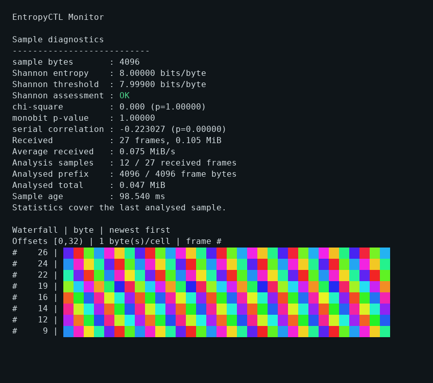

# Configuration — server and client

Run either binary with `-help` for its complete flag list. Boolean values use `-flag=true` or `-flag=false`.

## Server

All server timing flags accept **plain integer milliseconds**, without a unit suffix: `-reseed-ms=15000`, not `15s`. Sizes below are bytes unless explicitly labelled MiB.

### Source and reseeding

| Flag | Default | Purpose |
| --- | --- | --- |
| `-device` | `/dev/qrandom0` | Source device; OS fallback is allowed unless required. |
| `-require-device` | `false` | Fail startup if the requested device is unavailable. |
| `-drbg` | `aes-256-ctr` on non-ARM/non-RISC-V; `chacha20` on ARM/RISC-V | Backend: `chacha20` or `aes-256-ctr`. An explicit flag always overrides the platform default. |
| `-cpu-mix` | `false` | Supplement seed reads with RDSEED/RDRAND on supported amd64 CPUs. |
| `-rdrand-mix` | `false` | RDRAND-only mode; requires CPU support. |
| `-reseed-ms` | `15000` | Root reseed interval: 1–60000 ms. |
| `-buffer-reseed` | `256` | Bytes per root reseed: 32–1048576. |
| `-max-reseed-age` | `0` (effective 60000 ms) | Freshness-age limit in ms for readiness and stop-mode generation; zero selects `max(1000, 4 × reseed-ms)`. |
| `-on-reseed-failure` | `stop` | `stop` pauses generation on a recorded reseed failure or stale seed; `continue` explicitly permits existing-state output. Both report degraded readiness. |

The architecture-based backend policy uses the binary's Go target architecture (`GOARCH`): `arm`, `arm64` and `riscv64` select ChaCha20; other builds select AES-256-CTR. This does **not** inspect AES acceleration at runtime: some non-ARM platforms without hardware AES may perform worse or have different side-channel characteristics. Operators may override with `-drbg=chacha20` or `-drbg=aes-256-ctr` after evaluating their CPU. Neither algorithm is claimed to be a NIST-certified DRBG. The 15-second reseed interval and 60-second freshness-age threshold are **service policies**, not proven post-compromise recovery bounds. With the new default `stop` policy, failed or stale seed state denies generation as well as degrading readiness. See [rationale, recovery and migration](reseed-failure-policy.md); explicitly select `continue` to retain the old generation policy.

### Listeners and TLS

| Flag | Default | Purpose |
| --- | --- | --- |
| `-http` | `:8080` | HTTP address; binds all interfaces by default. |
| `-https` | `:8443` | HTTPS address; binds all interfaces by default. |
| `-enable-https` | `true` | Enable HTTPS; the packaged service explicitly disables it. |
| `-cert-file` | `cert.pem` | TLS certificate path. |
| `-key-file` | `key.pem` | TLS private key path. |
| `-debug` | `false` | Debug output and loopback pprof on port 6060. |

No certificate or private key is bundled. Use `entropy-server generate-cert`
for explicit, unique self-signed local identities, or provision a CA-issued
chain and matching private key. See [TLS provisioning](tls-certificates.md)
for SANs, expiry, safe reuse at startup and migration from the retired public key.
Normal server startup never generates or replaces an identity.

An explicit `-tags=experimental_barzakh` build additionally accepts
`-drbg=barzakh-521-experimental` for local research. The variable-time Go
implementation is excluded from normal releases and unsuitable for secrets.
See [construction, provenance and patent limitations](experimental-barzakh.md).

### Output and resource budgets

| Flag | Default | Purpose |
| --- | --- | --- |
| `-max-bytes` | `33554432` | Maximum binary sample: 1 byte to 32 MiB. |
| `-words` | `20` | Default word count and per-request word limit. |
| `-refresh-ms` | `5000` | Default `/bytes` WS interval in ms. |
| `-refresh-colors-ms` | `1500` | Default `/stream`, `/colors` and `/words` WS interval in ms. |
| `-refresh` | `5000` | HTTP word-page interval in ms; HTML rounds up to seconds. |
| `-fingerprint` | `2097152` | Upload prefix analysed statistically; full-upload SHA-256 is unaffected. |
| `-lab-sources` | empty | Strict JSON registry of experimental peers/devices/sockets; opens sources on demand. |
| `-lab-allow-remote` | `false` | Permit non-loopback clients to use registered lab bridges. |
| `-lab-max-connections` | `8` | Separate simultaneous bridge limit. |
| `-lab-memory-mib` | `32` | Separate estimated bridge working-memory budget; not RSS. |
| `-cookie` | `false` | Remember byte/word preferences and word language in Secure, HttpOnly cookies; use HTTPS for browser persistence. |
| `-ws-max-connections` | `128` | Shared WS connection limit. |
| `-ws-memory-mib` | `1024` | Shared WS estimated memory budget in MiB. |
| `-http-max-requests` | `128` | Separate HTTP work limit. |
| `-http-memory-mib` | `512` | Separate HTTP estimated memory budget in MiB. |

`-buffer-qrng` is deprecated and ignored. `-buffer-entropy` is an unused legacy option; neither controls an active pool or ring buffer.

Source selection opens and inspects the **actual file descriptor**. With
`-require-device=true`, `-device` must be non-empty and the named character
device must be opened successfully; **no startup fallback** is permitted.
`-device=/dev/urandom -require-device=true` deliberately requires that OS
character device, not a physical QRNG. To require a specific hardware device,
name its path explicitly. With strict mode off, failure to open/validate the
requested device selects `/dev/urandom`; if that also fails, Linux `getrandom(GRND_NONBLOCK)` is used. If the OS random source is not
initialized, that read fails rather than waiting indefinitely. `X-RNG-Source` and `/ready`
report the **actual selected reader**, not the originally requested path.
Optional CPU mixing supplements seed bytes but does not replace this
reported base source. This is **startup-only** fallback: an error from the
already opened source during a later reseed does not switch readers.
Source selection establishes neither entropy quality nor physical provenance.

`-source-timeout=3s` bounds each **complete** startup/reseed read (allowed
1ms–5m), including short reads and optional CPU mixing. Linux opens devices
with `O_NONBLOCK` and requires working Go read-deadline/poll support. Unsupported
drivers are rejected: strict hardware mode fails; optional startup selection
can use the logged OS fallback. The verified Linux urandom device (major 1,
minor 9) is a special case after a nonblocking OS-initialization check; OS reads
are chunked with deadline/cancellation checks. No timeout spawns a replacement
reader. Runtime timeouts use the existing reseed-failure policy and can recover
on a later successful read of the same source. See [driver limitations and
migration](source-io.md).

`-cpu-mix` prefers RDSEED, falls back to RDRAND, and takes precedence over `-rdrand-mix`. Mixing applies to **startup and reseed input**, not every output byte. Hardware attempts are bounded; if CPU randomness is unavailable, `-cpu-mix` retains the configured source bytes and logs the first failure. It does not turn the CPU instructions into a replacement for the configured source.

The systemd package overrides standalone defaults: it is **not enabled or started** by installation, uses an unprivileged systemd identity, binds only to 127.0.0.1:8080, and requires /dev/urandom. Switching to a hardware QRNG requires explicit Unix/group and systemd device permissions. See [packaged deployment](packaged-service.md).

### Preference cookies

Cookies remain **opt-in** with `-cookie=true`. They remember byte and word
counts and word language for `/v1/data/random`, `/v1/meta/random` and
`/paroleparoleparole`. A successful `/words` WebSocket upgrade also saves the
canonical language, making the browser word selector remember its last choice.
The existing format also retains a numeric `refresh` field, which does not
control the HTTP word page's refresh interval. Cookies contain no generated
random bytes, credentials or authentication/session token. `/words` uses the
remembered language when `lang` is absent; WebSocket word count and pacing
still use their explicit query values or server defaults. Other WebSocket
routes and browser demos continue to use their explicit settings.

The encoding schema is **standard Base64 of UTF-8 JSON**, for example:

```json
{"bytes":65536,"refresh":500,"words":6,"lang":"ar"}
```

| Field | Type | Meaning |
| --- | --- | --- |
| `bytes` | Positive integer | HTTP byte count, bounded by `-max-bytes`. |
| `refresh` | Positive integer | Retained millisecond preference; does not change the HTTP word-page interval. |
| `words` | Positive integer | HTTP word count, bounded by `-words`. |
| `lang` | String | Canonical dictionary code, such as `ru`, `ar` or `zh-Hant`. |

Base64 is encoding, **not encryption or a signature**. Clients can decode or
alter it; the server treats it as untrusted input and revalidates every value.
Older cookies with only the three numeric fields remain valid and default to
English. Unknown, empty or invalid stored language codes fall back to English;
valid aliases are canonicalized. An explicit invalid `lang` query returns 400
instead of using the cookie. Oversized cookie values (over 4,096 bytes), invalid
Base64, malformed JSON or wrong field types are ignored.

Appearance uses a separate browser setting, **not a cookie**:
`localStorage["entropy-theme"]` holds the plain string `"light"` or `"dark"`.
It is scoped to the browser origin (scheme, host and port), has no automatic
expiry and synchronizes between tabs. With no valid stored value, appearance
follows the operating system. Generated entropy is never stored in either
preference mechanism.

The `entropy_prefs` cookie is host-only (`Domain` omitted), uses `Path=/`,
`Secure`, `HttpOnly` and `SameSite=Lax`, and has a one-day `Max-Age`, renewed
when preferences are saved. Keep HTTPS enabled or use HTTPS at your reverse
proxy's browser-facing boundary. The server always sets `Secure`, including
when the backend connection from a TLS-terminating proxy is plain HTTP;
it does not infer cookie security from `X-Forwarded-Proto` or `Forwarded`.

Browsers do not send Secure cookies over ordinary HTTP. Some clients treat
localhost/loopback specially; use HTTPS rather than relying on that
exception. Plain-HTTP endpoints remain usable with query parameters, but
preference persistence over ordinary HTTP is deliberately unsupported.
Cookies issued by an older version without `Secure` gain the attribute on
their next cookie-enabled response; clear old site cookies if retiring an
HTTP deployment.

Explicit query parameters override stored values. Malformed cookie data is
ignored, and individual values outside server limits fall back to defaults.
The cookie is unsigned, untrusted preference input: it never increases
`-max-bytes` or `-words`, bypasses admission budgets or authenticates a
caller. Fresh cookie-mode defaults remain 512 KiB and 3 words, capped by
server limits. Stored `refresh` does not change the server-configured HTTP
word page refresh interval. Rejected HTTP requests, failed HTTP generator
setup and rejected WebSocket upgrades do not save preferences. A successful
WebSocket upgrade saves settings before streaming starts; a later generation,
connection or response-write failure can occur after cookie headers were sent.
The cookie is host-scoped, so unlike localStorage it is shared across HTTPS
ports on the same host. With cookies enabled, `/wordlists.json` reports the
validated `selected` language using `private, no-store` and `Vary: Cookie`;
reading that catalog never writes a cookie.

For example, start the HTTPS server with a certificate trusted for
`localhost` and opt in:

```sh
./bin/entropy-server -device=/dev/urandom -require-device=true -cookie=true \
  -http=127.0.0.1:8080 -https=127.0.0.1:8443 \
  -cert-file=/path/to/cert.pem -key-file=/path/to/key.pem

# Save a 64 KiB preference, then reuse it without a bytes query parameter.
curl --fail --cacert /path/to/cert.pem --cookie-jar prefs.txt \
  'https://localhost:8443/v1/data/random?bytes=65536' -o first.bin
curl --fail --cacert /path/to/cert.pem --cookie prefs.txt \
  'https://localhost:8443/v1/data/random' -o second.bin
```

Both files are 65,536 bytes and contain separately generated responses.
To remember a word language, request a word page with `lang`, or select it
and Apply in `/words.html`:

```sh
curl --fail --cacert /path/to/cert.pem --cookie-jar prefs.txt \
  'https://localhost:8443/v1/meta/random?lang=ru&words=8'
curl --fail --cacert /path/to/cert.pem --cookie prefs.txt \
  'https://localhost:8443/v1/meta/random'
```

Both word responses use Russian; a later explicit `lang=ar` overrides it.
Omit `-cookie` or use `-cookie=false` for stateless operation: the server
ignores incoming preference cookies and emits none. To remove previously
stored preferences, clear this site's cookies in the browser or delete the
local curl cookie jar. Cookie transport protection follows
[CWE-614](https://cwe.mitre.org/data/definitions/614.html).

## Client

Client timing options accept **Go durations**, such as `50ms` or `1s`. Byte counts are plain integers. Reception, analysis and terminal display have separate settings; a frame below means one HTTP response or one WebSocket message.

### Transport and payload

| Flag | Default | Purpose |
| --- | --- | --- |
| `-mode` | `pull` | HTTP `pull` or WebSocket `stream`. |
| `-slice` | `2097152` | Bytes per response/message: 1 byte to 32 MiB. |
| `-refresh` | `1s` | HTTP request interval or requested server WS interval; minimum 1 ms. |
| `-writeout` | `false` | Linux-only, uncredited pool mixing via `/dev/urandom`. Normally unnecessary; device errors fail the run. See [value, safeguards and limits](client-writeout.md). |
| `-output` | empty | Raw bytes to a new private file, or `-` for stdout with `-headless` on Linux. Stdout cannot also carry JSONL. See [exports and SSH examples](client-output.md). |
| `-output-device` | empty | Explicit Linux `/dev/random`, `/dev/urandom` or `/dev/null`; validated device identity, no entropy credit. Choose one destination across this flag, `-output` and `-writeout`. |
| `-output-bytes` | `0` | Stop after this many bytes have been exported; zero runs until duration/interruption. Requires an enabled destination. A byte limit can clip the final frame. |

Transport URLs are listed separately to keep the table readable:

- `-url`: `http://127.0.0.1:8080/v1/data/random`
- `-wsurl`: `ws://127.0.0.1:8080/stream`

`-url` and `-wsurl` accept endpoints with existing query parameters. The client preserves other parameters, including repeated values, while `-slice` and `-refresh` replace any existing `bytes` and `refresh` values. Malformed query strings are rejected. Only the selected transport's endpoint is configured and used. The CLI consumes `/stream` raw messages, not `/bytes` compact envelopes.

For example, this requests 64 KiB with a 100 ms refresh setting, overriding the values already in the URL:

```sh
./bin/entropy-client -mode=pull \
  -url='http://127.0.0.1:8080/v1/data/random?bytes=1024&refresh=1000' \
  -slice=65536 -refresh=100ms
```

For remote HTTPS/WSS, see [client certificate trust and renewal](client-tls.md).
Both transports verify the URL's name/IP against the certificate and use OS
trust; HTTP pull rejects redirects from HTTPS to plaintext.

### Analysis and terminal display

| Flag | Default | Purpose |
| --- | --- | --- |
| `-analysis-bytes` | `1048576` | Maximum prefix bytes analysed per selected frame.<br>Range: 0 to 33554432; `0` selects the full frame. |
| `-analysis-interval` | `250ms` | Minimum interval between analysed frames.<br>Non-negative; `0` analyses every frame. |
| `-display-interval` | `1s` | Terminal redraw interval; minimum 1 ms.<br>Does not change the requested reception interval. |
| `-shannon-threshold` | `7.999` | Minimum raw empirical Shannon estimate for `OK`, in bits/byte; finite value from 0 to 8, inclusive. |
| `-dashboard` | `false` | Reception/analysis rates and histories of sampled statistics. |
| `-matrix` | `false` | Compute and display the transition matrix for analysed samples. |
| `-graph` | `false` | Shannon-entropy history of analysed samples. |
| `-preview` | `false` | Up to 64 bytes, in hex, from the last selected frame. |
| `-histogram` | `false` | Byte-distribution bars from the analysed sample's existing counts. |
| `-waterfall` | `false` | Recent analysed sample prefixes as colored cells or a monochrome ramp. |
| `-waterfall-mode` | `byte` | `byte` (byte-value hues), `rgb` (consecutive RGB triplets) or `gray` (byte brightness). |
| `-waterfall-columns` | `0` | Automatic fit; or 8–512 cells, each using two terminal columns. Compact auto shows 32 cells. |
| `-waterfall-rows` | `0` | Automatic fit; or 1–512 retained samples. Compact auto shows 8 rows, newest first. |
| `-color` | `auto` | `auto`, `always`, `never`, `256` or `truecolor`; details below. |
| `-layout` | `auto` | `auto`, `compact`, `full` or `waterfall`; the latter enables a waterfall with only throughput and Shannon status on the first line. Adaptive canvas up to 1024×512; [rules and trade-offs](client-terminal.md). |
| `-debug` | `false` | Receive/fetch, analysis and runtime timings, to three decimal places in ms. |

By default, the client receives and counts every frame but analyses **at most the first 1 MiB of a selected frame, once every 250 ms**. The first frame is analysed immediately; later samples require both a new frame and an elapsed analysis interval. Slow sources therefore produce fewer samples. The terminal redraws once per second using the latest available result.

These settings apply to both `pull` and `stream`. They do not reduce the requested payload or filter data written with `-writeout`. Matrix computation is skipped unless `-matrix` is enabled. Statistics describe individual analysed samples; graphs show their history rather than a cumulative test of all received bytes.

For example, request 16 MiB every 50 ms while keeping analysis and display work bounded:

```sh
./bin/entropy-client -mode=stream -dashboard -slice=16777216 -refresh=50ms \
  -analysis-bytes=1048576 -analysis-interval=250ms -display-interval=1s
```

The three analysis/display arguments above are the defaults and may be omitted. The requested payload rate is **320 MiB/s** (`16 MiB / 0.05 s`), a scheduling target rather than a measured capacity. Actual throughput depends on generation, reception, analysis, terminal I/O and the network.

To analyse **every byte of every frame**, set both analysis options to zero:

```sh
./bin/entropy-client -mode=stream -dashboard -slice=16777216 -refresh=50ms \
  -analysis-bytes=0 -analysis-interval=0 -display-interval=1s
```

Add `-matrix` if transition-matrix analysis is also wanted. Setting only `-analysis-bytes=0` still selects frames at the configured interval; setting only `-analysis-interval=0` still respects the prefix cap. Full analysis can reduce throughput. The bounded receive queue applies backpressure when processing cannot keep up; increasing display frequency does not accelerate reception.

### Terminal waterfall and colors

```sh
# Vivid byte-value hues, with automatic terminal color detection.
./bin/entropy-client -mode=stream -slice=65536 -refresh=100ms -waterfall

# Interpret consecutive triples as RGB; request 24-bit terminal colors.
./bin/entropy-client -mode=pull -waterfall -waterfall-mode=rgb -color=truecolor

# Byte brightness with a 256-color palette, or an uncolored text ramp.
./bin/entropy-client -waterfall -waterfall-mode=gray -color=256
./bin/entropy-client -waterfall -color=never
```

Each waterfall row represents **one selected analysis sample**, labelled with
its received-frame number. Gaps in frame numbers are normal when analysis
sampling skips frames. The newest sample is at the top; columns always start
at byte offset zero. The offset heading gives the visible cell range, not a
claim that a short sample filled every cell.

| Mapping | Bytes per cell | Interpretation |
| --- | ---: | --- |
| `byte` | 1 | A fixed six-sector hue cycle over byte values 0–255; hue is a byte-value encoding. |
| `rgb` | 3 | Consecutive bytes are red, green and blue. An incomplete final triplet is left blank. |
| `gray` | 1 | A byte's value is brightness, from black at 0 to white at 255. |

Color palettes quantize these mappings to the selected depth. Without color,
`byte` uses raw-byte brightness (labelled `gray fallback`), `gray` uses the
same brightness ramp, and `rgb` uses luminance. Cells use the ASCII ramp
` .:-=+*#%@`; unused cells stay blank. This display is a visualization of
sample bytes, not a statistical assessment or proof of entropy quality.

The client copies at most `configured/automatic columns × bytes-per-cell` bytes from
each **analysed prefix**, further limited by the sample's actual length.
History retains at most the configured/automatic row bound: at the maximum
settings, 49,152 copied payload bytes in RGB mode, plus bounded row metadata. It
neither retains transport buffers nor changes analysis, reception, reports'
statistics or `-writeout` data. Empty or unselected frames add no row.
`-headless` allocates no waterfall history and renders nothing, even if
`-waterfall` or forced color is requested.

On Linux, stdout's terminal dimensions are read again on each redraw.
The waterfall narrows to fit the frame label and two-column cells and shows
only the newest rows that fit below the diagnostics and other enabled
panels. One screen row is reserved for the cursor. It is omitted if there
is insufficient room for its headings and a data row. Resizing changes the
visible area without discarding the bounded history, so older rows and
their wider prefixes can reappear after enlarging the terminal. Large
optional panels such as `-matrix` can themselves exceed the screen; they
leave no space for the waterfall on a small terminal.

At 120×30 or larger, automatic layout uses adjacent panels and fits the
waterfall to the remaining screen. `-layout=compact` retains stacked output.
Zero dimensions request fitting; explicit positive dimensions override it.
Full view also shows the existing sampled histories and histogram without
requiring their flags. Interactive terminal redraws are limited to 20 Hz (50 ms), including compact layouts.
See [the adaptive terminal guide](client-terminal.md) for viewport/history
bounds, clipping behavior, fullscreen examples and SSH considerations.

| Color choice | Behavior |
| --- | --- |
| `auto` | No color for redirected stdout, nonempty `NO_COLOR`, or empty/`dumb` `TERM`. Otherwise uses truecolor for `COLORTERM=truecolor`/`24bit` or `TERM=*-direct`, 256 colors for `TERM` containing `256color`, and basic ANSI colors otherwise. |
| `always` | Force color, including with redirected stdout or `NO_COLOR`; use the detected depth or basic ANSI colors as fallback. |
| `never` | No color escapes. A supported interactive terminal still uses cursor controls to redraw. |
| `256` | Force the 256-color palette, overriding detection and `NO_COLOR`. |
| `truecolor` | Force 24-bit RGB, overriding detection and `NO_COLOR`. |

Redirected output never uses cursor controls, including with forced colors.
`TERM=dumb` or empty `TERM` also suppresses cursor controls. Linux is the
packaged platform; on other systems automatic output is unstyled and
dimensions are unknown, so explicit color and configured row/column limits
are used. Colors affect diagnostics and preflight as well as the waterfall.
For JSONL stdout, use `-headless -report=-`; it stays unstyled regardless of
these display flags.



The preview was rendered from the actual client in an 80×32 Linux PTY,
using a local deterministic HTTP byte-cycle fixture, `-waterfall
-waterfall-mode=byte -waterfall-columns=32 -waterfall-rows=8
-color=truecolor -slice=4096 -refresh=50ms -analysis-interval=100ms
-display-interval=100ms`. It demonstrates the display, not a random-source
measurement; the fixture's ordered byte cycle is predictable despite its
Shannon estimate of 8. The server APIs and stream framing are unchanged.

### Reading the monitor

The monitor shows one raw **Shannon entropy** estimate, in bits/byte, and one
**Shannon assessment**: `OK` when the estimate is at least
`-shannon-threshold`, otherwise `WARN`. No analysed data means `NO_SAMPLE` in
reports. The threshold does not change the estimate. Chi-square, monobit and
serial-correlation results remain independent reference measurements; they
are not combined into another pass/fail badge. Optional histories use the
same raw estimates. See [client experiments](client-experiments.md#shannon-entropy-and-its-assessment)
for the formula, sample-size effects and interpretation.

| Display | Meaning |
| --- | --- |
| `Requested rate` | Payload size divided by requested interval; a target, in MiB/s. |
| `Received` / `Average received` | All frames handled by the monitor and their cumulative throughput over monitoring runtime. |
| `Total received` / `Transfer Rate` | Receiver byte count and throughput sampled over approximately one-second windows. |
| `Analysed Rate` | Bytes actually analysed per second, including the prefix/frame selection limits. |
| `Analysis samples` / `Analysed prefix` | Number of selected frames versus received frames, and analysed bytes versus the last selected frame's full size. |
| `Analysed total` / `Sample age` | Cumulative sampled bytes and age of the latest analysis sample. |

`Total received`, `Transfer Rate` and `Analysed Rate` are shown with `-dashboard`. Throughput uses **MiB/s**: 1 MiB = 1,048,576 bytes. Analysis rates measure processing of sampled data, not physical entropy production. Receiver and monitor counters can differ briefly because frames may be in flight or queued and rate windows differ.

The interactive client samples the selected transport once, shows preflight
diagnostics for three seconds, then resets the reception-rate window before
monitoring. The former separate cumulative startup demonstration is removed,
so startup and monitoring use the same diagnostics and threshold. With
`-debug`, `Last WS receive` includes waiting for the server's next message;
`WS runtime` sums message-read durations. `Last HTTP fetch` includes the
complete response body; `HTTP cycle runtime` includes request pacing plus
that fetch. Analysis is timed separately, and `Total runtime` is wall time
since monitoring started. These are client-side timings, not pure network
round-trip measurements.

### Timed runs and reports

| Flag | Default | Purpose |
| --- | --- | --- |
| `-duration` | `0s` | Non-negative measurement duration, e.g. `10m` or `3h`; zero runs until interrupted. Excludes interactive preflight. |
| `-retries` | `0` | Maximum total transport retries per measured run, 0–100; opt-in, without resetting output or timing limits. |
| `-retry-delay` | `1s` | Initial backoff, 1ms–30s; exponential with jitter, capped at 30s. See [retryable failures and limits](client-recovery.md). |
| `-report` | empty | Write JSONL metadata, analysed samples and a final summary to a **new** file (mode 0600). `-` selects stdout and requires `-headless`. |
| `-headless` | `false` | Skip interactive preflight and all terminal rendering, previews and bells; suitable for scripts and JSONL stdout. |

The measurement clock includes connection establishment, reception, analysis
and report-writing overhead. Expiry cancels pending network work and releases
queued frames. An analysis or write already in progress and connection
cleanup can make the process finish slightly after the requested duration.
Without `-report`, no report is created; `-headless` alone runs quietly.
With a writable report, normal duration expiry, Ctrl+C/SIGTERM and transport
failures produce a final summary. A failed report write, sync or close is a
command error; a broken destination or forced kill cannot guarantee a final
record. `WARN` is an assessment, not a nonzero exit code.

```sh
./bin/entropy-client -mode=pull -slice=1048576 -refresh=50ms \
  -headless -duration=10m -shannon-threshold=7.99 -report=pull-10m.jsonl
```

See [client experiments](client-experiments.md) for the JSONL contract, longer
runs, payload comparisons and a report-analysis example.

See [experimental source/socket labs](source-labs.md) and the
[registry example](../resources/lab-sources.example.json) for peer/self links,
protocols, deadlines and exposure rules.

The registry also supports `webpage` body prefixes/URL pools and `rtsp`/`onvif`
cameras. Cameras optionally set `width`, `height` and `profile_token` and need
FFmpeg on the server's PATH. Credentials are entered per capture rather than
saved in the registry. The lab's assisted configurator prepares the JSON for
operator installation/restart; it does not change running configuration.

[Back to README](../README.md) · [Technical reference index](README.md)
