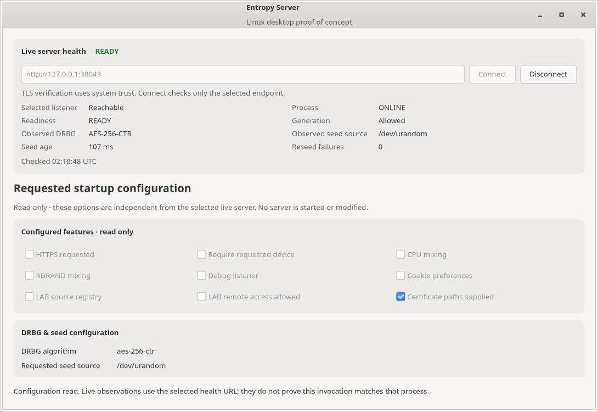
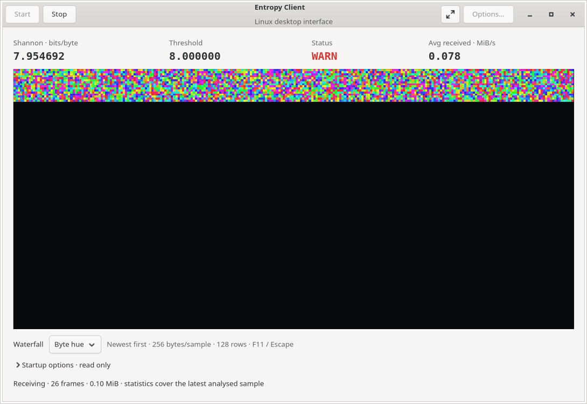

# Desktop GUI proof of concept

This optional GTK 4/PyGObject frontend supports Linux and Windows x64. It runs
from source, with desktop dependencies separate from the Go binaries. The
command-line and web interfaces remain independently usable. macOS support,
standalone application bundles, installers and signing remain follow-ups.

The server window combines a read-only startup configuration with live health
from an existing server. The client window provides statistics and a bounded,
resizable waterfall with fullscreen mode. Neither window installs or controls
an operating-system service.

| Window | Main button | What it does |
| --- | --- | --- |
| Server (`--view server`) | **Connect** | Monitor an already-running server. This window has no Start button. |
| Client (`--view client`) | **Start**, at the top left | Launch the selected client and show its statistics and waterfall. |

[](images/desktop-gui-server-poc.png)
[](images/desktop-gui-client-poc.png)

## Linux setup

On Debian/Ubuntu, install the desktop dependencies and build both utilities
from the source directory:

```sh
sudo apt install python3-gi python3-gi-cairo python3-cairo gir1.2-gtk-4.0
make build
```

Use the distribution's Python: virtual environments can hide PyGObject even
when its OS package is installed. Ubuntu 24.04 and Debian 13 are the initial
Linux targets. GTK supports X11 and Wayland; native Linux CI uses X11 under
Xvfb. `--help` does not require GTK or a graphical session.

Start the actual server in one terminal for loopback testing:

```sh
./bin/entropy-server -device=/dev/urandom -require-device=true \
  -enable-https=false -http=127.0.0.1:8080
```

Keep that terminal running. In another terminal in the same source directory,
open the server GUI and click **Connect**:

```sh
/usr/bin/python3 tools/desktop-gui/entropy-gui --view server \
  --health-url=http://127.0.0.1:8080 -- \
  -device=/dev/urandom -require-device=true -enable-https=false \
  -http=127.0.0.1:8080
```

To open the client GUI, use another terminal and click **Start**:

```sh
/usr/bin/python3 tools/desktop-gui/entropy-gui --view client -- \
  -mode=pull -url=http://127.0.0.1:8080/v1/data/random \
  -slice=1048576 -refresh=250ms -analysis-interval=250ms
```

Use **F11** for the client waterfall's fullscreen view and **Escape** to return.
The server GUI observes the separately running server; it does not start it.

## Windows setup

### Download the source and the executables

For the v2.2.0 release, download **both** archives:

- [Source ZIP](https://github.com/fantuz/entropy-service/archive/refs/tags/v2.2.0.zip): contains the GUI launcher and its Python modules.
- [Windows x64 binaries ZIP](https://github.com/fantuz/entropy-service/releases/download/v2.2.0/entropy-service_2.2.0_windows_amd64.zip): contains `entropy-server.exe` and `entropy-client.exe`.

Extract the entire source ZIP. The resulting `entropy-service-2.2.0` directory
contains `go.mod`, `cmd` and `tools`. Create a `bin` directory inside it, then
copy the two executables from the binaries ZIP into `bin`:

```text
entropy-service-2.2.0/
  bin/
    entropy-server.exe
    entropy-client.exe
  tools/
    desktop-gui/
      entropy-gui
      entropy_gui/
```

`entropy-gui` is a Python launcher **without a filename extension**. Keep its
neighboring `entropy_gui` directory; downloading the launcher alone is not
sufficient. This arrangement uses released binaries and does not require Go.

### Install the desktop dependencies

Install [MSYS2](https://www.msys2.org/) and open its **UCRT64** terminal:

```sh
pacman -Syu
```

Restart the terminal if the update asks you to, then install the native
GTK/Python bindings:

```sh
pacman -S --needed mingw-w64-ucrt-x86_64-gtk4 \
  mingw-w64-ucrt-x86_64-python-gobject mingw-w64-ucrt-x86_64-python-cairo
```

Use UCRT64's `python` for the GUI commands below so its GTK DLLs and bindings
match. The GUI runs from source; binary archives and Linux packages do not
contain a bundled GUI application or GUI installer.

### Start the server and its GUI

In **PowerShell**, enter the extracted source directory and start the server:

```powershell
cd "$env:USERPROFILE\Downloads\entropy-service-2.2.0"
.\bin\entropy-server.exe -device=windows-csprng -enable-https=false -http=127.0.0.1:8080
```

Adjust the directory if you extracted elsewhere. Keep this terminal running.
The example uses the Windows OS CSPRNG and loopback HTTP with HTTPS disabled
for initial testing. If a server is already running there, keep that process
and skip starting another one.

In **MSYS2 UCRT64**, enter the same source directory, replacing `yourname`
with your Windows account name:

```sh
cd /c/Users/yourname/Downloads/entropy-service-2.2.0
ls tools/desktop-gui

python tools/desktop-gui/entropy-gui --view server \
  --health-url=http://127.0.0.1:8080 -- \
  -device=windows-csprng -enable-https=false -http=127.0.0.1:8080
```

The `ls` command should show `entropy-gui` and `entropy_gui`. Click **Connect**
to display live server health. The GUI displays requested startup settings and
observes the existing server; it does not start or reconfigure that server.

### Start the client GUI

In another **MSYS2 UCRT64** terminal in that same source directory:

```sh
python tools/desktop-gui/entropy-gui --view client -- \
  -mode=pull -url=http://127.0.0.1:8080/v1/data/random \
  -slice=1048576 -refresh=250ms -analysis-interval=250ms
```

Click **Start** at the top left of the **client** window to receive samples
and display the waterfall. It becomes enabled after local startup inspection
succeeds. The **server** window uses **Connect** instead. **F11** toggles
fullscreen and **Escape** returns. **Stop** affects only the client process
started by that window; the separate server keeps running.

### Build from source instead

As an alternative to copying the released executables, install the Go version
required by `go.mod` and run these commands from the source directory in
PowerShell or CMD:

```powershell
go build -o bin/entropy-server.exe ./cmd/entropy-server
go build -o bin/entropy-client.exe ./cmd/entropy-client
```

Then follow the same server and client launch steps above. Make and a C
compiler are not required for these Go builds.

## Troubleshooting startup inspection

**No configuration file is required.** Arguments after the launcher's `--`
separator describe the requested CLI invocation. To display those settings,
the GUI briefly runs the selected local executable with `-describe-json`,
which returns before opening runtime devices or listeners. It does not read
the command line of an already-running process or infer its startup options
from the health URL. Use the same CLI arguments after `--` if you want the
requested settings to match the server you started separately.

`Configuration could not be read: [WinError 2]` on Windows, or
`[Errno 2] No such file or directory` on Linux, normally means the inspection
executable could not be found. A green **READY** health panel can still appear:
network health and local startup inspection are separate operations.

By default, the launcher selects the source directory's `bin/entropy-server`
and `bin/entropy-client`, with `.exe` on Windows. These paths are relative to
the launcher location, independently of the terminal's working directory or
where you started the running server. It does not select another version from
`PATH` automatically.

The executables can be stored in another directory. Supply their paths
explicitly **before** `--`; moving or restarting an already-running server is
not required. Use native Windows paths with forward slashes and quote paths
containing spaces. For example, in UCRT64:

```sh
python tools/desktop-gui/entropy-gui --view server \
  --server-binary "C:/Users/yourname/Downloads/Entropy binaries/entropy-server.exe" \
  --health-url=http://127.0.0.1:8080 -- \
  -device=windows-csprng -enable-https=false -http=127.0.0.1:8080

python tools/desktop-gui/entropy-gui --view client \
  --client-binary "C:/Users/yourname/Downloads/Entropy binaries/entropy-client.exe" -- \
  -mode=pull -url=http://127.0.0.1:8080/v1/data/random
```

An installed Linux executable can be selected in the same way:

```sh
/usr/bin/python3 tools/desktop-gui/entropy-gui --view server \
  --server-binary /usr/bin/entropy-server --health-url=http://127.0.0.1:8080 -- \
  -device=/dev/urandom -enable-https=false -http=127.0.0.1:8080

/usr/bin/python3 tools/desktop-gui/entropy-gui --view client \
  --client-binary /usr/bin/entropy-client -- \
  -mode=pull -url=http://127.0.0.1:8080/v1/data/random
```

If the file exists but the error mentions an unknown `-describe-json` flag,
use matching v2.2.0-or-newer source and executable versions. A CLI option
validation error should be corrected in the arguments after `--`; creating a
configuration file does not resolve a missing executable or invalid option.

## Live server health

In the server view, enter an existing server's base URL and press **Connect**.
`--health-url` prepopulates that field; it does not start polling automatically.
The suggested URL comes from the requested listener settings, with wildcard
bind addresses replaced by loopback. It is a suggestion, not evidence that a
listener exists. Port-zero/dynamically assigned listeners need an explicit URL.

The GUI reads `/live` and `/ready` approximately every two seconds. It shows:

- Selected HTTP/HTTPS endpoint reachability and process liveness.
- Actual readiness, observed DRBG and seed source.
- Seed age, reseed-failure count and whether generation is currently allowed.
- The last observation time and any connection or verification failure.

HTTP 503 from `/ready` is a valid **DEGRADED** response. A continuing generator
can be degraded while generation remains allowed; a stop-policy failure can
pause generation. The GUI displays the server's reported values without
turning a readiness failure into a transport failure. **Disconnect**, failed
requests and stale observations clear current green status and live values.
Polling does not generate entropy samples or change server configuration.

“Selected listener” describes the endpoint being checked. The GUI does not
claim that every configured HTTP, HTTPS or debug port is reachable. A remote
health target can belong to a different instance from the startup invocation
shown below it; those sections are deliberately labelled separately.

HTTPS uses certificate and hostname verification. Supply an additional trusted
CA or a deliberately provisioned self-signed server certificate when needed:

```sh
/usr/bin/python3 tools/desktop-gui/entropy-gui --view server \
  --health-url=https://localhost:8443 --health-ca=/path/to/cert.pem
```

On Windows, use UCRT64 `python` and an accessible certificate path. See
[TLS provisioning](tls-certificates.md). There is no insecure verification
switch or automatic HTTPS-to-HTTP fallback. Redirects and URL credentials,
query parameters and fragments are rejected. Existing proxy environment
settings are honored. Health responses are bounded to 64 KiB, one polling
worker runs at a time, and late responses cannot restore status after a
Disconnect or target change.

System trust and the selected CA are loaded once per Connect; reconnect to
reload them after a trust-store or CA-file change. IPv6/IPv4 connection attempts
use bounded, staggered fallback, with unused sockets closed after a successful
connection. Each of `/live` and `/ready` has its own two-second network budget;
trust-store initialization does not consume it. Both requests run sequentially
inside the single polling worker.

OS DNS resolution and local certificate loading can take longer;
Disconnect clears the displayed state immediately, while reconnect waits for
the previous worker to finish instead of accumulating background lookups.

## Startup configuration and client controls

**Requested configuration:** both binaries accept `-describe-json`, returning
one schema-version-1 object with `live: false` and exiting before runtime I/O.
The GUI displays grouped settings and read-only feature checkboxes. Inspection
does not open devices or listeners, generate certificates, load source
registries, or modify a service. “Certificate paths supplied” does not mean
those files exist or are trusted. TLS paths, registry contents and client URL
credentials/query strings are omitted from descriptions.

**Client:** press **Start** to run the existing CLI, using its transport, TLS
verification and analysis. Shannon and threshold use six decimal places;
**OK** is green and **WARN** is red. Throughput is the cumulative average in
MiB/s. Choose byte hue, RGB or grayscale. **F11** toggles fullscreen and
**Escape** returns. Completion or failure restores the status display while
retaining the last sample for inspection.

**Stop** and window close affect only the owned client process. The GUI drains
both report pipes while stopping, then reaps that process. Linux uses SIGTERM;
Windows starts an owned process group and sends targeted CTRL_BREAK. If no
console exists, a private hidden console supplies Windows control delivery.
An existing console is preserved. Forced termination is a bounded fallback,
reported as forced instead of inventing a clean summary. The GUI never stops
a separately started entropy-server or an operating-system service.

**Ctrl+C** in the GUI's launch terminal also closes the GUI and cleans up its
owned client and health polling, with exit status 130 and no Python traceback.
Windows also accepts **Ctrl+Break**. Keep a separately started server in its
own terminal as shown above; the GUI does not send it a stop request.

Change utility options by reopening the window with arguments after `--`.
`--server-binary` selects the local executable used to inspect server startup
options; it does not start or replace the server at the health URL.
`--client-binary` selects the local executable used for inspection and launched
when you click **Start**. It does not select a remote server: that address is
the client's `-url` argument after `--`. Both options can be omitted when the
executables are in the source directory's `bin` folder. Windows batch/command
scripts are rejected. The GUI manages headless/report
flags. Raw exports and device writes through the GUI are unsupported; use the
CLI for deliberate exports. Certificate trust for client acquisition follows
[the existing client guidance](client-tls.md).

## Data and performance boundaries

Explicit `-report-waterfall` adds `settings.report_waterfall: true` and a
base64 `waterfall_prefix_base64` to analysed JSONL samples. Each contains at
most 256 raw bytes, also bounded by the analysed sample length. It requires
`-report`; default reports remain statistics-only. GUI prefixes travel through
a local pipe and remain in memory until replaced; the GUI does not save them.

History is limited to 128 rows (32 KiB of raw prefixes), report records to
64 KiB and stderr history to 8 KiB. One bounded pipe pump updates state;
GTK checks for updates at most 20 times per second. The Windows pipe adapter
uses Win32 pipe readiness rather than socket-only selectors. Rows arrive at
the CLI's analysis cadence. A cached raster scales to the window, so larger
screens do not request larger raw samples or unlimited history. Painting and
optional prefix encoding add work to a GUI run; ordinary CLI runs do not
allocate prefix copies for this option.

Shannon **OK** is an empirical threshold assessment, not cryptographic or
physical-entropy certification.

## Validation

```sh
python3 -m unittest discover -s scripts -p 'test_desktop_gui.py'
python3 -m unittest discover -s scripts -p 'test_gui_health.py'

# Linux native GUI integration; build both binaries first.
sudo apt install xvfb xauth dbus-x11
xvfb-run -a dbus-run-session -- /usr/bin/python3 scripts/test_desktop_gui_gtk.py \
  --server bin/entropy-server --client bin/entropy-client --artifacts /tmp/entropy-desktop-gui

# Windows UCRT64, after building the native Go executables.
python scripts/test_desktop_gui_gtk.py \
  --server bin/entropy-server.exe --client bin/entropy-client.exe --artifacts gui-artifacts/windows
```

CI exercises native GTK windows on Linux and Windows, real CLI acquisition,
verified health polling, failure/recovery, pipe bounds and owned-process
cleanup, alongside existing CLI/browser regressions. Xvfb validates fullscreen
requests and UI behavior; actual fullscreen geometry and native Wayland/HiDPI
behavior still need desktop user testing. Packaging, service control and
interactive configuration editing remain follow-ups.
