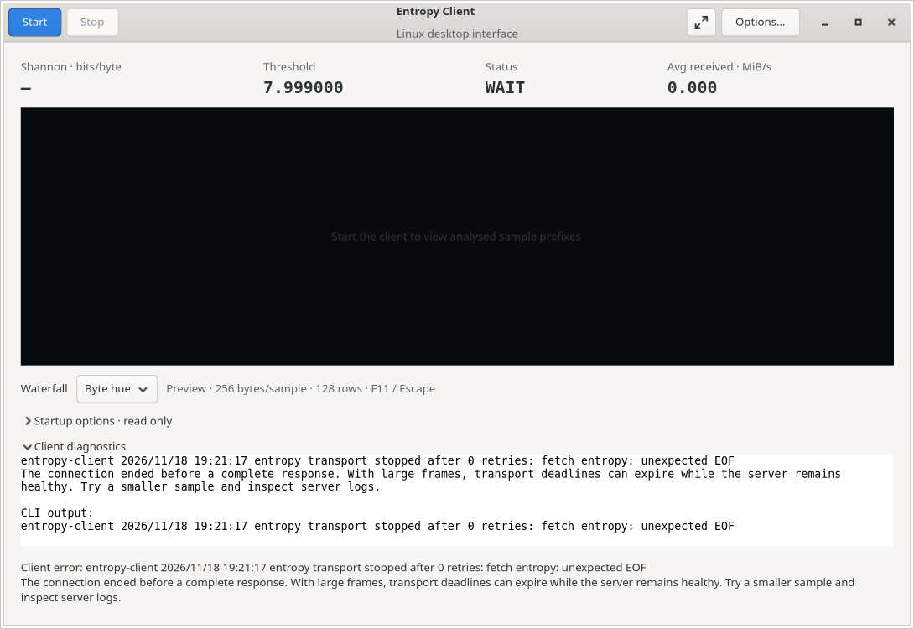

# Desktop GUI validation and large-payload observations

## Load investigation, 18 November 2026

A Windows user reported a client failure with 32 MiB frames at 100 ms while
the server remained healthy. That failure was **not reproduced** in 24 bounded
native-GTK runs on a Linux x86-64 cloud VM. This is Linux evidence, not a
measurement of that Windows PC or a physical-device qualification.

The runs used Debian 13, GTK 4.18/Cairo under Xvfb, an advertised RDRAND-capable
virtual CPU, loopback networking and one GUI client at a time. Both HTTP and
WebSocket transports were exercised with ChaCha20 and direct experimental
RDRAND output, 8/32 MiB payloads and 100/50 ms intervals. The first 16 cases
analysed a 1 MiB prefix; eight more analysed whole 32 MiB frames. Cases lasted
4–12 seconds. All clients exited successfully and all **173 readiness probes**
were healthy. These short observations are not an endurance or capacity guarantee.

Approximate received throughput for 32 MiB frames:

| Backend / analysis | HTTP, 100 ms | HTTP, 50 ms | WebSocket, 100 ms | WebSocket, 50 ms |
| --- | ---: | ---: | ---: | ---: |
| ChaCha20 / 1 MiB prefix | 296 MiB/s | 328 MiB/s | 312 MiB/s | 464 MiB/s |
| RDRAND / 1 MiB prefix | 221 MiB/s | 224 MiB/s | 259 MiB/s | 256 MiB/s |
| ChaCha20 / full frame | 197 MiB/s | 228 MiB/s | 241 MiB/s | 244 MiB/s |
| RDRAND / full frame | 227 MiB/s | 221 MiB/s | 248 MiB/s | 252 MiB/s |

The nominal rates are 320 MiB/s at 100 ms and 640 MiB/s at 50 ms. Reducing the
interval did not make RDRAND sustain those rates on this host. Generation,
analysis and transport determine the actual rate; a lower achieved frame rate
alone is not an error. The [condensed observations](measurements/desktop-gui-load-2026-11-18.json)
retain counts, durations, sample sizes, readiness observations and machine context.

For a comparable local test, start a loopback-only server:

```sh
entropy-server -device=/dev/urandom -enable-https=false \
  -http=127.0.0.1:8080 -drbg=rdrand-experimental
```

Use `windows-csprng` or `macos-csprng` as the seed source on those platforms.
Direct RDRAND requires native x64 CPU support; use `-drbg=chacha20` for the
software comparison or on unsupported CPUs. In GUI client Options select pull
or push, 33,554,432 bytes, 100 ms, an analysis prefix of 1,048,576 or `0`, and a
finite duration. Repeat at 50 ms while checking server readiness and logs.

## Failure reporting and coverage

The investigation found that the GUI could hide the CLI's actual transport
reason behind a generic exit-status message. The client now opens a bounded,
selectable diagnostics panel on failure and preserves the reported cause.
Specific guidance distinguishes incomplete responses, timeouts, rejected sample
sizes and reported backend/reseed failures. It does not infer a CPU failure
from an EOF or reduce verification/failure policies.

Native tests deliberately inject a truncated response and an HTTP 503 carrying
a backend-failure message. These are **controlled faults**, not observed
RDRAND failures. They verify visible reasons, automatic diagnostics, URL-secret
redaction and continued health of an independent real server. Separate checks
receive and fully analyse an actual 32 MiB frame while keeping the GUI preview
and report history bounded.



Native GTK CI on Linux, Windows, Intel Mac and Apple Silicon additionally
exercises LAB registry/Host/remote-access settings, missing-registry recovery,
invalid-edit rollback, debug listener on/off and shutdown, and Secure/HttpOnly
cookies over verified HTTPS. Windows installer CI covers the real replacement
notice, cancellation, relocation rejection, stale-file removal, reinstall,
Explorer handoff and full GUI use before and after replacing the bundled runtime.

Remaining manual coverage includes Wayland (Linux CI uses X11), mixed-DPI and
multi-monitor desktops, native file-picker permission/accessibility edge cases,
and long GUI runs on users' physical hardware. Installer disk-full/reboot/file-lock
recovery and physical RNG/driver behavior are not established by the small
upgrade fixtures or these loopback load runs. No GUI coverage percentage is
claimed from this functional matrix.
