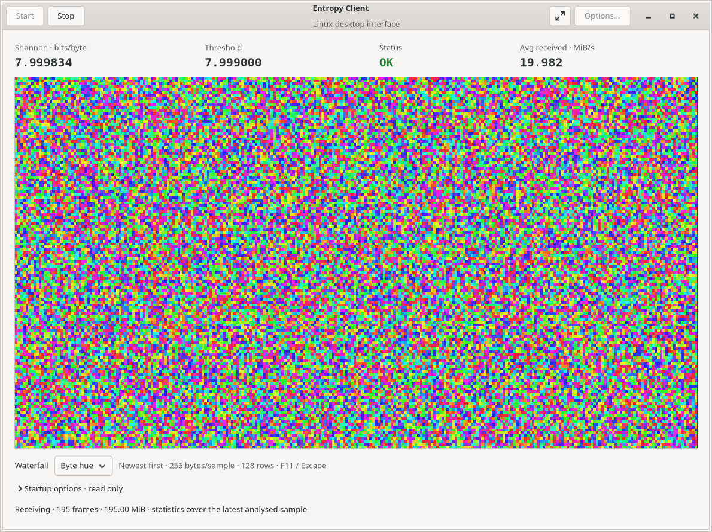
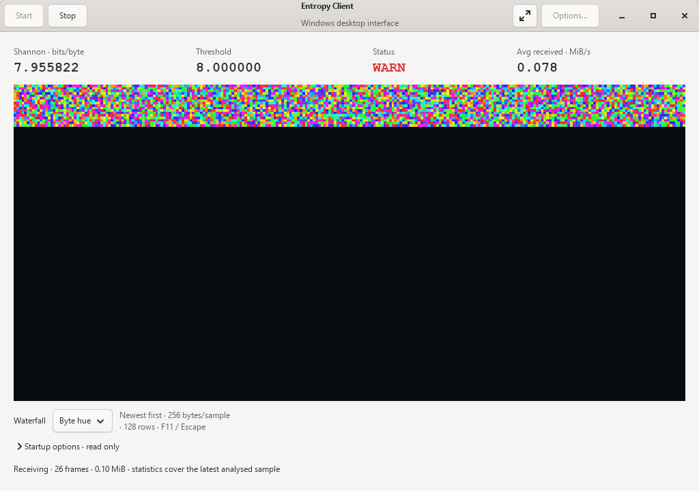
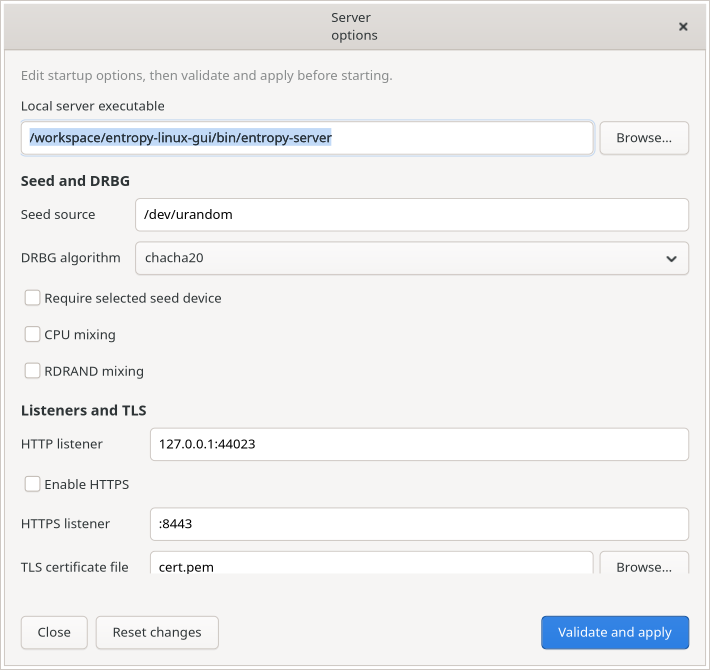

# Desktop GUI

The GTK 4/PyGObject desktop interface supports Linux and Windows x64. It runs
from source, with Python/GTK dependencies separate from the Go binaries. The
command-line and web interfaces remain independently usable.

Both windows provide an **Options** editor for common startup settings and
**Start/Stop** for a process launched by that window. The server window also
has **Connect/Disconnect** for observing an existing local or remote server.
It does not install or control an operating-system service.

| Window | Control | What it does |
| --- | --- | --- |
| Server (`--view server`) | **Start/Stop**, at the top left | Start or stop the selected local server owned by this window. |
| Server | **Connect/Disconnect** | Monitor the server at the health URL, independently of the local process. |
| Client (`--view client`) | **Start/Stop**, at the top left | Run the selected client and display its statistics and waterfall. |
| Both | **Options** | Choose a local executable and edit startup options while its owned process is stopped. |

| Server — local process and live health | Client — live waterfall |
| --- | --- |
| [](images/desktop-gui-server-live.webp) | [](images/desktop-gui-client-live.webp) |

These Linux captures use an OS-seeded local server and a WebSocket client.
Select an image for the full-size view.

## Source and executable versions

The editable Options and local-server controls described here require the
source revision containing this guide and its complete `tools/desktop-gui`
directory. Obtain a checkout of that revision, or use GitHub's **Code →
Download ZIP** on the branch or release you are viewing. Keep the launcher and
its neighboring Python modules together.

The [v2.2.0 source ZIP](https://github.com/fantuz/entropy-service/archive/refs/tags/v2.2.0.zip)
contains the earlier GUI: it can monitor a server and run the client, but its
server settings are read-only and it has no Options editor or local-server
Start/Stop controls. Its separate
[Windows x64 binaries ZIP](https://github.com/fantuz/entropy-service/releases/download/v2.2.0/entropy-service_2.2.0_windows_amd64.zip)
contains compatible CLI executables, which can also be used with the updated
GUI source. The source and binaries are separate downloads; CLI archives do
not contain the Python GUI.

## Linux setup

From the source directory, install the desktop dependencies and build both
utilities with the Go version required by `go.mod`:

```sh
sudo apt install python3-gi python3-gi-cairo python3-cairo gir1.2-gtk-4.0
make build
```

Use the distribution's Python: virtual environments can hide PyGObject even
when its OS package is installed. Ubuntu 24.04 and Debian 13 are the initial
Linux targets. GTK supports X11 and Wayland; native Linux CI uses X11 under
Xvfb. `--help` does not require GTK or a graphical session.

Open the server GUI for loopback HTTP testing:

```sh
/usr/bin/python3 tools/desktop-gui/entropy-gui --view server \
  --health-url=http://127.0.0.1:8080 -- \
  -device=/dev/urandom -require-device=true -enable-https=false \
  -http=127.0.0.1:8080
```

Click **Start** to launch its local server, then **Connect** to check that
endpoint's live health. If a server is already running there, use **Connect**
without starting another one, or select different listener settings in
**Options**.

In a second terminal in the same source directory, open the client GUI:

```sh
/usr/bin/python3 tools/desktop-gui/entropy-gui --view client -- \
  -mode=pull -url=http://127.0.0.1:8080/v1/data/random \
  -slice=1048576 -refresh=250ms -analysis-interval=250ms
```

Click **Start** at the top left to receive samples. **F11** toggles the
waterfall's fullscreen view and **Escape** returns. An installed executable
can be selected with `--server-binary /usr/bin/entropy-server` or
`--client-binary /usr/bin/entropy-client` before `--`, or in **Options**.

## Windows setup

### Download the GUI source and the executables

Obtain the updated GUI source as explained under
[Source and executable versions](#source-and-executable-versions), and download
the [Windows x64 binaries ZIP](https://github.com/fantuz/entropy-service/releases/download/v2.2.0/entropy-service_2.2.0_windows_amd64.zip).
Extract the entire source archive. Its directory must contain `go.mod`, `cmd`,
`docs/desktop-gui.md` and `tools`. You can rename it to `entropy-service-gui`
to match the examples below.

Create a `bin` directory inside it and copy `entropy-server.exe` and
`entropy-client.exe` from the binaries ZIP into `bin`:

```text
entropy-service-gui/
  bin/
    entropy-server.exe
    entropy-client.exe
  tools/
    desktop-gui/
      entropy-gui
      entropy_gui/
```

`entropy-gui` is a Python launcher **without a filename extension**. Keep its
neighboring `entropy_gui` directory; downloading the launcher alone is not
sufficient. Using released executables does not require Go. They may also
remain elsewhere if selected explicitly as shown in
[binary-path troubleshooting](#troubleshooting-startup-inspection).

### Install the desktop dependencies

Install [MSYS2](https://www.msys2.org/) and open its **UCRT64** terminal:

```sh
pacman -Syu
```

Restart the terminal if the update asks you to, then install the native
GTK/Python bindings:

```sh
pacman -S --needed mingw-w64-ucrt-x86_64-gtk4 \
  mingw-w64-ucrt-x86_64-python-gobject mingw-w64-ucrt-x86_64-python-cairo
```

Use UCRT64's `python` for the GUI commands so its GTK DLLs and bindings match.
A [bundled Windows GUI installer](windows-gui-installer.md) is available through the dedicated installer workflow. The manual source setup below remains supported.

### Start the server GUI

In **MSYS2 UCRT64**, enter the extracted source directory. Replace `yourname`
and adjust the location if you extracted elsewhere:

```sh
cd /c/Users/yourname/Downloads/entropy-service-gui
ls tools/desktop-gui

python tools/desktop-gui/entropy-gui --view server \
  --health-url=http://127.0.0.1:8080 -- \
  -device=windows-csprng -enable-https=false -http=127.0.0.1:8080
```

The `ls` command should show `entropy-gui` and `entropy_gui`. Click **Start**
at the top left to launch the local server, then **Connect** for live health.
This example uses the Windows OS CSPRNG and loopback HTTP with HTTPS disabled
for initial testing. If another server already occupies that address, monitor
it with **Connect**, or choose a different listener in **Options** before
starting a local server.

### Start the client GUI

In another **MSYS2 UCRT64** terminal in the same source directory:

```sh
python tools/desktop-gui/entropy-gui --view client -- \
  -mode=pull -url=http://127.0.0.1:8080/v1/data/random \
  -slice=1048576 -refresh=250ms -analysis-interval=250ms
```

Click **Start** at the top left of the **client** window to receive samples
and display the waterfall. It becomes enabled after local startup inspection
succeeds. **F11** toggles fullscreen and **Escape** returns. Use **Options**
while the client is stopped to change its connection and sampling settings.

### Windows interface

The native Windows server options editor and running client waterfall:

[](images/desktop-gui-windows-server-options.png)
[](images/desktop-gui-windows-client.png)

### Monitor a separately started server

A server can instead be started from **PowerShell**:

```powershell
cd "$env:USERPROFILE\Downloads\entropy-service-gui"
.\bin\entropy-server.exe -device=windows-csprng -enable-https=false -http=127.0.0.1:8080
```

Keep that terminal running, then launch the server GUI using the UCRT64
command above and click **Connect**. The GUI's **Stop** button does not stop
that separately launched process; it only controls a server started by its
own **Start** button. The v2.2.0 GUI source supports this monitoring workflow
and the client workflow, with `entropy-service-2.2.0` as its extracted folder.

### Build the executables instead

As an alternative to copying the released executables, install the Go version
required by `go.mod` and run from the source directory in PowerShell or CMD:

```powershell
go build -o bin/entropy-server.exe ./cmd/entropy-server
go build -o bin/entropy-client.exe ./cmd/entropy-client
```

Then follow the same GUI launch steps. Make and a C compiler are not required
for these Go builds.

## Edit startup options

The LAB/debug editor additions, **Edit features…** shortcut and expanded client
diagnostics are available from v2.7.0. Use the matching source revision or
bundled installer for these controls.

Click **Options** while the process owned by that window is stopped. Select
its local executable with **Browse**, change the fields you need, then use
**Validate and apply**. Validation runs the CLI's `-describe-json` path and
returns before opening runtime devices, listeners or output destinations.
Invalid settings stay in the editor with an explanation. Successful edits
become the options used by the next **Start**; they do not reconfigure a
running process or the server being monitored at the health URL.

The checkboxes under **Validated startup features** show the last validated
startup values. Select **Edit features…** beside them to configure LAB, debug
and cookie options; these controls also require the GUI-owned server to be
stopped. The same editor is used on Linux, Windows and macOS.

| Client options | Server options |
| --- | --- |
| Pull/push transport and separate HTTP/WebSocket endpoints | Seed source and DRBG |
| Bytes per response and analysed prefix size | HTTP/HTTPS listeners and HTTPS enablement |
| Request/analysis intervals and Shannon threshold | Existing TLS certificate and private-key paths |
| Duration, retries and retry delay | Reseed interval, maximum age, policy and reseed bytes |
| Waterfall mapping: byte hue, RGB or grayscale | Source timeout, maximum sample size, required device and optional CPU/cookie flags |
| Up to 32 MiB per response; 0 analyses the full frame | LAB registry file, trusted Host names, remote-access opt-in, bridge and memory limits |
| Automatically opened failure diagnostics | Local debug/pprof listener and HTTPS browser-preference cookies |

[](images/desktop-gui-client-options.png)
[](images/desktop-gui-server-options.png)

`pull` uses the HTTP endpoint and `push` uses the WebSocket endpoint. The GUI
keeps the CLI's TLS certificate and hostname verification. For Windows client
trust, follow [client TLS guidance](client-tls.md); selecting a server's
private key is not a client trust mechanism.

For HTTPS serving, select existing certificate/key material and provision it
as described in [TLS certificates](tls-certificates.md). The Options editor
does not generate a certificate or read its private-key contents. An
inspection success confirms valid option syntax, not that files, listeners
or hardware are available; those are checked when the server actually starts.

**LAB sources and access** selects an operator-prepared registry JSON file.
Clear its path to disable registered sources; browser-local LAB tools remain
available. Registry contents are read only at server startup. Registered
bridges stay loopback-only by default; additional trusted Host names do not
enable remote peers. Remote access is a separate explicit option. Hardware
adapters still follow each OS's supported capabilities; choosing a registry
does not add a missing Windows/macOS device driver.

**Enable local debug / pprof listener** starts the existing debug service at
`http://127.0.0.1:6060/debug/pprof/` with the owned server. It is available on
Linux, Windows and macOS and remains loopback-only. A port already in use is
reported in local server logs. Stop closes that listener with the owned process.

**Remember HTTP preferences** controls Secure, HttpOnly browser cookies for
byte/word counts, refresh and word language. Use HTTPS for browser persistence.
It does not persist GUI startup options or change a separately monitored server.

### Large samples and client failures

**Bytes per response** accepts up to 33,554,432 bytes (32 MiB), matching the
server's default maximum; the operator can configure a lower limit. The 2 MiB
receive default and 1 MiB analysis prefix are configurable defaults, not GUI
ceilings. Set **Analysis prefix bytes** to `0` for whole-frame analysis.
The waterfall shows a bounded preview of each analysed sample, keeping GUI
memory independent of payload size.

An interval of 100 ms requests up to 10 frames/s; it cannot guarantee
320 MiB/s for 32 MiB frames. Generation, analysis and transport may run slower,
especially with direct RDRAND output. The server can remain healthy while an
individual connection times out or closes. Readiness does not measure the
client connection or promise a requested throughput.

On failure, the client reveals the reported cause and opens **Client
diagnostics**, with bounded, selectable CLI output and URL credentials/query
values hidden. EOFs/connection resets, timeouts, rejected sample sizes and
reported CPU-backend failures have different guidance. Check server logs and
compare a smaller sample before attributing a problem to the GUI. An explicitly
reported sticky RDRAND hardware failure requires an operator restart; changing
refresh does not reset it. See the [load checks and coverage notes](desktop-gui-validation.md)
for measured results and the remaining qualification gaps.

Additional CLI arguments supplied after the launcher's `--` are retained.
Editing one supported field replaces that flag without discarding unrelated
flags or changing untouched endpoint query parameters. Options are held for
this GUI session; they are not a saved configuration file. GUI raw exports
and device writes remain unsupported; use the CLI for deliberate exports.

Saved endpoint credentials, query parameters and fragments are hidden in the
editor. Leaving that field unchanged preserves the full original URL. Editing
an endpoint replaces the complete URL, including any hidden components.

## Troubleshooting startup inspection

**No configuration file is required.** Arguments after the launcher's `--`
separator describe the requested CLI invocation. To display those settings,
the GUI briefly runs the selected local executable with `-describe-json`,
which returns before opening runtime devices or listeners. It does not read
the command line of an already-running process or infer its startup options
from the health URL. Use the same CLI arguments after `--` if you want the
requested settings to match the server you started separately.

`Configuration could not be read: [WinError 2]` on Windows, or
`[Errno 2] No such file or directory` on Linux, normally means the inspection
executable could not be found. A green **READY** health panel can still appear:
network health and local startup inspection are separate operations.

By default, the launcher selects the source directory's `bin/entropy-server`
and `bin/entropy-client`, with `.exe` on Windows. These paths are relative to
the launcher location, independently of the terminal's working directory or
where you started the running server. It does not select another version from
`PATH` automatically.

The executables can be stored in another directory. Supply their paths
explicitly **before** `--`; moving or restarting an already-running server is
not required. Use native Windows paths with forward slashes and quote paths
containing spaces. For example, in UCRT64:

```sh
python tools/desktop-gui/entropy-gui --view server \
  --server-binary "C:/Users/yourname/Downloads/Entropy binaries/entropy-server.exe" \
  --health-url=http://127.0.0.1:8080 -- \
  -device=windows-csprng -enable-https=false -http=127.0.0.1:8080

python tools/desktop-gui/entropy-gui --view client \
  --client-binary "C:/Users/yourname/Downloads/Entropy binaries/entropy-client.exe" -- \
  -mode=pull -url=http://127.0.0.1:8080/v1/data/random
```

An installed Linux executable can be selected in the same way:

```sh
/usr/bin/python3 tools/desktop-gui/entropy-gui --view server \
  --server-binary /usr/bin/entropy-server --health-url=http://127.0.0.1:8080 -- \
  -device=/dev/urandom -enable-https=false -http=127.0.0.1:8080

/usr/bin/python3 tools/desktop-gui/entropy-gui --view client \
  --client-binary /usr/bin/entropy-client -- \
  -mode=pull -url=http://127.0.0.1:8080/v1/data/random
```

If the file exists but the error mentions an unknown `-describe-json` flag,
use matching v2.2.0-or-newer source and executable versions. A CLI option
validation error should be corrected in the arguments after `--`; creating a
configuration file does not resolve a missing executable or invalid option.

## Live server health

In the server view, enter an existing server's base URL and press **Connect**.
`--health-url` prepopulates that field; it does not start polling automatically.
The suggested URL comes from the requested listener settings, with wildcard
bind addresses replaced by loopback. It is a suggestion, not evidence that a
listener exists. Port-zero/dynamically assigned listeners need an explicit URL.

The GUI reads `/live` and `/ready` approximately every two seconds. It shows:

- Selected HTTP/HTTPS endpoint reachability and process liveness.
- Actual readiness, observed DRBG and seed source.
- Seed age, reseed-failure count and whether generation is currently allowed.
- The last observation time and any connection or verification failure.

HTTP 503 from `/ready` is a valid **DEGRADED** response. A continuing generator
can be degraded while generation remains allowed; a stop-policy failure can
pause generation. The GUI displays the server's reported values without
turning a readiness failure into a transport failure. **Disconnect**, failed
requests and stale observations clear current green status and live values.
Polling does not generate entropy samples or change server configuration.

“Selected listener” describes the endpoint being checked. The GUI does not
claim that every configured HTTP, HTTPS or debug port is reachable. A remote
health target can belong to a different instance from the startup invocation
shown below it; those sections are deliberately labelled separately.

HTTPS uses certificate and hostname verification. Supply an additional trusted
CA or a deliberately provisioned self-signed server certificate when needed:

```sh
/usr/bin/python3 tools/desktop-gui/entropy-gui --view server \
  --health-url=https://localhost:8443 --health-ca=/path/to/cert.pem
```

On Windows, use UCRT64 `python` and an accessible certificate path. See
[TLS provisioning](tls-certificates.md). There is no insecure verification
switch or automatic HTTPS-to-HTTP fallback. Redirects and URL credentials,
query parameters and fragments are rejected. Existing proxy environment
settings are honored. Health responses are bounded to 64 KiB, one polling
worker runs at a time, and late responses cannot restore status after a
Disconnect or target change.

System trust and the selected CA are loaded once per Connect; reconnect to
reload them after a trust-store or CA-file change. IPv6/IPv4 connection attempts
use bounded, staggered fallback, with unused sockets closed after a successful
connection. Each of `/live` and `/ready` has its own two-second network budget;
trust-store initialization does not consume it. Both requests run sequentially
inside the single polling worker.

OS DNS resolution and local certificate loading can take longer;
Disconnect clears the displayed state immediately, while reconnect waits for
the previous worker to finish instead of accumulating background lookups.

## Process controls and shutdown

The requested settings summary is separate from observed health. Both binaries
accept `-describe-json`, returning one schema-version-1 object with
`live: false` before runtime I/O. The summary's feature indicators describe
requested settings; they do not prove successful runtime checks. “Certificate
paths supplied” does not mean those files exist or are trusted. TLS paths,
registry contents and client URL credentials/query strings are omitted from
CLI descriptions.

**Server:** **Start** launches the selected local CLI with the applied startup
options. Its bounded log view shows startup failures and shutdown output.
**Stop** affects only that process. **Connect** independently polls the health
URL, which can point to a different local or remote server. Starting a local
server does not silently replace an unrelated health target. The GUI does not
control systemd, Windows services or processes started elsewhere.

**Client:** **Start** runs the selected CLI using its transport, TLS
verification and analysis. Shannon and threshold use six decimal places;
**OK** is green and **WARN** is red. Throughput is the cumulative average in
MiB/s. Choose byte hue, RGB or grayscale. **F11** toggles fullscreen and
**Escape** returns. Completion or failure restores the status display while
retaining the last sample for inspection.

**Stop** and window close stop and reap only the process owned by that window,
while draining its output. Linux uses SIGTERM; Windows creates an owned
process group and sends targeted CTRL_BREAK. A private hidden console supplies
Windows control delivery if no console exists; an existing console is
preserved. Forced termination is a bounded fallback and is reported honestly.
A separately started server or operating-system service receives no stop
request from these controls.

**Ctrl+C** in the GUI's launch terminal also closes the GUI and cleans up its
owned process and health polling, with exit status 130 and no Python
traceback. Windows also accepts **Ctrl+Break**. Normal window close returns
exit status 0.
Keep a separately started server in its own terminal as shown above.

`--server-binary` selects the local CLI used for server inspection and local
**Start**. It does not select or replace the server at the health URL.
`--client-binary` selects the local CLI inspected and launched by the client
window. Its remote server address is `-url` for pull or `-wsurl` for push after
`--`. Both executable options can be omitted when the files are in the source
directory's `bin` folder. Windows batch/command scripts are rejected. The GUI
manages headless/report flags for the client. Certificate trust for client
acquisition follows [the existing client guidance](client-tls.md).

## Data and performance boundaries

Explicit `-report-waterfall` adds `settings.report_waterfall: true` and a
base64 `waterfall_prefix_base64` to analysed JSONL samples. Each contains at
most 256 raw bytes, also bounded by the analysed sample length. It requires
`-report`; default reports remain statistics-only. GUI prefixes travel through
a local pipe and remain in memory until replaced; the GUI does not save them.

Client history is limited to 128 rows (32 KiB of raw prefixes), report records
to 64 KiB and stderr history to 8 KiB. The server log is limited to 64 KiB.
Each owned process has one bounded pipe pump;
GTK checks for updates at most 20 times per second. The Windows pipe adapter
uses Win32 pipe readiness rather than socket-only selectors. Rows arrive at
the CLI's analysis cadence. A cached raster scales to the window, so larger
screens do not request larger raw samples or unlimited history. Painting and
optional prefix encoding add work to a GUI run; ordinary CLI runs do not
allocate prefix copies for this option.

Shannon **OK** is an empirical threshold assessment, not cryptographic or
physical-entropy certification.

## Validation and platform support

```sh
python3 -m unittest discover -s scripts -p 'test_desktop_gui*.py'
python3 -m unittest discover -s scripts -p 'test_desktop_gui_options.py'
python3 -m unittest discover -s scripts -p 'test_desktop_gui_server.py'
python3 -m unittest discover -s scripts -p 'test_gui_health.py'

# Linux native integration; build both binaries first.
sudo apt install xvfb xauth dbus-x11
xvfb-run -a dbus-run-session -- /usr/bin/python3 scripts/test_desktop_gui_gtk.py \
  --server bin/entropy-server --client bin/entropy-client --artifacts /tmp/entropy-desktop-gui

# Windows UCRT64, after building the native Go executables.
python scripts/test_desktop_gui_gtk.py \
  --server bin/entropy-server.exe --client bin/entropy-client.exe --artifacts gui-artifacts/windows
```

CI exercises native GTK windows on Linux and Windows, real CLI acquisition,
option editing, live health, process cleanup and terminal interruption,
alongside the CLI/browser regression suites. Fullscreen geometry and native
Wayland/HiDPI behavior can depend on the desktop compositor. The
[Windows installer](windows-gui-installer.md) bundles the private runtime; native
[Windows Service commands](windows-service.md) are separate from GUI process
controls. macOS, signing and GUI integration with operating-system services
remain follow-ups.

The server's Output backend selector also offers `rdrand-experimental` for
explicit CPU experiments. It requires native x64 and advertised RDRAND support;
the CLI rejects it on unsupported hosts. This mode has CPU-only output trust,
no software fallback and a restart-required failure latch. See the
[direct CPU backend guide](experimental-rdrand.md) before selecting it.

macOS Intel and Apple Silicon use the same interface through the
[Homebrew launcher](macos.md#homebrew-gui).

## Server limits and acquisition performance

Client Options now includes **Server capability discovery**, **Adaptive HTTP pull
pacing**, and its maximum interval. Start checks advertised operator limits
before acquisition; oversized requests report the actual server maximum without
changing the requested sample. Discovery is automatic for recognized routes,
optional for legacy/custom servers, and remains separate from offline validation.

**Connection & performance** displays discovery results, requested/effective and
average received FPS, receive/analysis/output timings and pacing status. Collapse
it to give the waterfall more space. Fullscreen hides it. Older CLI reports can
omit this information. See [the shared CLI/GUI guide](client-capabilities-performance.md)
for interpretation, compatibility and the HTTP-only adaptive policy.
