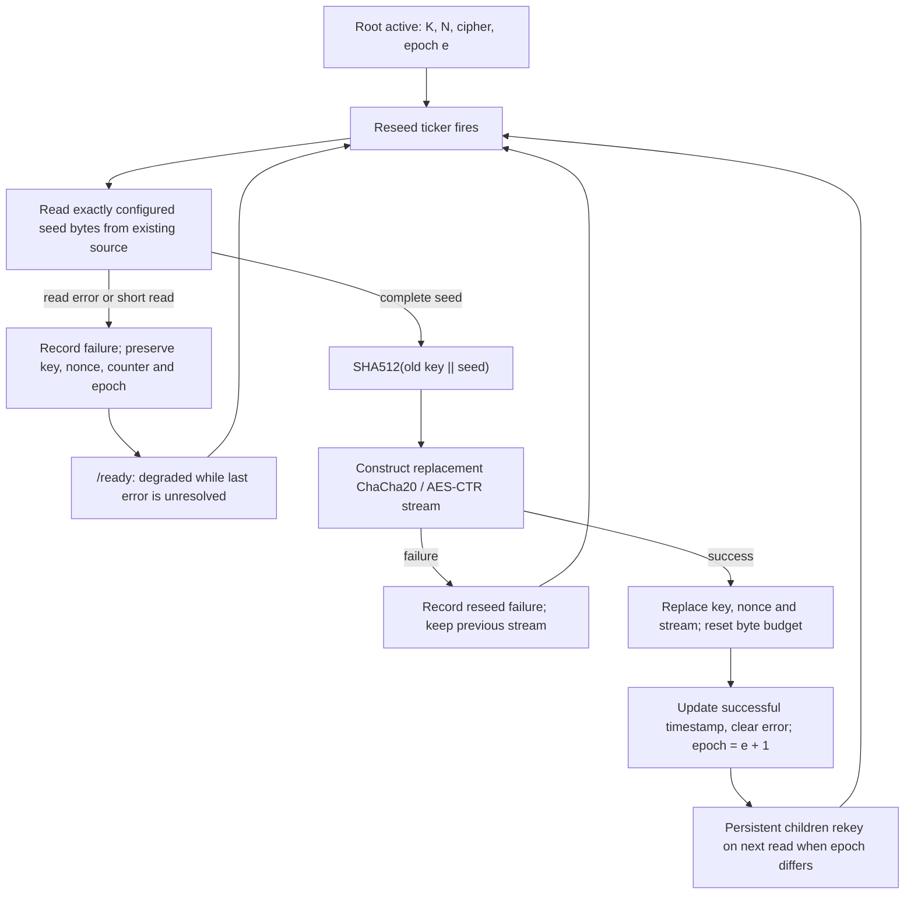

# DRBG construction specification (implementation baseline)

> **Status:** descriptive specification of the current Entropy Service
> construction, reviewed against `main` at `b183df363b3e75cd9863a0a9a24c28bb68720fd9`.
> **Not** a proof of security, certified DRBG design, SP 800-90A CTR_DRBG,
> independent audit, or promise that the source has a measured entropy rate.
> This document intentionally does not change cryptographic algorithms.

## Purpose and vocabulary

Entropy Service **distributes pseudorandom bytes**, refreshed with input from
an operator-selected source. It is not a 1:1 forwarder of physical entropy.

- `S0`: startup seed, exactly 64 bytes acquired with `io.ReadFull`.
- `Si`: later reseed material of `buffer-reseed` bytes (default 256).
- `H`: SHA-512, output of 64 bytes.
- `K`: 32-byte stream-cipher key.
- `N`: 16-byte nonce/counter material (12 bytes used for ChaCha20).
- `G(K, N)`: a cipher-stream instance whose output is keystream bytes from
  ChaCha20 or AES-256-CTR, not an approved NIST DRBG algorithm.
- `e`: root reseed epoch, initially zero and incremented only after an
  admitted successful root reseed.

These names describe **byte-level computation**, not formal security claims.

## Source acquisition

`openEntropySource` opens and checks the configured character device.
Optional startup fallback can select `/dev/urandom` or Go `crypto/rand`;
`-require-device=true` rejects open/selection failures. The opened reader can
be supplemented with RDSEED/RDRAND bytes by optional CPU mixing. Neither
character-device classification nor CPU mixing measures min-entropy.
The selected reader remains open for subsequent reseeds; a failed runtime
read does **not** trigger startup fallback again.

## Root initialization

```text
S0 = io.ReadFull(source, 64 bytes)       # must succeed
D0 = SHA512(S0)
K0 = D0[0:32]
N0 = D0[32:48]
Root = G(K0, N0)
counter = 0, reseedEpoch = 0
```

For ChaCha20, the cipher uses `N0[0:12]`; for AES-256-CTR, the
entire 16-byte initial counter block is used. No nonce is transmitted to
clients by the generation API. Explicit cleanup of application-owned seed,
digest and temporary key/nonce buffers has been added, but cannot guarantee
erasure of opaque cipher state or Go runtime copies.

## Generate

A locked `DRBG.Read(p)` fills `p` with the current stream keystream and
advances its internal stream position. Reads are serialized per DRBG.
A configured implementation ceiling of `2^38` bytes (256 GiB) per key is
enforced; a read crossing this ceiling returns an error *without* writing the
destination. This ceiling is a usage rule, not a security-strength proof.

The stream is deterministic once its current key, nonce and position are
known. HTTP `/v1/data/random` allocates a distinct derived child for each
request; WebSockets allocate a private child lazily on first output and
refresh it on epoch change or key-output exhaustion. Some legacy/media routes
still use the root directly: the root is **not derivation-only**.

## Child derivation

```text
C = Root.Read(64 bytes)      # consumes ordinary root keystream, under lock
DC = SHA512(C)
KC = DC[0:32]
NC = DC[32:48]
Child = G(KC, NC)
```

Each derived child inherits the root algorithm. The derived 64-byte seed is
cleared promptly after use. No explicit domain-separation label or unique
client identity is included in the derivation. Separation is **conditional**
on root state secrecy, secure stream-cipher behavior, and sufficient initial
seed unpredictability; it is not a guarantee of certified multi-tenant
isolation.

For a persistent `ConnectionReader`, derivation of `C` and reading of
`e` occur while holding the root mutex. The child refreshes its own stream
when its remembered epoch differs or its output budget is exhausted. A child
refresh **does not** itself read fresh entropy from a hardware device.

## Root and child reseeding (existing construction)

For a root generator with old key `Kold`:

```text
Di = SHA512(Kold || Si)      # concatenation of 32-byte key then seed
Knew = Di[0:32]
Nnew = Di[32:48]
newStream = G(Knew, Nnew)
# Only once cipher construction succeeds:
replace old key/nonce/stream with Knew/Nnew/newStream
reset generated byte counter
update last successful reseed timestamp and total
clear unresolved reseed error
increment reseedEpoch
```

Reseeding a child from a 64-byte root-derived seed uses the **same
construction with the child's existing key**. The implementation currently
uses streaming SHA-512 writes for `Kold` and `Si`; its digest matches the
original concatenation and is regression-tested.

### Reseed state-transition diagram



**Important:** `/ready` and `/live` have different semantics. A reseed error
or stale last-successful-reseed timestamp can make `/ready` return 503 while
`/live` remains 200 and the root/child streams **continue emitting
deterministic bytes**. A blocked hardware read may not be cancellable by the
Go context; this code currently has no source-level read timeout. These
failure policies are separate from any future fail-closed mode.

## Invariants worth testing

1. A failed or incomplete seed read never updates the key, nonce, epoch,
   timestamp or successful-reseed counter.
2. An invalid seed size is rejected **without** claiming a successful reseed.
   The legacy code needs explicit zero/negative input validation; this is
   addressed separately from this documentation/benchmark branch.
3. The reseed digest matches `SHA512(Kold || Si)` exactly.
4. A successful reseed atomically replaces the cipher state under the DRBG
   mutex; a child sees an epoch paired with one derived seed.
5. A child cannot produce bytes after it has been closed.
6. Output-length limits apply independently to each key/stream.
7. Source unavailability alone does not imply compromised DRBG output;
   continued output does not imply fresh physical entropy.

## Security interpretation and caveats

- SHA-512, ChaCha20, and AES-256 are well-studied *primitives*; this custom
  composition has no external security proof and is not NIST CTR_DRBG.
- Reusing the same old key in both the stored state and reseed hash does not
  by itself establish forward secrecy, prediction resistance, or
  post-compromise recovery. Those require an explicit model and analysis.
- The cryptographic state cannot be assumed irrecoverable from a process dump:
  libraries retain expanded keys and Go may make copies.
- The first 64 bytes do not guarantee 512 bits of *entropy*. Source min-entropy,
  and the treatment of hardware faults, must be assessed separately.
- The byte-oriented derivation has no explicit source/key/child domain labels,
  and the root is also used as a direct output stream on some endpoints.
- Formal changes to key derivation, domain separation, or reseed transitions
  will change deterministic outputs and must come only after a separate review,
  independent test vectors, explicit migration/version strategy, and an
  operator decision.

See [security boundaries](security-boundaries.md),
[architecture review](architecture-review.md),
[NIST SP 800-90A](https://csrc.nist.gov/pubs/sp/800/90/a/r1/final), and
[NIST SP 800-90B](https://csrc.nist.gov/pubs/sp/800/90/b/final).
