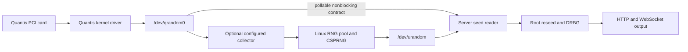

# Hardware drivers, source layers and validation

The Go server's platform adapters read seed material; kernel drivers bind the
physical device. Driver compilation, device detection, a successful sample,
cancellation and entropy assessment are separate checks. This guide records
evidence and an implementation plan without treating one check as all of them.

## Historical card and official packages

Maintainer-supplied photographs show a legacy **Quantis-PCI** board with one
populated module. Historical Linux output records:

```text
quantis_pci driver version: 2.9
PCI vendor/device:        179a:0001
core version:             0x040a1201
character device:         /dev/qrandom0
```

The accompanying EasyQuantis **20.2.3** screenshot recognizes `Quantis PCI #0`
and reports approximately **4.0 Mbit/s**. The screenshots do not identify the
running kernel version or establish the current server's I/O contract.

The vendor's public [Quantis Software page](https://www.idquantique.com/random-number-generation/products/quantis-software/)
links these downloads. Anonymous HTTPS archive reads were checked on 2026-11-11:

| Package | Family and contents | Vendor download |
| --- | --- | --- |
| 18.03.08 | Legacy distribution | [ZIP](https://documentsidq.s3.eu-central-1.amazonaws.com/Quantis_products/Quantis-v18.03.08.zip) |
| 20.2.3 `pci-module` | Legacy PCI/PCIe, Linux sources and Windows x86/amd64 drivers | [ZIP](https://documentsidq.s3.eu-central-1.amazonaws.com/Quantis_products/pci-module-20.2.3.zip) |
| 20.2.4 `pcie-chip` | New-generation PCIe, Linux and Windows; changelog dated 1 April 2022 | [ZIP](https://documentsidq.s3.eu-central-1.amazonaws.com/Quantis_products/pcie-chip-20.2.4.zip) |
| 24.4.2 | New-generation PCIe Linux drivers, libraries, EasyQuantis sources and samples | [tar.gz](https://ftp.idquantique.com/ftp_public/quantis-qrng/linux/pcie-chip-linux-24.4.2.tar.gz) |

The FTP-hosted file works over HTTPS with its complete filename; directory
listing returned 403. A distinct 22.x package has not been verified. Package
20.2.4's 2022 release date should not be confused with a 22.x version. Package
and component versions differ: the legacy 20.2.3 ZIP contains a Windows INF
with `DriverVer = 04/01/2010, 5.0`.

## Linux patch history and a source backup

Unmodified old vendor sources generally need adaptation for later kernels.
The maintainer's [18.x gist](https://gist.github.com/fantuz/8deb4eeb6963645bfb9ccd2bbe9116a7)
and [20.x gist](https://gist.github.com/fantuz/d45080e87e438ded307979b3402f9950)
record Linux 5.x changes: the build wrapper accepts 5.x, `access_ok()` uses the
new signature, and procfs gets `proc_ops` on kernels from 5.6. Character-device
operations remain a separate `file_operations` table.

Treat these as historical porting notes. The 18.x gist includes repeated diffs
and shell transcript text. Normalize the relevant patch series and check it
against the exact source release before applying it. Neither gist supplies a
current-kernel build matrix or adds `.poll`/`O_NONBLOCK` behaviour.

Both change `ioremap_nocache()` to **`ioremap_cache()`**. That changes semantics:
cacheable mapping is unsuitable for side-effecting device registers/FIFOs.
Preserve the original uncached register access, normally with `ioremap()` or
an appropriate PCI mapping helper, and audit accesses/barriers against the
hardware. See the [Linux 6.12 device-I/O mapping documentation](https://docs.kernel.org/6.12/driver-api/device-io.html#ioremap-and-ioremap-like-functions).
Modern ports also need correct procfs status handlers and must handle the
`class_create()` owner-argument removal in Linux 6.4. Distro backports make a
build against the actual target headers essential.

For safekeeping, a small, version-pinned **community legacy-driver source** is
available from [tcdent/quantis-pci](https://github.com/tcdent/quantis-pci/tree/00fffc49306d748b34a95c14769b30908ef5985f).
Its source header matches `179a:0001`; its README's `1ae8` vendor text differs
from that header and is not used as identity evidence here. It contains modern
procfs, uncached mapping and 6.4+ class adaptations, plus probe/remove cleanup
fixes. It is a community port of the older 2.6 driver, not the exact vendor 2.9
binary from the historical screenshot.

[Download the pinned source archive](https://codeload.github.com/tcdent/quantis-pci/tar.gz/00fffc49306d748b34a95c14769b30908ef5985f)
and save its checksum alongside it:

```sh
curl --fail --location --proto '=https' \
  'https://codeload.github.com/tcdent/quantis-pci/tar.gz/00fffc49306d748b34a95c14769b30908ef5985f' \
  --output quantis-pci-00fffc49.tar.gz
printf '%s\n' '159989355fbfb688c39864846886e1a2b1e14479b07d46bad06cfa31f1f94f16  quantis-pci-00fffc49.tar.gz' | sha256sum --check
tar -xzf quantis-pci-00fffc49.tar.gz
cd quantis-pci-00fffc49306d748b34a95c14769b30908ef5985f/linux
make KERNELVERSION="$(uname -r)"
```

The build needs matching kernel headers, a compatible compiler and the kernel's
build tools, including `pahole` when BTF generation is enabled. This creates
a module for that kernel; it does not install or load it. A portable backup is
source, patches, hashes and build instructions. A prebuilt `.ko` is tied to
kernel/configuration/architecture and signing policy. Preserve the source's
BSD/GPL notices. Keep driver maintenance and any DKMS packaging in its driver
project, separate from the Go application's release.

Compile-only validation on 2026-11-11 built and linked this unmodified snapshot
against Debian **6.12.115+deb13.1-amd64** headers with GCC 14.2.0. Headers were
unpacked in a user-owned directory and their build paths relocated; optional
BTF debug generation was disabled with `CONFIG_DEBUG_INFO_BTF_MODULES=` because
`pahole` was unavailable. The resulting module advertises `179a:0001`. No
module was installed or loaded, and no card was tested. The
[recorded build evidence](https://github.com/fantuz/entropy-service/blob/main/docs/hardware-validation/quantis-pci-linux-build.json)
captures the exact source, compiler, target and qualification limits.

An optional [bounded-read Linux overlay](https://github.com/fantuz/entropy-service/blob/main/drivers/quantis-pci/README.md) now
implements the separate read/readiness contract, with reference-counted open-file
lifetime, uncached MMIO, periodic readiness checks, wait queues and isolated-VM
file-operation tests. It is not installed by the Go application and still needs
physical qualification on the target card.

The **unmodified** community snapshot has **no `.poll` operation and no `O_NONBLOCK`
branch**. Its ability to build or serve a blocking C reader does not establish
direct compatibility with entropy-server's deadline-aware reader. A modern
kernel module and a safe bounded seed reader are distinct deliverables.

## Where the Linux bytes actually come from



The examined legacy PCI driver exposes its own character device and does not
register a Linux `hwrng`. Installing it alone does not feed the OS pool.
A separately configured collector can do that, with an explicit source/health/
entropy-credit policy. `/dev/urandom` remains mixed OS CSPRNG output; reading it
cannot attribute individual bytes to Quantis. The server then generates DRBG
output from its seeds.

Direct `-device=/dev/qrandom0 -require-device=true` requires correct readiness,
nonblocking reads, deadlines and close/error behaviour. The server rejects a
character device without deadline support. Without strict selection an optional
Linux device can fall back to OS seeding, so inspect the reported actual source.
The explicit Quantis PCI/USB selectors remain strict. See [source I/O](source-io.md)
and [hardware probing](hardware-probe.md).

For IDQ and other drivers, validate compilation against target headers first,
then permissions/binding, a complete bounded sample, data starvation, deadline
expiry, recovery, shutdown and supported removal scenarios. Keep hardware and
kernel versions with results. Build tests and healthy-data reads do not test
cancellation. A driver can still block in kernel code despite userspace deadlines.

## Windows PCI: validate the existing adapter

The official legacy ZIP supplies:

- `windows/Drivers/Windows/QuantisPci/QuantisPCI.inf`: model sections for
  `PCI\VEN_179A&DEV_0001` on x86 and amd64, matching the historical card ID.
- `amd64/QuantisPCI.sys`: AMD64 **PE32+**, native subsystem; `x86/QuantisPCI.sys`:
  x86 **PE32**, native subsystem.
- Setup-class GUID `{F2F5F1E5-380E-4194-8FC0-ED5AF63E93DF}`, also present as a
  constant in both drivers and used as the interface GUID in the vendor SDK.
  Class metadata and binary presence alone do not prove runtime interface registration.
- `QuantisPCI.cat`: a PKCS#7 catalog with SHA-1-era certificates, including
  ID Quantique SA. The SYS files have no embedded signature; catalog signing
  needs separate membership and Windows kernel-policy verification.

The inspected archive SHA-256 is:

```text
f088ebb9175592485e9809581b4c8631a4b535c6e4eea0d4f7df6cc0ab56633b
```

This recorded digest identifies the archive examined by this project; it is
not a separately published vendor attestation. The offline repository tool
rechecks identity, PE architecture/subsystem, GUID constants, selected-member
hashes and the archive digest without extracting files or making network calls:

```sh
python3 scripts/inspect_quantis_pci.py /path/to/pci-module-20.2.3.zip --json
python3 -m unittest discover -s scripts -p test_inspect_quantis_pci.py
```

The [recorded reference report](https://github.com/fantuz/entropy-service/blob/main/docs/hardware-validation/quantis-pci-package.json)
was generated against the complete official ZIP and includes member hashes.

Exit 0 means metadata matched, not trusted installation. Read
`matches_reference_sha256` for comparison with the recorded archive. Signature,
catalog member hashes, Windows policy, interface registration, hardware I/O,
cancellation and entropy-quality flags remain **false**. Synthetic fixtures
run in Linux and native Windows CI; no vendor driver is bundled in releases.

On the target Windows host, inspect the catalog with
`Get-AuthenticodeSignature`. With the Windows SDK SignTool available, verify
the catalog-member and kernel policy explicitly, for example from the vendor
`QuantisPci` directory:

```powershell
Get-AuthenticodeSignature .\QuantisPCI.cat | Format-List Status,StatusMessage,SignerCertificate,TimeStamperCertificate
signtool verify /kp /v /c .\QuantisPCI.cat .\amd64\QuantisPCI.sys
```

Record OS build, Secure Boot/HVCI policy and actual tool results. An expired
certificate alone neither proves rejection nor acceptance; timestamps and
Windows policy matter. This archive's INF lists older Windows targets and a
2010 driver version, so modern Windows support is not inferred from the ZIP's
20.2.3 software label. Neither signature command installs or loads the driver.

The [existing `quantis-pci:N` adapter](quantis.md) is the appropriate user-mode
implementation for this legacy interface; a second legacy adapter is not
needed merely because the driver was located. After driver installation on a
real host, use inventory and the explicit probe, then qualify overlapped status
queries, reads, timeout/cancel/drain, repeated use and shutdown. The named-pipe
CI tests establish OS I/O mechanics, not this driver's behaviour. The newer
PCIe/XDMA protocol needs a separate future adapter and hardware qualification.

## ChaosKey: useful USB addition, separate protocol

The [ChaosKey project](https://altusmetrum.org/ChaosKey/) identifies a USB
hardware-noise TRNG. It is not an ID Quantique device. The
[author's `chaosread` source](https://github.com/keith-packard/chaosread/blob/master/chaosread.c)
identifies USB **`1d50:60c6`**, interface zero and these bulk-IN endpoints:

| Endpoint | Meaning in that implementation | Proposed use |
| --- | --- | --- |
| `0x85` | Cooked output | Candidate seed stream after device/descriptor validation |
| `0x86` | Raw samples | Separate lab capture/analysis, not an interchangeable seed stream |
| `0x87` | Flash contents | Firmware data, not entropy |

`chaosread` defaults to **raw**, not cooked; its cooked/binary capture options
are `-c -b`. Refer to its own documentation before using it. Its Linux userspace
implementation can detach the kernel driver, which can affect OS RNG collection;
that behaviour should not be copied into an automatic seed-source open.

The Linux driver exists in [v4.1](https://github.com/torvalds/linux/blob/v4.1/drivers/usb/misc/chaoskey.c)
and registers with `hwrng`. Active-source selection and kernel/collector policy
determine pool use; inspect `/sys/class/misc/hw_random/rng_available` and
`rng_current`. In the examined [v6.12 source](https://github.com/torvalds/linux/blob/v6.12/drivers/usb/misc/chaoskey.c),
`/dev/chaoskeyN` has no `.poll` and its read path does not branch on
`O_NONBLOCK`. The `/dev/hwrng` core likewise has no `.poll` there. These nodes
therefore do not satisfy this server's generic direct-device contract merely
by existing. OS-pool use through `/dev/urandom` remains a different path.

The separate [experimental ChaosKey cooked backend](https://github.com/fantuz/entropy-service/blob/main/docs/chaoskey.md)
now provides explicit `chaoskey-usb:N` selection on released Linux targets and
Windows x64. It reuses the native USB cancellation mechanics through a neutral
transport package, while retaining separate identity/descriptor and cooked-source
checks. It never reads raw endpoint `0x86` or flash endpoint `0x87`, detaches the
Linux kernel driver, installs WinUSB or changes OS RNG policy. Existing
`/dev/chaoskeyN` nodes are reported separately and must meet the actual
poll/nonblocking deadline contract before direct reads are allowed. Device
health remains unavailable for the cooked protocol; simulated/native I/O tests
do not establish physical-device qualification or entropy quality.
