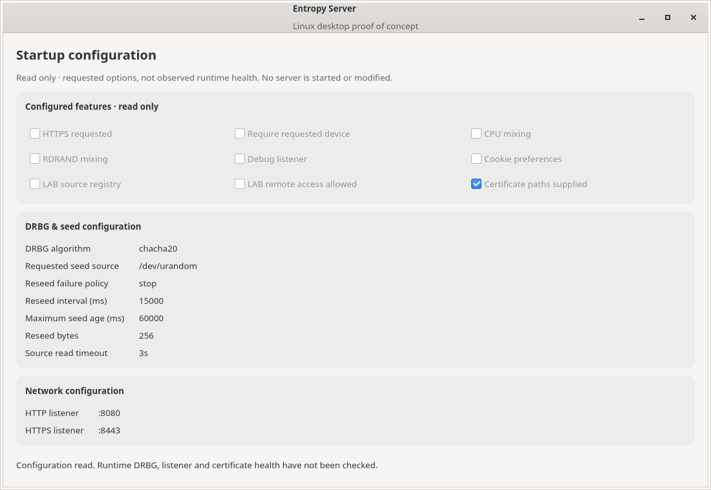
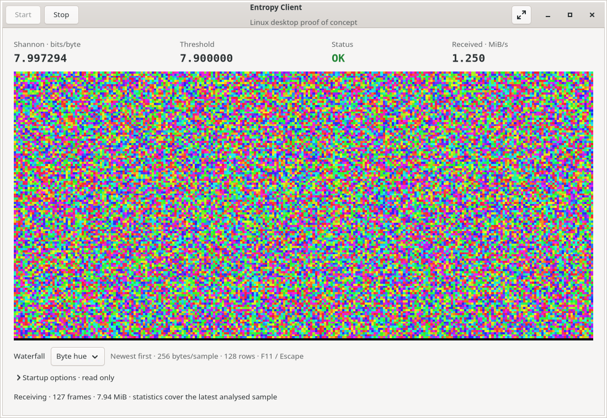

# Linux desktop proof of concept

This optional GTK 4 frontend is a small native Linux experiment. GTK supports
both X11 and Wayland; the automated native smoke test uses X11 under Xvfb.
It adds no GTK, Python, CGO or graphics dependency to the Go binaries. The
existing command-line and web interfaces remain independently usable.

The server window helps explain a startup invocation. The client window adds
a graphical, resizable waterfall and fullscreen view. This is developer-run
source code, not an installed desktop application or a service manager.
macOS and Windows GUI support are deferred.

[](images/linux-gui-server-poc.png)
[](images/linux-gui-client-poc.png)

## Run it

On Debian/Ubuntu, install the optional desktop dependencies:

```sh
sudo apt install python3-gi python3-gi-cairo python3-cairo gir1.2-gtk-4.0
make build

# Display these server startup options; this does not start a server.
/usr/bin/python3 tools/linux-gui/entropy-gui --view server -- \
  -device=/dev/urandom -require-device=true -enable-https=false \
  -http=127.0.0.1:8080 -drbg=chacha20
```

Use the distribution's Python: virtual environments may hide PyGObject even
when its OS package is installed. GTK 4/PyGObject versions supplied by Ubuntu
24.04 and Debian 13 are the initial targets. A graphical desktop session is
required; `--help` does not require GTK or an active display.

Start the server separately, then open the client view and press **Start**:

```sh
# Separate terminal; HTTP is suitable for initial loopback testing.
./bin/entropy-server -device=/dev/urandom -require-device=true \
  -enable-https=false -http=127.0.0.1:8080

/usr/bin/python3 tools/linux-gui/entropy-gui --view client -- \
  -mode=pull -url=http://127.0.0.1:8080/v1/data/random \
  -slice=1048576 -refresh=250ms -analysis-interval=250ms
```

For a remote instance, pass the normal CLI options, such as `-mode=push` and
`-wsurl=wss://your-server/stream`. The real client handles transport and normal
certificate verification; the GUI adds no trust bypass. See
[client TLS guidance](client-tls.md) for certificate trust requirements.
`--server-binary` and `--client-binary` select explicit executable paths;
defaults point to this checkout's `bin` directory. Utility options go after
`--`, as individual command-line arguments, without a shell-command field.

## What the windows show

**Server:** grouped DRBG, reseeding, source, listener and resource-budget
settings, plus read-only checkboxes for independent enabled features.
These are requested settings, not observed health. Inspecting an invocation
does not open devices or listeners, generate certificates, load a source
registry or modify an existing service. “Certificate paths supplied” does
not mean those files exist or are trusted. This window does not attach to
systemd or discover an already running server's effective configuration.

**Client:** parsed startup settings, the measured Shannon estimate and
threshold (six decimal places), green **OK** or red **WARN**, throughput,
and a waterfall of sampled prefixes. Choose byte hue, RGB or grayscale.
**F11** toggles fullscreen; **Escape** returns to the window. **Stop** ends
only the client process the window started. Closing the window stops and
reaps that owned process. The window never stops a separately started server.
A completed or failed client run returns from fullscreen to show its outcome;
the last analysed sample remains available for inspection.

Changing utility options requires reopening the window with different
arguments. The PoC manages `-headless`, `-report` and `-report-waterfall` for
its owned client. Starting raw file/device exports or `-writeout` through
the GUI is intentionally unsupported; use the CLI for deliberate exports.
Configuration inspection can still describe those requested options.

## Data and performance boundaries

Both binaries accept **`-describe-json`**: validate and describe a startup
invocation as one schema-version-1 JSON object, then exit before runtime I/O.
The allowlist excludes TLS key/certificate paths and registry contents;
client endpoints omit user information, query strings and fragments.
`live: false` explicitly distinguishes configuration from runtime health.

The graphical client consumes the existing JSONL protocol rather than parsing
human-readable logs or opening a second network connection. Its explicit
**`-report-waterfall`** option adds `settings.report_waterfall: true` to
`run_start` and a base64 `waterfall_prefix_base64` field to each analysed
`sample`: at most 256 raw bytes, also bounded by the analysed sample length.
It requires `-report`. Ordinary reports remain statistics-only by default.
The GUI does not save reports, but these optional raw prefixes travel through
its local pipe and remain in memory until replaced. Do not enable the option
when a report must contain no sampled bytes.

History is limited to 128 rows (32 KiB of raw prefixes); record input is
capped at 64 KiB and stderr history at 8 KiB. A pipe-reading thread updates
bounded state, while GTK checks for updates at most 20 times per second.
Rows arrive at the CLI's analysis cadence, not its received-frame rate.
An idle or disconnected input does not produce synthetic waterfall rows.
The drawing uses a bounded raster scaled to the window, so a larger display
does not require a larger raw sample or unlimited history.

Acquisition, analysis, TLS and normal cancellation stay in the existing
client. Repainting and optional prefix encoding still add work during a GUI
run; ordinary CLI runs do not allocate prefix copies for this option.
Shannon **OK** describes the configured empirical threshold, not a
cryptographic or physical-entropy certification.

## Validation

```sh
# Focused core/protocol/lifecycle checks; no GTK needed.
python3 -m unittest discover -s scripts -p 'test_linux_gui.py'

# Native GTK rendering and real CLI integration under a virtual X display.
sudo apt install xvfb xauth dbus-x11
xvfb-run -a dbus-run-session -- /usr/bin/python3 scripts/test_linux_gui_gtk.py \
  --server bin/entropy-server --client bin/entropy-client \
  --artifacts /tmp/entropy-linux-gui
```

CI runs native GTK checks on Linux alongside the repository's existing full
regression workflows. Native Wayland behavior, packaging, desktop launchers,
live server inspection and interactive configuration editing remain follow-ups
for user testing. The GUI is not included in release archives or installers.
