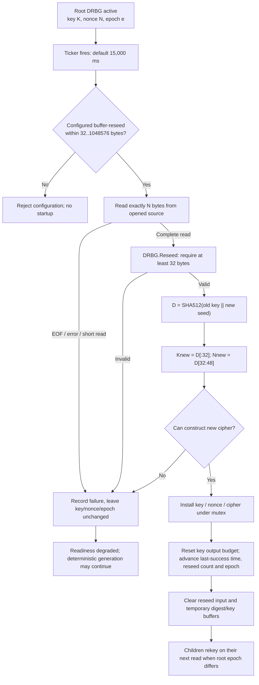

# Root reseeding — implementation review and input-validation fix

> This document records the earlier input-validation change. The later
> [reseed failure policy](reseed-failure-policy.md) now defaults serving to
> fail closed, including private children and already-open streams. Historical
> descriptions of continued output below apply to explicit `continue` mode.

> **Scope:** review of the existing custom `SHA512(oldKey || seed)`
> transition, and a narrow correctness fix for invalid reseed sizes.
> **Not** a NIST DRBG certification, proof of compromise recovery,
> or a change to the generation or failure-policy architecture.

## State transition

The code reads from the **already-open source**. Startup fallback is
**not retried** on a runtime error. An invalid full read must not update
the clock, old key, nonce, output counter or root epoch.

## Bug found and corrected

Previously `-buffer-reseed=0` was accepted. `make([]byte, 0)` and
`io.ReadFull(source, empty)` may succeed without acquiring any bytes.
The root could then compute `SHA512(oldKey || empty)`, increment successful
reseed counters and reset the timestamp as though fresh input arrived.

A negative size could panic when the reseed loop allocated the buffer.

Now the CLI rejects `-buffer-reseed` outside **32–1,048,576 bytes**, and
`DRBG.Reseed()` independently rejects fewer than 32 bytes.
This is a **length precondition, not a min-entropy guarantee**: a hardware
device could still return 32 predictable bytes, and the function cannot
detect that from the length alone.

Defaults are `buffer-reseed=256` and `reseed-ms=15000` (15 seconds); the derived readiness age is 60 seconds unless overridden.
The SHA-512 formula, cipher backend selection, state/output layout,
current fail-open-on-source-error behavior, and all API contracts remain
unchanged.

## Exact behavior in failure modes

| Event | State | Readiness | Client effect |
| --- | --- | --- | --- |
| Valid complete source read + valid reseed | New key/nonce/cipher; epoch increments | Fresh/healthy if other checks pass | Private children update on next read |
| Short source read or read error | No key or epoch change; failure recorded | Degraded (503) | Existing streams may continue |
| Invalid config size | CLI rejects startup | No listener starts | None |
| Invalid direct `DRBG.Reseed()` argument (<32 bytes) | Returns error; does not alter state | Caller decides whether to record failure | Existing stream remains unchanged |
| Source read blocks indefinitely | No reseed completion, age grows | Eventually stale/503 | Read worker may block even after cancellation |
| CPU mixing unavailable | Configured source bytes retained | Depends on base source | No assumed supplemental entropy |

Root source quality, true physical entropy arrival rate, prediction
resistance, post-compromise recovery, and indefinite device-read
cancellation remain **separate assurance questions**.

## Verification

- Configuration tests reject `-buffer-reseed`: `-1,0,1,31,1048577`;
  accept `32,256,1048576`.
- DRBG tests for **both** ChaCha20 and AES-256-CTR verify that direct
  zero/short reseeds do not change last-success time, counters, epoch,
  output position or deterministic output, and that a 32-byte argument
  remains accepted.
- Existing source failure/recovery and lifecycle tests must continue
  passing, including server race detection and existing output fixtures.
- A runtime read that blocks indefinitely and formal hardware entropy
  health validation are **not resolved** by this fix.

## Optional future work — not in this PR

1. Define an explicit operator choice between continuing from the old
   DRBG state and refusing generation after stale or failed reseeds.
2. Add source-specific cancellable/time-bounded I/O and worker cleanup.
3. Measure actual source min-entropy, document health tests and trust assumptions.
4. Independently review `SHA512(Kold || Si)` for backtracking and
   compromise-recovery properties; consider domain separation only as a
   versioned, intentionally non-backward-compatible crypto change.

See [architecture review](architecture-review.md) and
[security boundaries](security-boundaries.md).
