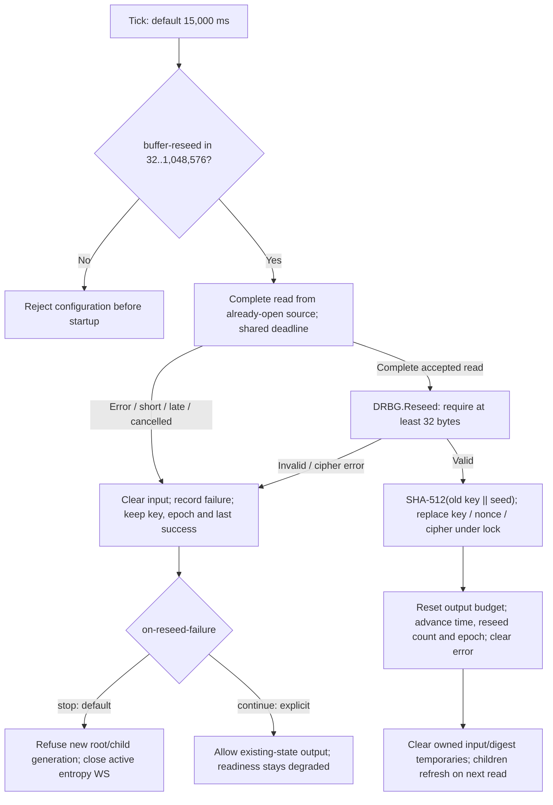

# Root reseeding: validation and current failure behavior

The input-validation fix rejects empty/undersized reseeds. Later changes added
[default fail-closed serving](reseed-failure-policy.md) and
[bounded source I/O](source-io.md). This page describes those together as of
`main` `dcc01a8` (2026-11-13); the construction remains the custom
`SHA512(oldKey || seed)` transition, not NIST CTR_DRBG or a proof of compromise
recovery. See the [byte-level specification](drbg-construction.md).

## State transition

The source is not reopened or replaced after a runtime error. Every successful
reseed must acquire and accept the complete configured input. Failed input
must not advance the successful-seed timestamp, key, budget or epoch. An age
watcher also enforces staleness if a source has not reported an error.

## Input-validation bug and fix

Previously a zero-length allocation/read could succeed without acquiring any
bytes, allowing `SHA512(oldKey || empty)` to look like a successful refresh.
A negative size could panic on allocation. Configuration now accepts
`-buffer-reseed` only from 32 to 1,048,576 bytes, and `DRBG.Reseed` independently
rejects fewer than 32 bytes. This is a length precondition, not a min-entropy
assessment: 32 predictable bytes can still be accepted.

Defaults remain `-buffer-reseed=256` and `-reseed-ms=15000`. The derived maximum
seed age is 60 seconds unless overridden; `-source-timeout=3s` covers each complete
startup/reseed read, including short reads and optional CPU mixing. Supported
source waits are cancelled and the worker is joined at shutdown. Synchronous
OS calls and broken drivers remain subject to the native implementation.

## Exact failure behavior

| Event | State / readiness | Client effect |
| --- | --- | --- |
| Complete accepted source read + reseed | New key/nonce/cipher, epoch and success time; failure cleared | Generation resumes; still-open child readers refresh on their next read |
| Short, error, late or cancelled reseed input | Input cleared; failure recorded; `/ready` 503 | Default `stop` refuses later generation; explicit `continue` permits old-state output |
| Successful seed grows too old | `/ready` 503 without inventing a successful read | Same policy gate applies; active entropy WS closes with 1013 |
| Invalid configured size | Startup rejected | No listeners start |
| Invalid direct `DRBG.Reseed` argument | Error without changing generator state; caller decides failure reporting | No implicit successful refresh or stream reset |
| CPU supplement unavailable | Base source retained under bounded mixing policy | No assumed supplemental entropy |
| Broken/uninterruptible native driver | No userspace interruption guarantee | Age gate can still stop new generation; process cleanup may depend on OS/driver |

Generation already admitted and bytes already encoded/buffered/delivered cannot
be recalled. HTTP transfers stop at a subsequent bounded read and can be visibly
truncated; active entropy WebSockets close. Readiness, metrics and independent
LAB sources remain available. A later successful reseed can restore the serving
root, but clients must reconnect WebSockets closed by the policy.

## Evidence and remaining work

Configuration tests reject `-1,0,1,31,1048577` and accept `32,256,1048576`.
Both production backends have fixtures proving invalid direct reseeds preserve
state/output position and 32-byte input remains accepted. Existing tests cover
source failure/recovery, stale age, root/child routes, partial HTTP, active WS,
blocked supported reads, cancellation and joined shutdown. Go race and full
regression checks run in CI.

These tests do not certify a physical device, prove input min-entropy or
establish post-compromise recovery. Remaining work includes
[physical qualification](hardware-qualification.md), source-specific health
assessment, repeated endurance/fault runs and independent review of the custom
construction. Any cryptographic transition change needs deliberate versioning
and migration rather than a maintenance edit.
