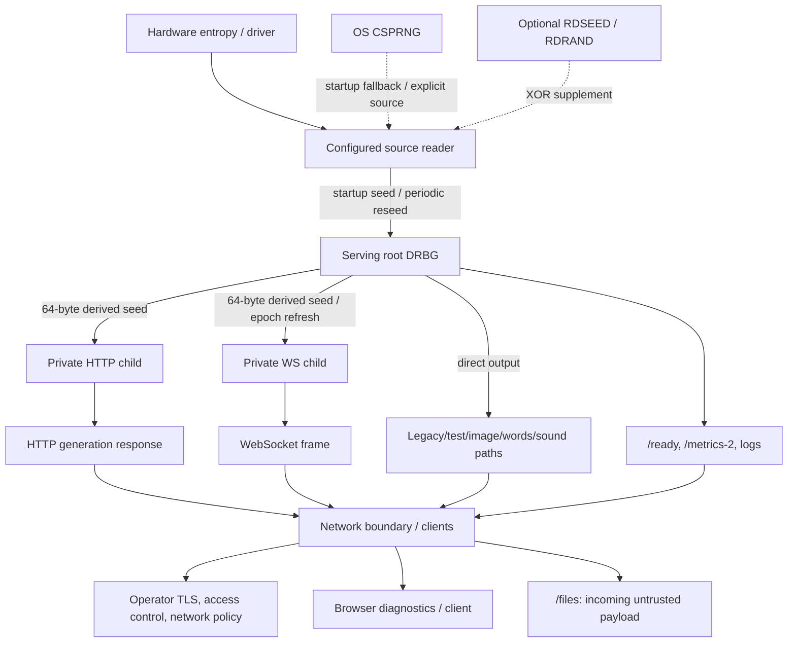

# Entropy Service — Security Boundaries and Threat Model

> **Status:** first-pass, code-informed threat model; **not** an independent
> cryptographic audit, penetration test, FIPS validation, or deployment approval.
> Reviewed against GitHub `main` commit
> [`3e4dfbe71a86708b20ecfa3123b026fd71fe476a`](https://github.com/fantuz/entropy-service/commit/3e4dfbe71a86708b20ecfa3123b026fd71fe476a)
> on 2026-11-04. See [architecture review](architecture-review.md) for evidence
> and an actionable remediation plan.

## 1. Purpose and security claims

Entropy Service is a **self-hosted random-data generation and distribution
system**. It obtains startup/reseed bytes from a configured source, optionally
mixes CPU randomness, and expands seed material using a project-specific
SHA-512/ChaCha20 or SHA-512/AES-256-CTR construction. Its HTTP and WebSocket
interfaces distribute generated data; browser graphs are diagnostic views.

**Supported implementation properties, subject to the assumptions below:**

- A full startup seed read is required before the serving root is created.
- HTTP `/v1/data/random` requests derive separate child stream instances.
  Long-lived entropy WebSockets lazily derive per-connection streams and
  refresh them on detected root reseed epochs or per-key output exhaustion.
- A mutex protects each active generator's stream state; the parent synchronizes
  seed derivation and root reseeding.
- Output-size ceilings and HTTP/WebSocket admission budgets bound **admitted
  work**, not total RSS, bandwidth, clients per identity, or overall DoS exposure.
- Reseed age, last failure, counters, and admission pressure are observable.

**Not claimed:** independently reviewed cryptographic security; SP 800-90A
CTR_DRBG conformance; SP 800-90B entropy-source validation; FIPS 140
certification; information-theoretic independence; guaranteed fresh entropy per
output byte; automatic fail-closed behavior after source loss; authentication,
tenant isolation, secure key storage, or immunity from denial of service.

The design's use of established primitives is promising, but **the composed
generator and reseed scheme have not received a formal security proof or
external cryptographic review**. For workloads requiring certified randomness,
use a validated solution rather than interpreting this document as assurance.

## 2. System assets and principals

| Asset / principal | Security interest | Relevant trust assumption |
| --- | --- | --- |
| Hardware entropy device and its kernel driver | Seed quality, availability, integrity | Device, firmware, driver and host are trusted and assessed separately. |
| OS CSPRNG (`/dev/urandom` or nonblocking Linux `getrandom`) | Startup/reseed confidentiality and strength | Host kernel and operating system are uncompromised. |
| CPU RDSEED/RDRAND mixing | Supplemental seed material | CPU instructions are optional, not the sole trusted source. |
| Root DRBG key, nonce and cipher position | Unpredictability of later derivations | Process memory and OS isolation are trusted. |
| Request/connection child generators | Computational stream separation | Derived seeds and internal state remain private. |
| HTTP/WS payloads | Confidentiality/integrity **if the consumer needs them** | Transport and client endpoints must be trusted. |
| Uploaded files and statistical results | Confidentiality, bounded parsing, availability | Uploading to a remote instance reveals file bytes to that operator. |
| API, metrics, health pages, logs, debug tooling | Availability and operational metadata | Access is restricted upstream, not by this application. |
| TLS certificate, private key and configuration | Channel authenticity and secrecy | Operator provisions unique, secret private keys. |
| Server host, root user, administrators, CI/release process | Global control over all previous assets | Fully trusted administration and software supply chain. |

**Adversary classes considered:** a remote unauthenticated network user;
a malicious or buggy consumer; a passive network observer; a compromised or
faulty seed-source device/driver; a resource-exhaustion attacker; and someone
who can view externally exposed metrics, logs or debug endpoints.

An administrator with arbitrary host/kernel privileges can usually read
process memory, replace the entropy device or the executable, and bypass
application restrictions. **Host compromise is outside the application's
defensible trust boundary.**

## 3. Data flow and trust boundaries

The arrows show **data flow**, not authentication or automatic protection.
In the current deployment, the client reaches the server listener directly
unless the operator installs an external proxy. HTTP and HTTPS expose the
**same routes**; enabling HTTPS does not disable the HTTP listener.

| Boundary | Crossing and current guard | Residual exposure |
| --- | --- | --- |
| **B1 — Source to process** | Configured character device is opened; startup and reseeds use full reads. | Device quality is not measured; a stalled device read may not cancel; root trusts supplied bytes. |
| **B2 — Source mixing** | Optional RDSEED/RDRAND bytes are XORed after the configured source read. | No additive certified entropy claim; CPU-mixing failure logs once and continues with source-only bytes. |
| **B3 — Source to root** | SHA-512 derives initial key/nonce; reseed hashes old key plus new seed while locking root state. | Custom construction, unknown input min-entropy, no proven compromise-recovery guarantee. |
| **B4 — Root to child** | Fresh 64-byte root output seeds a per-request/per-WS private cipher stream. | All clients ultimately trust the same parent and host. Some endpoints expose root output directly. |
| **B5 — Generator to network** | Bounded HTTP/WS handlers; optionally TLS 1.3 listener. | No app authentication, authorization, identity-level quota, or automatic HTTP-to-HTTPS redirect. |
| **B6 — Browser to WebSocket** | Gorilla's default host-based browser Origin policy. | An absent Origin is allowed; Origin is not client authentication. |
| **B7 — Upload into server** | POST + octet-stream + 32 MiB body cap; bounded analysis and digest computation. | Untrusted data consumes CPU/bandwidth; uploads are disclosed to the server operator. |
| **B8 — Monitoring and debugging** | Readiness indicates seed freshness; pprof binds to loopback if enabled. | Public metrics reveal operational data; loopback profiling is sensitive to local users/tunnels. |
| **B9 — Packaging/deployment** | Packaged unit defaults to a restricted unprivileged identity, loopback-only HTTP and explicit service activation; release CI runs Go/race/lint/snapshot checks. | Upgrading an already-enabled service preserves its running process until restart; operator must authorize QRNG permissions, certificate/access policy and wider exposure. |

> **Historical baseline note:** This review captures the implementation as of
> `3e4dfbe`. A subsequent change consolidated source selection and
> corrected strict empty-path handling and actual-source labeling. Consult
> [current configuration](configuration.md) for implementation behavior.
>
## 4. Entropy-source behavior: exact failure policy

### 4.1 Startup

The standalone binary's configured path defaults to `/dev/qrandom0` (the packaged unit explicitly selects `/dev/urandom`). Startup opens with `O_NONBLOCK`, validates the opened character device and
its deadline support, and requires a complete 64-byte read within
`-source-timeout` before initializing the root generator.

| Condition | With `-require-device=false` (default) | With `-require-device=true` |
| --- | --- | --- |
| Configured path missing / not a char device | Resolve to `/dev/urandom`; startup may proceed. | Startup fails. |
| Device open/validation/deadline support fails | Try `/dev/urandom`, then nonblocking Linux `getrandom`. | Startup fails. |
| Complete initial seed cannot be read | Startup fails; no root output is served. | Startup fails. |
| Path supplied as empty string | Fallback to the OS CSPRNG may be used. | Configuration is rejected: strict mode requires a nonempty device path. |
| Source returns 64 bytes, but predictable or defective | Seed is accepted. | Seed is accepted. |

`/dev/urandom` and Linux `getrandom` are **cryptographic OS sources**,
not intentionally weak generators. Any legacy fallback description using the word "weak" is misleading. The resolved path in metadata is not
cryptographic proof of physical-source quality or provenance. Fallback may select an OS CSPRNG, but source metadata reports the actual
opened reader rather than just the originally requested device.

**`-require-device` protects only startup selection/opening, not an
uninterrupted hardware supply throughout the process lifetime.**

### 4.2 Source fails *after* startup

The active reseed loop reads the **existing open reader** every configured
interval (default 15 seconds; default read 256 bytes). It does not automatically
open `/dev/urandom`, replace the source, or switch the root to a new device.

1. A read that returns an error or too few bytes increments failure metadata.
   The root key and reseed timestamp remain unchanged.
2. `/ready` becomes HTTP 503 while there is an unresolved reseed error, or
   once the elapsed age exceeds `-max-reseed-age`; `/live` stays HTTP 200.
3. By default, `-on-reseed-failure=stop` also refuses serving-root and child
   generation. New requests/upgrades receive 503; active binary transfers
   stop at a subsequent read, and entropy WebSockets close with code 1013.
   Explicit `continue` permits existing-state output with degraded readiness.
4. A later successful reseed clears the last error and advances the root's
   reseed epoch. Long-lived child readers check that epoch before subsequent
   reads and refresh their streams. In-flight reads complete within their
   current generator state.
5. Each complete startup/reseed read has a configurable deadline, and
   cancellation interrupts supported pollable source reads. The reseed worker
   is joined before root cleanup. Unsupported devices are rejected; a broken
   driver that ignores `O_NONBLOCK` remains an OS/driver boundary, requiring
   hardware verification. See [source I/O](source-io.md).
6. Each stream has a configured operational per-key output ceiling
   (`1 << 38` bytes, or 256 GiB). If sufficient state refresh cannot
   occur, generation may eventually fail rather than reuse the same key.

A failure to reseed is **not equivalent** to immediately predictable output.
Conversely, continued output is **not** a guarantee of current physical
entropy or post-compromise recovery. The server now enforces the freshness
contract by default, including private children and already-open streams.
Operators can explicitly select the former availability-first behavior with
`continue`. Already admitted reads and buffered/delivered data cannot be
recalled. See [policy rationale, exact boundaries and migration](reseed-failure-policy.md).

### 4.3 What the hardware source is *not* validated for

Startup/device checks prove that a node exists, can be opened, and emits enough
bytes. They do not test **min-entropy**, device provenance, hardware failure
modes, repetition/stuck-bit faults, hostile-driver output, or statistical
independence of samples. The dashboard's Shannon entropy, histograms, and
Dieharder/`rngtest` workflows operate on **DRBG output** and are not SP
800-90B source health tests.

A device that returns deterministic zero bytes could be accepted and produce
predictable cryptographic state. Before claiming suitability for
security-critical keys, the source/driver, continuous health testing, entropy
crediting, conditioning, and startup failure handling need their own review.
See [NIST SP 800-90B](https://csrc.nist.gov/pubs/sp/800/90/b/final).

## 5. Cryptographic construction and client isolation

Implementation in
[`internal/drbg/`](../cmd/entropy-server/internal/drbg/)
and [`entropy-server.go`](../cmd/entropy-server/entropy-server.go):

- Initial root: `SHA-512(startup_seed)` supplies a 256-bit cipher key and
  a 16-byte nonce/counter initialization value. ChaCha20 uses the first 12
  nonce bytes; AES-256-CTR uses the full 16 bytes.
- Root reseed: `SHA-512(old_key || fresh_seed)` derives replacement key and
  nonce and resets the root output byte count. This is **not** the state
  transition of NIST CTR_DRBG.
- HTTP `/v1/data/random`: derive 64 bytes from the root, hash them into a
  private stream's key/nonce, generate a bounded response, release the child.
- WebSockets: lazily create a private child from the root, reuse it per frame,
  refresh it when the parent reseed epoch changes or its own byte budget is
  exhausted, and close/release it on disconnect.
- The serving root also generates direct output for `/v1/data/test`, some
  image/QR/word/sound routes and certain compatibility paths. The root is thus
  **not a private derivation-only key hierarchy**.

**Can client A infer client B's private stream?** There is no exposed API to
read another child's key, and normal child streams use independently derived
root outputs. Under the assumed security of the stream ciphers, secret root
state and sufficient seed unpredictability, one client's samples should not
make another child's stream practically predictable. **This remains a
conditional engineering assessment, not a proof of multi-tenant isolation**.
The same host and root state are shared, and client A can still cause
resource contention for client B.

**State compromise:** arbitrary read access to process memory defeats
confidentiality of active root/child state. Fresh *trusted and unpredictable*
post-compromise seed input may help recovery after reseeding, but this
project-specific transition has not been formally analyzed for that property.
Neither old output confidentiality nor post-compromise security is guaranteed.

**Lifecycle hardening (post-review implementation):** Startup and periodic
reseed input buffers are explicitly cleared after use. Per-request and
WebSocket child seeds are cleared immediately after derivation; child
generators now close by clearing their owned key and nonce fields,
dropping cipher references, and rejecting further reads/reseeds.
SHA-512 intermediate digest buffers are cleared when constructors/reseeds
return, and reseeding no longer builds a concatenated old-key-plus-seed
heap buffer. The root generator also closes on normal server return.
These measures reduce the **duration of accessible application-owned
copies**, but do not claim complete zeroization of Go heap, hash/cipher
internals, runtime copies, swapped memory, crash dumps or dead process
pages. `Close` does not replace operating-system process isolation.

**Memory lifecycle:** key, nonce, derived seed, hash and cipher-state copies
may live in Go-managed memory. The packaged service now sets `LimitCORE=0`,
which restricts conventional core dumps but does not systematically erase
Go heap/runtime copies, lock cryptographic pages out of swap or control all
privileged crash collection. The compiler/garbage
collector may copy objects, so clearing one buffer is not a comprehensive
zeroization guarantee. Treat process memory, crash dumps and backup snapshots
as sensitive.

**API review note:** generator APIs outside normal serving routes should be
checked against the same closed-state and derivation bounds as `Read`; do not
assume auxiliary helper methods have identical security guarantees.

## 6. Network, API and privacy boundaries

### Public-facing distribution

- There is **no built-in credential or identity check** for randomness
  endpoints, uploads, health or Prometheus metrics.
- The standalone program starts an HTTP listener by default at `:8080`;
  it may start HTTPS on `:8443` concurrently. It does not force HTTP
  clients to switch to HTTPS.
- HTTPS is TLS 1.3 with server certificates but **no client certificate
  authentication**. The repository distributes a publicly known development
  private key; **do not reuse it in a deployment**.
- Gorilla's default browser Origin check protects against a subset of
  cross-origin browser upgrades, not unauthenticated non-browser clients
  which can omit `Origin`.
- A remote random-data consumer trusts the transport, DNS, TLS identity,
  proxy, and remote operator. Without authenticated encryption and
  endpoint trust, a network attacker can substitute, record or modify
  bytes. SHA-256 bundled in some WS frames is a checksum, **not a MAC or
  signature**.
- Randomness may be embedded in private-key generation by downstream
  callers. Such consumers need an explicit trust and assurance decision
  about using a remote generator.

### Availability and limits

Per-request/connection admissions cap configured concurrency and
**estimated** working-memory reservations. Payload bounds constrain
normal generation to at most 32 MiB per response/message; WebSocket inbound
messages are limited to 1 KiB. The 32 MiB JSON format may expand output to
roughly 106.7 MiB of application data. CPU, TLS, transport buffers, network
bandwidth, allocations retained by Go's GC, generic HTTP requests and static
assets are **not all bounded by the admission reservations**.

No per-IP/per-identity quota, connection-level authentication, global
request-rate limiter or public traffic shaping is provided. Restrict
untrusted clients with a firewall/reverse proxy and monitor rejection rates.

### Uploads and metadata

`POST /files` accepts a raw binary body capped at 32 MiB and streams
statistics and SHA-256 without intentionally saving files to disk. But a
remote upload is **delivered to the service operator** and may enter
transient memory, network traces or host diagnostics. Never assume the
remote analysis API is private merely because it does not write to disk.

`/ready` and `/metrics-2` may reveal configured source paths,
operational failure details, concurrency and traffic behavior. `pprof`
is separately loopback-bound when enabled, but should not be exposed by
an untrusted tunnel or proxy.

### Packaging defaults

The supplied [systemd unit](../resources/systemd/entropy-server.service)
now uses an unprivileged systemd identity and binds HTTP only to
`127.0.0.1:8080`, with HTTPS disabled. Installation does **not** enable or
start the service. Its default source is `/dev/urandom`, and device cgroup
access is deliberately restricted. See the [deployment and migration guide](packaged-service.md).
These constraints do **not** supply authentication or TLS to remote clients.
An existing enabled/running installation may retain old exposure until its
next restart; widening a bind or switching to a hardware device requires
explicit operator-reviewed configuration and appropriate permissions.

## 7. Threat scenarios and mitigation register

Severity reflects the **conditional impact** if a threatened deployment
exposes the relevant capability. No exploit or penetration test is claimed.

| ID | Scenario / target | Severity | Current control | Remaining action |
| --- | --- | --- | --- | --- |
| T01 | Internet client consumes or floods unauthenticated endpoints | **High** | Global payload and admission budgets | Private bind, authenticated proxy, per-client quotas and rate limits. |
| T02 | Packaged daemon compromise / privilege escape | **High** | Restricted systemd user, capabilities and filesystem/device access | Verify sandbox effectiveness on the target distribution and review optional device overrides. |
| T03 | Public demo TLS key deployed as real server identity | **High** | Documentation warning | Unique private key, trusted certificate, rotation and restricted permissions. |
| T04 | Faulty/malicious entropy device emits predictable seed | **High** for security-sensitive output | Complete source read, optional mixing | Hardware/driver evaluation and source health tests; no automatic entropy claims. |
| T05 | Device disappears or blocks after startup | **Medium–High** availability/freshness | Failure counters, `/ready`, per-key ceiling | Validate nonblocking/deadline behavior on the real driver; startup/reseed deadlines and fail-closed generation are implemented. |
| T06 | Attacker reads process memory or crash dumps | **High** | OS process boundaries | Restrict privileges, diagnostics, dumps; review key lifecycle. |
| T07 | One client attempts to predict another stream | **Medium** assurance question | Separate derived streams, stream ciphers | External cryptographic review, explicit domain separation and threat-model tests. |
| T08 | Untrusted clients exhaust CPU, memory or bandwidth | **High** when exposed | Admission reservations and message limits | Rate limits and observed RSS/heap/load tests; distinguish rejection vs capacity. |
| T09 | HTTP interceptor reads/substitutes random output | **High** if output is secret | Optional HTTPS listener | Require authenticated TLS or local trusted IPC; disallow plaintext at boundary. |
| T10 | Browser embeds dashboard / probes sensitive status | **Medium** | Default WS origin check; no-store on health | Authentication and access policy for metrics/status; avoid treating Origin as credentials. |
| T11 | Release validation bypass or packaging mismatch | **Medium** supply-chain/process | Tag workflow runs Go/race/lint/browser/snapshot checks before release | Review job permissions, verify signed artifacts as appropriate and test packages on target distributions. |
| T12 | Users mistake statistical entropy display for device assurance | **Medium** interpretation | Documentation disclaimers | Keep diagnostic/cryptographic assurances explicitly separate. |
| T13 | `DRBG.Write` / `ReadInto` invoked outside normal route | **Low–Medium** latent | Not identified as normal serving path | Add API test, remove stale helper or make it use guarded `Read`. |

## 8. Operational security profiles

| Mode | Minimum practical policy | Suitable interpretation |
| --- | --- | --- |
| **Local laboratory** | Bind `127.0.0.1`, use OS CSPRNG, optionally disable HTTPS for local use, keep real credentials out of demos. | Functional and educational experiments. |
| **Private organizational service** | Dedicated service user, trusted seed source, TLS, authentication and per-client rate limits upstream, readiness-aware routing, metrics access policy. | Internal integration testing after environment-specific review. |
| **Hardware-required experiment** | Use a specific device and `-require-device=true`; monitor startup provenance and `/ready`; explicitly decide what happens on stale seed state. | Hardware-dependent experiments, **not** continuous entropy assurance. |
| **Security-critical/certified randomness** | Requires trusted and validated source, externally reviewed construction, controlled key lifecycle, auditable operation and applicable certification. | **Not currently an assured deployment profile.** |

## 9. Explicitly out of scope

This project does not claim to withstand:

- A malicious host administrator, compromised kernel, virtual-machine
  hypervisor or memory-read-capable attacker.
- A deliberately subverted device/driver that lies about its entropy quality.
- Traffic analysis, data substitution or disclosure on a plaintext/untrusted
  network without external authenticated encryption.
- Colluding clients, denial of service by network-scale adversaries, or
  identity-level isolation without an external identity/control plane.
- Physical fault injection, side-channel and power analysis, secure enclave
  threats, or hardware supply-chain tampering.
- Cryptographic certification, HSM-grade key custody, secure multi-tenant
  confidentiality guarantees, or prevention of downstream misuse of output.
- Protection of files that clients choose to upload to an untrusted instance.

These are exclusions from the **assurance claim**, not reasons to ignore the
associated deployment risks.

## 10. Validation and review cadence

This model is derived from source review and available automated tests.
The latest reviewed `main` build passed Go tests, server race detection,
browser test scripts, lint and a snapshot build. **No long-duration fault
campaign, independent cryptanalysis, code-coverage proof, formal verification
or new benchmark was performed as part of this documentation review.**

Before upgrading assurance claims, run a controlled matrix:

1. Startup with missing, unreadable, short-reading, zero-output and
   disappearing device sources; both `-require-device` modes.
2. A source that errors versus one that **blocks indefinitely**; verify
   readiness, output policy, recovery and shutdown cleanup.
3. Concurrent HTTP and WebSocket clients through repeated root reseeds,
   child rekeys, client cancellation, limits and deliberate overload.
4. TLS/authentication/bind-address exposure checks, including public key
   replacement and non-browser WebSocket clients without `Origin`.
5. Heap/RSS and goroutine trending under 1-hour, 4-hour and 24-hour
   workloads; repeat with `-race` where feasible.
6. Statistical/cryptographic assurance review separate from visual
   dashboards; a third-party review is needed before stronger claims.

**Change triggers:** modify this threat model whenever the seed-source
policy, DRBG construction, client/key hierarchy, HTTP/WS contracts, TLS,
authorization, privilege model, or release process materially changes.

## 11. References and related files

- [Architecture and implementation review](architecture-review.md).
- [Security reporting and basic deployment policy](../SECURITY.md).
- [Configuration](configuration.md), [API inventory](api.md),
  [operations](operations.md), and [benchmark methodology](benchmarks.md).
- [NIST SP 800-90A Rev. 1](https://csrc.nist.gov/pubs/sp/800/90/a/r1/final)
  specifies approved deterministic bit generators; **using AES-CTR is not
  equivalent to implementing CTR_DRBG**.
- [NIST SP 800-90B](https://csrc.nist.gov/pubs/sp/800/90/b/final)
  addresses entropy-source evaluation and health testing.
- [Go `crypto/rand` documentation](https://pkg.go.dev/crypto/rand)
  documents the operating-system-backed cryptographic source.
